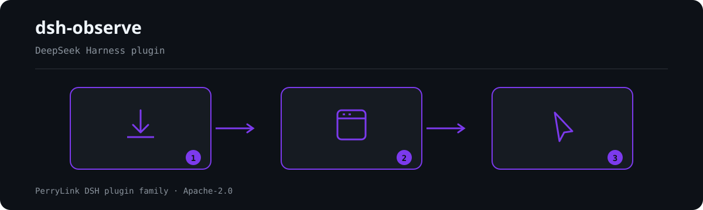

<div align="center">

# 📊 dsh-observe
- **Canal 1024 store**: `npm i -g dsh1024` uma vez, depois `dsh1024 plugin --profile web add dsh-observe` (conta para o ranking de instalações do [deepseek1024.com](https://deepseek1024.com)).

**Exportador de observabilidade OpenTelemetry e Langfuse para o DeepSeek Harness.**

*Transforme eventos de sessão em traces OTLP e observações Langfuse — saneados, com buffer e desligados por padrão.*

[](LICENSE)
[](https://gitee.com/perrylink/dsh-observe)
[](https://github.com/topics/dsh-plugin)
[](https://github.com/PerryLink/dsh-plugin-doctor#verified-徽章)
[](https://dsh.market/)
[](#)
[](https://github.com/PerryLink/dsh-observe/actions)
[](https://github.com/PerryLink/dsh-observe/releases)
[](https://www.npmjs.com/package/dsh-observe)
[](https://www.npmjs.com/package/dsh-observe)
[](https://dshfind.com/pt/plugins/PerryLink/dsh-observe?ref=badge)

[English](README.md) · [简体中文](README-zh.md) · [Español](README-es.md) · [Português](README-pt.md) · [हिन्दी](README-hi.md)

```sh
dsh plugin --profile <name> add dsh-observe
```


</div>

---


**📖 Base de conhecimento do ecossistema** — dados medidos, não marketing: [guia de desenvolvimento · dados de seleção · critérios de manutenção](https://perrylink.github.io/dsh-plugin-guide/).

<!-- star-cta -->
## Install & uninstall

- **Canal git** (último `main`): `dsh plugin --profile web add github:PerryLink/dsh-observe` — o script `prepare` compila apenas com dependências de produção.
- **Canal npm** (versões publicadas): `dsh plugin --profile web add dsh-observe`.
- **Canal tarball**: `pnpm pack` neste repositório e então `dsh plugin --profile web add ./dsh-observe-<version>.tgz`.
- **Desinstalar**: `dsh plugin --profile web remove dsh-observe` (ou remova a linha do patch do perfil).

> Se o pnpm reportar `ERR_PNPM_IGNORED_BUILDS` para este pacote (a validação inofensiva do binário de plataforma do esbuild), adicione `allowBuilds: { esbuild: true }` ao seu `pnpm-workspace.yaml` — o CLI `dsh` imprime o trecho exato.

## ⭐ 如果它帮到了你

Este plugin faz parte da [família de plugins DSH](https://github.com/PerryLink) (mais de 40, todos Apache-2.0). Se for útil, **deixe uma estrela**: não desbloqueia nada, mas ajuda a próxima pessoa a encontrá-lo.

*English:* part of a 95 plugin family for DeepSeek Harness. If it is useful, **a star helps the next person find it** — nothing is gated behind it.

## What is dsh-observe?

Exportador de observabilidade OpenTelemetry e Langfuse para o DeepSeek Harness.

Transforme eventos de sessão em traces OTLP e observações Langfuse — saneados, com buffer e desligados por padrão.



*Visão geral do fluxo: instalar → abrir painel → agir. Os exemplos abaixo usam a superfície real de comandos.*


*A mesma execução, animada.*

## Compatibility

| Superfície | Status |
|---|---|
| Harness | DeepSeek Harness `dsh-v0.2.1-alpha.1` (adaptado em 2026-10-04): o formato de sessão V4 representa o resultado de uma ferramenta como uma mensagem de primeira classe `role: 'tool'` com `toolCallId` + `content` + `isError` opcional no nível superior — o bloco de conteúdo `tool-result` do V3 saiu do `ContentBlockMap` do host, e este plugin lê apenas a forma V4 (um log V3 anterior à atualização ainda é projetado por um caminho de compatibilidade somente leitura). Os demais traços do formato de sessão V3 permanecem: o fluxo do assistente é embutido em `assistant/message` / `assistant/attempt` e o prompt de sistema é o nó 0 da superfície (`system/message`); o plugin consome apenas o fluxo de eventos ao vivo e nunca lê arquivos de log de sessão. O intervalo de peers `>=0.1.2-rc.1 <0.2.0 \|\| >=0.1.5-alpha.1 <0.2.0 \|\| >=0.1.6-0 <0.2.0 \|\| >=0.1.7-0 <0.2.0` mantém cada linha publicada instalável (cadeia completa de portas local; o workflow compat cobre o smoke de instalação de perfil). |
| Node | `^22.19.0 \|\| >=24.0.0` |
| Backends | OpenTelemetry OTLP/HTTP (traces + metrics, codificação JSON) e Langfuse (observabilidade de LLM) — um ou ambos |
| Modelo | Independente de modelo: exporta o fluxo `session/event`; não faz chamadas a modelos |

## What you get

O `dsh-observe` transforma o fluxo `session/event` do harness em protocolos padrão de observabilidade:

- **Spans** — spans de turno, passo, chamada de ferramenta (duração, status, derivação de tentativas) e geração de LLM, ligados em traces por turno com ids deterministas.
- **Metrics** — contadores de tokens por provider/modelo, contadores de custo em USD (tabela de preços configurável) e o gauge opcional de pressão de contexto via `ctx.tokenMeter`.
- **Captura saneada** — corpos de prompt e completion são redigidos (nomes de chave estruturais + padrões de segredos embutidos + seus padrões) e truncados antes de qualquer enfileiramento ou envio.
- **Confiabilidade** — lotes assíncronos (por tamanho e por temporizador), um buffer offline durável e limitado (storage-domain) com despejo do mais antigo, e tentativas com backoff exponencial determinista; lotes não entregues sobrevivem a reinícios.
- **Interruptor em tempo de execução** — o Typert remote opcional (`observe/status`, `observe/setEnabled`) permite a uma página de ajustes parar e retomar a exportação sem desmontar.
- **Desligado por padrão** — `enabled: true` mais ao menos um backend é a adesão explícita; caso contrário, nada é capturado ou exportado.

```text
fluxo session/event
   │ collector (spans de turno/passo/ferramenta/LLM, métricas)
   │ sanitize (chaves, segredos, orçamentos)
   ├──▶ pipeline "otlp"  ── fila ── flush ──▶ OTLP /v1/traces + /v1/metrics
   │         └─ tentativa/backoff ─┐
   ├──▶ pipeline "langfuse" ── fila ── flush ──▶ ingestão Langfuse
   │         └─ tentativa/backoff ─┤
   └────────── spool durável (buffer offline, limitado) ◀┘
```

## Quick start

```sh
dsh plugin --profile web add github:PerryLink/dsh-observe
```

```sh
# 1. instale o bundle no seu perfil
dsh plugin --profile web add github:PerryLink/dsh-observe

# ou pelo npm (versões publicadas)
dsh plugin --profile web add dsh-observe

# 2. configure um backend no patch do seu perfil (cordis.yml) e reinicie
dsh --profile web
```

Configuração OTLP mínima (a linha vem comentada em `cordis.patch.yml`):

```yaml
- insert:
    - id: dsh-observe
      name: dsh-observe
      config:
        enabled: true
        otlp:
          endpoint: http://localhost:4318
```

Depois verifique que a linha monta:

```sh
dsh --profile web --dump-config | grep -A2 'id: dsh-observe'
```

### Exemplos

Este plugin não registra um comando visível; ele roda como exportador em segundo plano, configurado pelas opções.

## Configuration

Todos os ajustes são campos `Config` do Schemastery (alteráveis pelo cordis.yml). Uma sobrescrita direcionada por id substitui a linha inteira — redeclare cada chave que precisar. O `cordis.patch.yml` documenta cada chave em linha.

| Key | Default | Meaning |
|---|---|---|
| `enabled` | `false` | Interruptor mestre; `true` mais ao menos um backend é a adesão explícita |
| `otlp` | `null` | Configuração do backend OTLP, ou `null` para desativá-lo |
| `otlp.endpoint` | *(obrigatório)* | URL base do OTLP; `/v1/traces` e `/v1/metrics` são acrescentados |
| `otlp.serviceName` | `deepseek-harness` | Atributo de recurso `service.name` |
| `otlp.serviceVersion` | *(nenhum)* | Atributo de recurso `service.version` |
| `otlp.headers` | `{}` | Cabeçalhos extras mesclados em cada requisição de exportação |
| `otlp.timeoutMs` | `10000` | Tempo limite por requisição |
| `langfuse` | `null` | Configuração do backend Langfuse, ou `null` para desativá-lo |
| `langfuse.baseUrl` | `https://cloud.langfuse.com` | URL base do Langfuse |
| `langfuse.publicKey` | *(obrigatório)* | Chave pública do projeto |
| `langfuse.secretKey` | *(obrigatório)* | Chave secreta do projeto |
| `langfuse.release` | *(nenhum)* | Tag de release carimbada nos traces |
| `langfuse.traceName` | `session {session} turn {turn}` | Modelo do nome do trace; `{session}`/`{turn}` interpolam por trace |
| `langfuse.tags` | `[]` | Tags estáticas carimbadas em cada trace |
| `langfuse.timeoutMs` | `10000` | Tempo limite por requisição |
| `capture.turns` | `true` | Spans de ciclo de vida do turno |
| `capture.steps` | `true` | Spans de ciclo de vida do passo |
| `capture.tools` | `true` | Spans de chamada de ferramenta com argumentos/resultados saneados |
| `capture.llm` | `true` | Spans de geração de LLM |
| `llm.prompt` | `true` | Captura o prompt de requisição saneado (`false` = apenas tamanhos) |
| `llm.completion` | `true` | Captura a completion saneada (`false` = apenas tamanhos) |
| `metadata.sessionId` | `true` | Atributo de id de sessão |
| `metadata.cwd` | `false` | Diretório de trabalho da sessão (um caminho local — desligado por padrão) |
| `metadata.agentPreset` | `true` | Atributo de id do agent preset |
| `metadata.model` | `true` | Atributos de provider/modelo |
| `metrics.tokens` | `true` | Contadores de tokens por provider/modelo |
| `metrics.cost` | `true` | Contadores de custo em USD (precisam de regras `pricing` que coincidam) |
| `metrics.contextTokens` | `true` | Gauge de pressão de contexto (precisa de `ctx.tokenMeter`) |
| `pricing` | `[]` | Tabela de preços, primeira coincidência vence: `{ provider?, model, inputPerToken, outputPerToken, cacheReadPerToken?, cacheWritePerToken? }` |
| `sanitize.enabled` | `true` | Interruptor mestre de redação (`false` desativa a redação, nunca o truncamento) |
| `sanitize.redactKeys` | `[]` | Substrings de nome de chave extras (key/token/secret/password/authorization/credential/apiKey sempre incluídas) |
| `sanitize.redactPatterns` | `[]` | Expressões regulares de segredos extras |
| `sanitize.truncatePromptChars` | `4000` | Orçamento de caracteres do prompt |
| `sanitize.truncateCompletionChars` | `4000` | Orçamento de caracteres da completion |
| `sanitize.truncateToolInputChars` | `2000` | Orçamento de caracteres dos argumentos de ferramenta |
| `sanitize.truncateToolOutputChars` | `2000` | Orçamento de caracteres do resultado de ferramenta |
| `sanitize.truncateAttributeChars` | `512` | Orçamento de strings de atributos de span |
| `batch.maxRecords` | `256` | Flush quando a fila atinge este número de registros |
| `batch.flushIntervalMs` | `5000` | Intervalo de flush por temporizador |
| `batch.maxQueueRecords` | `2000` | Limite da fila em memória; o excesso derrama para o buffer |
| `batch.maxBufferRecords` | `10000` | Limite do buffer offline durável; os registros mais antigos caem primeiro |
| `batch.bufferRetryIntervalMs` | `30000` | Intervalo de tentativa do buffer offline |
| `retry.maxAttempts` | `5` | Tentativas por lote, incluindo a primeira |
| `retry.baseDelayMs` | `1000` | Primeiro atraso de backoff |
| `retry.factor` | `2` | Multiplicador de backoff por falha consecutiva |
| `retry.maxDelayMs` | `60000` | Teto do backoff |
| `remote.enabled` | `false` | Monta o Typert remote `observe` (interruptor) |

## Tools & surfaces

Este plugin **não registra ferramentas de modelo** — é um exportador em segundo plano. Suas superfícies:

- **Consome** `session/event` (coleta de spans/métricas), `session/flush` (impulso de exportação best-effort — o checkpoint de durabilidade nunca espera um backend remoto) e `session/disposed`.
- **Serviço remote opcional** `observe` — `observe/status` devolve o estado do interruptor, os backends configurados, a profundidade da fila e a ocupação do buffer; `observe/setEnabled` para e retoma a exportação em tempo de execução.

## Permissions & data

- **Permissões**: `network:outbound` para os endpoints que você configurar, `session:read` para o fluxo de eventos, `storage:write` para o buffer offline; sem código nativo, sem acesso ao sistema de arquivos.
- **Dados**: tudo o que é enviado deriva do registro de sessão e é saneado (redação + truncamento) antes de enfileirar, armazenar ou transmitir. O buffer offline guarda apenas registros saneados, re-validados ao serem lidos.
- **Credenciais**: as chaves pública/secreta do Langfuse viajam apenas para o endpoint Langfuse configurado; os cabeçalhos OTLP apenas para o endpoint OTLP configurado. O plugin não armazena credenciais — guarde-as em referências de credenciais ou valores injetados pelo ambiente.

## Security boundaries

- **Desligado por padrão** — nada é capturado ou exportado sem adesão explícita.
- **Sanear antes de enviar** — redação estrutural de chaves, padrões de segredos embutidos (chaves de API, tokens do GitHub, chaves da AWS, credenciais bearer, chaves privadas), seus padrões e orçamentos de caracteres aplicam-se antes de qualquer registro sair da memória.
- **Re-validação no limite durável** — registros lidos do armazenamento são checados novamente antes que um sink possa vê-los.
- **Falha ruidosa, falha contida** — falhas de exportação avisam, contam, tentam de novo e por fim vão para o spool; um manipulador de sessão que falha é capturado e registrado, de modo que a observabilidade nunca pode quebrar o caminho quente do harness.
- **Model-visible ⟺ logged** — as exportações de prompt/completion projetam apenas a superfície da sessão (cujo nó 0 é o prompt de sistema) e o cabeçalho registrado (configuração da chamada e ferramentas); o exportador não inventa conteúdo.

## Known limitations

- **npm 0.1.7-rc.2** — o plugin é desenvolvido e testado contra `@deepseek-ai/dsh@0.1.7-rc.2` (devDeps e a régua primária do CI); o intervalo de peers `>=0.1.2-rc.1 <0.2.0 || >=0.1.5-alpha.1 <0.2.0 || >=0.1.6-0 <0.2.0 || >=0.1.7-0 <0.2.0` mantém cada linha publicada instalável, e a segunda régua (`typecheck:ci`) mais o workflow compat cobrem os baselines antigos.
- **Eventos de auditoria não são persistidos** — os registros `observe/*` do próprio exportador são apenas de auditoria: na linha de host atual o portão de append da sessão admite eventos de superfície, então nenhum evento `observe/*` é gravado no log da sessão, e o plugin não o falsifica com um append sem marcação (isso tornaria as sessões ilegíveis). Use a saída de status do `/observe` e os backends OTLP/Langfuse como superfície de auditoria.
- **Métricas evitam o caminho de tentativa/spool** — as métricas OTLP são agregadas cumulativamente, então um flush perdido se autocura no seguinte (por design, não é um bug).
- **Sem amostragem** — toda família de spans habilitada é exportada; ajuste os interruptores `capture.*` e `batch.maxBufferRecords` para sessões de alto volume.

## Development

```sh
pnpm install        # node ^22.19 || >=24
pnpm run typecheck  # tsc: src + tests contra os devDeps 0.1.7-rc.2 (sem tsconfig paths)
pnpm run typecheck:ci  # tsc contra a linha publicada (sem paths)
pnpm run check:ruler-live  # canário: deve falhar ao compilar, provando que a régua segue viva
pnpm test           # vitest: 126 testes, 18 suítes (Context/Session/storage seam reais)
pnpm run test:coverage  # porta de cobertura (90/80/90/90)
pnpm run build      # bundle tsdown + declarações tsc (lib/)
pnpm run verify:self-contained  # as especificações de dependências resolvem pelo registry
pnpm run verify:artifacts       # face ESM construída + bundle patch presentes
node scripts/check-readme-sync.mjs  # porta de sincronia dos cinco READMEs
pnpm pack           # o tarball publicado
```

## Topics

`dsh`, `dsh-plugin`, `deepseek-harness`, `deepseek`, `cordis`, `observability`, `opentelemetry`, `otlp`, `langfuse`, `tracing`

## Contributors

- [@PerryLink](https://github.com/PerryLink) — criador e mantenedor: collector, pipelines, spool, sinks OTLP/Langfuse, saneamento e a documentação em cinco idiomas.

## PerryLink DSH Plugin Family

Este projeto faz parte da família de plugins do DeepSeek Harness da [PerryLink](https://github.com/PerryLink). O registro fica recolhido abaixo para que cada README mantenha uma primeira tela curta; expanda para ver cada linha e seu status.

<details>
<summary>Expandir todos os plugins</summary>

| Plugin | Status |
|---|---|
| **[dsh-aqua-input-check](https://github.com/PerryLink/dsh-aqua-input-check)** |  |
| **[dsh-archive-check](https://github.com/PerryLink/dsh-archive-check)** |  |
| **[dsh-auto-review](https://github.com/PerryLink/dsh-auto-review)** |  |
| **[dsh-autotier](https://github.com/PerryLink/dsh-autotier)** |  |
| **[dsh-bid-ca-precheck](https://github.com/PerryLink/dsh-bid-ca-precheck)** |  |
| **[dsh-bid-qual-check](https://github.com/PerryLink/dsh-bid-qual-check)** |  |
| **[dsh-cert-mcp](https://github.com/PerryLink/dsh-cert-mcp)** |  |
| **[dsh-checkpoint-rewind](https://github.com/PerryLink/dsh-checkpoint-rewind)** |  |
| **[dsh-click](https://github.com/PerryLink/dsh-click)** |  |
| **[dsh-composer-history](https://github.com/PerryLink/dsh-composer-history)** |  |
| **[dsh-contract-stance](https://github.com/PerryLink/dsh-contract-stance)** |  |
| **[dsh-customs-doc-check](https://github.com/PerryLink/dsh-customs-doc-check)** |  |
| **[dsh-data-quality](https://github.com/PerryLink/dsh-data-quality)** |  |
| **[dsh-demurrage-ledger](https://github.com/PerryLink/dsh-demurrage-ledger)** |  |
| **[dsh-doublecheck](https://github.com/PerryLink/dsh-doublecheck)** |  |
| **[dsh-drill-script-check](https://github.com/PerryLink/dsh-drill-script-check)** |  |
| **[dsh-eia-guide-check](https://github.com/PerryLink/dsh-eia-guide-check)** |  |
| **[dsh-emergency-plan](https://github.com/PerryLink/dsh-emergency-plan)** |  |
| **[dsh-essay-rubric-check](https://github.com/PerryLink/dsh-essay-rubric-check)** |  |
| **[dsh-evidence-check](https://github.com/PerryLink/dsh-evidence-check)** |  |
| **[dsh-export-ctl-check](https://github.com/PerryLink/dsh-export-ctl-check)** |  |
| **[dsh-fast](https://github.com/PerryLink/dsh-fast)** |  |
| **[dsh-fmea-table-check](https://github.com/PerryLink/dsh-fmea-table-check)** |  |
| **[dsh-forecast-penalty](https://github.com/PerryLink/dsh-forecast-penalty)** |  |
| **[dsh-fund-research](https://github.com/PerryLink/dsh-fund-research)** |  |
| **[dsh-github](https://github.com/PerryLink/dsh-github)** |  |
| **[dsh-gongwen-flow-check](https://github.com/PerryLink/dsh-gongwen-flow-check)** |  |
| **[dsh-gongwen-word-check](https://github.com/PerryLink/dsh-gongwen-word-check)** |  |
| **[dsh-guard-plan-qc](https://github.com/PerryLink/dsh-guard-plan-qc)** |  |
| **[dsh-hazchem-check](https://github.com/PerryLink/dsh-hazchem-check)** |  |
| **[dsh-hazplan-check](https://github.com/PerryLink/dsh-hazplan-check)** |  |
| **[dsh-hidden-risk-map](https://github.com/PerryLink/dsh-hidden-risk-map)** |  |
| **[dsh-hs-classify](https://github.com/PerryLink/dsh-hs-classify)** |  |
| **[dsh-icd-rule-check](https://github.com/PerryLink/dsh-icd-rule-check)** |  |
| **[dsh-industry-research](https://github.com/PerryLink/dsh-industry-research)** |  |
| **[dsh-lawcite-adapter](https://github.com/PerryLink/dsh-lawcite-adapter)** |  |
| **[dsh-laya](https://github.com/PerryLink/dsh-laya)** |  |
| **[dsh-lc-doc-check](https://github.com/PerryLink/dsh-lc-doc-check)** |  |
| **[dsh-learning-gap-check](https://github.com/PerryLink/dsh-learning-gap-check)** |  |
| **[dsh-library](https://github.com/PerryLink/dsh-library)** |  |
| **[dsh-local-ai](https://github.com/PerryLink/dsh-local-ai)** |  |
| **[dsh-lsp-actions](https://github.com/PerryLink/dsh-lsp-actions)** |  |
| **[dsh-mask](https://github.com/PerryLink/dsh-mask)** |  |
| **[dsh-mcp-panel](https://github.com/PerryLink/dsh-mcp-panel)** |  |
| **[dsh-medrec-qc](https://github.com/PerryLink/dsh-medrec-qc)** |  |
| **[dsh-memento](https://github.com/PerryLink/dsh-memento)** |  |
| **[dsh-nsfc-form-check](https://github.com/PerryLink/dsh-nsfc-form-check)** |  |
| **[dsh-nurse-record-check](https://github.com/PerryLink/dsh-nurse-record-check)** |  |
| **[dsh-observe](https://github.com/PerryLink/dsh-observe)** |  |
| **[dsh-origin-rvc-check](https://github.com/PerryLink/dsh-origin-rvc-check)** |  |
| **[dsh-ota-review-check](https://github.com/PerryLink/dsh-ota-review-check)** |  |
| **[dsh-output-styles](https://github.com/PerryLink/dsh-output-styles)** |  |
| **[dsh-paper-doc-adapter](https://github.com/PerryLink/dsh-paper-doc-adapter)** |  |
| **[dsh-permission-rules](https://github.com/PerryLink/dsh-permission-rules)** |  |
| **[dsh-permit-report-check](https://github.com/PerryLink/dsh-permit-report-check)** |  |
| **[dsh-pipeline-check](https://github.com/PerryLink/dsh-pipeline-check)** |  |
| **[dsh-pleading-draft](https://github.com/PerryLink/dsh-pleading-draft)** |  |
| **[dsh-plugin-doctor](https://github.com/PerryLink/dsh-plugin-doctor)** |  |
| **[dsh-plugin-guide](https://github.com/PerryLink/dsh-plugin-guide)** |  |
| **[dsh-plugin-kit](https://github.com/PerryLink/dsh-plugin-kit)** |  |
| **[dsh-plugin-upgrade](https://github.com/PerryLink/dsh-plugin-upgrade)** |  |
| **[dsh-policy-brief-draft](https://github.com/PerryLink/dsh-policy-brief-draft)** |  |
| **[dsh-power-loss-split](https://github.com/PerryLink/dsh-power-loss-split)** |  |
| **[dsh-power-ticket-check](https://github.com/PerryLink/dsh-power-ticket-check)** |  |
| **[dsh-ppap-check](https://github.com/PerryLink/dsh-ppap-check)** |  |
| **[dsh-protest-deadline](https://github.com/PerryLink/dsh-protest-deadline)** |  |
| **[dsh-railway-window](https://github.com/PerryLink/dsh-railway-window)** |  |
| **[dsh-repair-order-qc](https://github.com/PerryLink/dsh-repair-order-qc)** |  |
| **[dsh-research-report](https://github.com/PerryLink/dsh-research-report)** |  |
| **[dsh-review-reply-check](https://github.com/PerryLink/dsh-review-reply-check)** |  |
| **[dsh-rulefile-check](https://github.com/PerryLink/dsh-rulefile-check)** |  |
| **[dsh-safety-brief-check](https://github.com/PerryLink/dsh-safety-brief-check)** |  |
| **[dsh-score](https://github.com/PerryLink/dsh-score)** |  |
| **[dsh-session-sync](https://github.com/PerryLink/dsh-session-sync)** |  |
| **[dsh-site-log-check](https://github.com/PerryLink/dsh-site-log-check)** |  |
| **[dsh-skill-pack-security](https://github.com/PerryLink/dsh-skill-pack-security)** |  |
| **[dsh-soe-decision-check](https://github.com/PerryLink/dsh-soe-decision-check)** |  |
| **[dsh-soilwater-check](https://github.com/PerryLink/dsh-soilwater-check)** |  |
| **[dsh-sop-sync-check](https://github.com/PerryLink/dsh-sop-sync-check)** |  |
| **[dsh-spc-gbt-adapter](https://github.com/PerryLink/dsh-spc-gbt-adapter)** |  |
| **[dsh-talk](https://github.com/PerryLink/dsh-talk)** |  |
| **[dsh-tender-extract](https://github.com/PerryLink/dsh-tender-extract)** |  |
| **[dsh-tender-matrix](https://github.com/PerryLink/dsh-tender-matrix)** |  |
| **[dsh-test-drive](https://github.com/PerryLink/dsh-test-drive)** |  |
| **[dsh-ticktick](https://github.com/PerryLink/dsh-ticktick)** |  |
| **[dsh-translate](https://github.com/PerryLink/dsh-translate)** |  |
| **[dsh-warranty-calc](https://github.com/PerryLink/dsh-warranty-calc)** |  |
| **[dsh-budget](https://github.com/PerryLink/dsh-budget)** | 🧊 CONGELADO — ver o README do repositório |
| **[dsh-claude-move](https://github.com/PerryLink/dsh-claude-move)** | 🧊 CONGELADO — ver o README do repositório |
| **[dsh-defend](https://github.com/PerryLink/dsh-defend)** | 🧊 CONGELADO — ver o README do repositório |
| **[dsh-draw](https://github.com/PerryLink/dsh-draw)** | 🧊 CONGELADO — ver o README do repositório |
| **[dsh-reach](https://github.com/PerryLink/dsh-reach)** | 🧊 CONGELADO — ver o README do repositório |
| **[dsh-background-agents](https://github.com/PerryLink/dsh-background-agents)** | 🚫 RETIRADO — ver o README do repositório |
| **[dsh-session-pin](https://github.com/PerryLink/dsh-session-pin)** | 🚫 RETIRADO — ver o README do repositório |
| **[dsh-team-rooms](https://github.com/PerryLink/dsh-team-rooms)** | 🚫 RETIRADO — ver o README do repositório |

</details>

## License

[Apache License 2.0](LICENSE) © 2026 dsh-observe contributors

### Instalar a partir do mercado do DSH Desktop

Todos os plugins PerryLink podem ser explorados no mercado integrado do DSH Desktop: **Market → Sources → add source → colar** `https://perrylink-dsh-catalog.perrylink.workers.dev/catalog-source.json` **→ selecionar**. A instalação continua passando pela verificação de identidade npm do mercado e pela sua confirmação.
