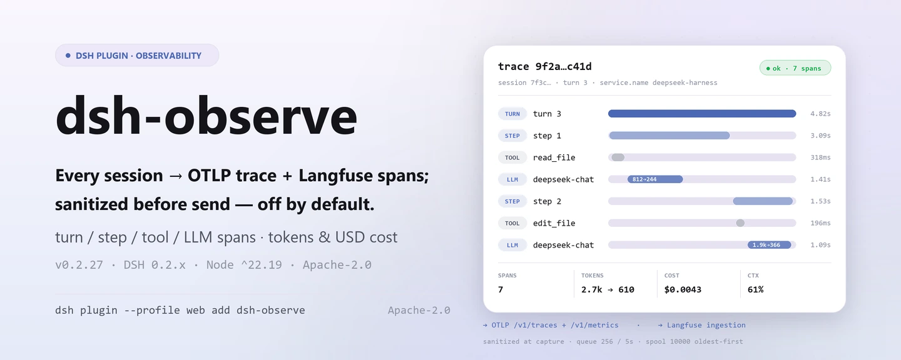

<div align="center">

<picture>
  <source media="(prefers-color-scheme: dark)" srcset="docs/assets/dsh-observe-hero-en-dark.webp">
  
</picture>

# dsh-observe

**Turn every session into standard OTLP traces and Langfuse observations—sanitized before anything leaves, exporting nothing by default.**

Observability exporter for DeepSeek Harness: turn/step/tool/LLM spans, token and USD cost metrics, async batching, a bounded offline buffer, and exponential-backoff retries; use OTLP, Langfuse, or both.

[Install](#three-step-setup) · [Configuration](#configuration) · [FAQ](#faq) · [简体中文](README.md) · [English](README.en.md) · [Español](README.es.md) · [Português](README.pt.md) · [हिन्दी](README.hi.md)

[](LICENSE)
[](#compatibility)
[](https://www.npmjs.com/package/dsh-observe)
[](https://github.com/PerryLink/dsh-observe/actions/workflows/ci.yml)
[](#compatibility)

[](https://github.com/PerryLink/dsh-observe/stargazers)
[](https://www.npmjs.com/package/dsh-observe)
[](https://dshfind.com/plugins/PerryLink/dsh-observe?ref=badge)
[](https://securityscorecards.dev/viewer/?uri=github.com/PerryLink/dsh-observe)
[](https://dsh.market/)
[](https://gitee.com/perrylink/dsh-observe)

```sh
dsh plugin --profile <name> add dsh-observe
```

</div>

<sub>Community plugin, not affiliated with DeepSeek. Only repository: <https://github.com/PerryLink/dsh-observe> (Gitee is a mirror).</sub>

## What it is

`dsh-observe` translates the harness `session/event` stream into standard observability protocols: one trace per turn, a span each for steps, tool calls, and LLM generations, cumulative token and cost metrics, and prompt/completion bodies that are sanitized and truncated before they are queued. It only exports: it registers no model tools and no user-facing command, and every behaviour is driven by configuration. Configure OTLP or Langfuse, restart, and the data flows on its own; leave it unconfigured and nothing is captured at all.

<picture>
  <source media="(prefers-color-scheme: dark)" srcset="docs/assets/dsh-observe-flow-v5-dark.svg">
  
</picture>

## Three-step setup

1. **Install** (pick one):

   ```sh
   # git channel (latest main; the prepare script builds with production dependencies only)
   dsh plugin --profile web add github:PerryLink/dsh-observe
   # npm channel (published version)
   dsh plugin --profile web add dsh-observe
   # tarball channel: pnpm pack in this repo, then
   dsh plugin --profile web add ./dsh-observe-<version>.tgz
   ```

   > If pnpm reports `ERR_PNPM_IGNORED_BUILDS` for this package (esbuild's harmless platform-binary validation), add `allowBuilds: { esbuild: true }` to your `pnpm-workspace.yaml`; the `dsh` CLI prints the exact snippet.

2. **Minimal configuration** (turn `enabled` on in the profile patch and configure at least one backend; the row ships disabled in `cordis.patch.yml`):

   ```yaml
   - insert:
       - id: dsh-observe
         name: dsh-observe
         config:
           enabled: true
           otlp:
             endpoint: http://localhost:4318
   ```

   Langfuse works the same way: `langfuse.baseUrl` + `langfuse.publicKey` + `langfuse.secretKey`. Both backends can be on at once.

3. **Verify it is live**:

   ```sh
   dsh --profile web --dump-config | grep -A2 'id: dsh-observe'
   ```

   No user-facing command is registered, so there is no manual `/observe` trigger. With `remote.enabled: true`, a settings page can read the configured backends, queue depths, and buffer occupancy through `observe/status`.

**Uninstall**: `dsh plugin --profile web remove dsh-observe` (or delete the row from the profile patch).

<details>
<summary>Install from the DSH Desktop market</summary>

Every PerryLink plugin can be browsed in the built-in DSH Desktop market: **Market → Sources → add source → paste** `https://perrylink-dsh-catalog.perrylink.workers.dev/catalog-source.json` **→ select it**. Installation still goes through the market's npm identity check and your confirmation.

</details>

## Core capabilities

`dsh-observe` turns the session event stream into standard observability protocols:

- **Spans** — turn, step, tool-call (duration, status, retry derivation), and LLM generation spans, linked into per-turn traces with deterministic ids.
- **Metrics** — per-provider/model token counters, USD cost counters (configurable pricing table), and the optional context-pressure gauge from `ctx.tokenMeter`.
- **Sanitized capture** — prompt and completion bodies pass structural key-name redaction, built-in secret patterns, your patterns, and character budgets before anything is queued or sent.
- **Reliability** — async batching (size- and timer-triggered), a bounded durable offline buffer (storage-domain, oldest-first eviction), and deterministic exponential-backoff retries; undeliverable batches survive restarts.
- **Runtime kill switch** — the optional Typert remote (`observe/status`, `observe/setEnabled`) lets a settings page stop and resume exporting without unmounting.
- **Off by default** — `enabled: true` plus at least one backend is the explicit opt-in; nothing is captured or exported otherwise.

```text
session/event stream
   │ collector (turn/step/tool/llm spans, metrics)
   │ sanitize (keys, secrets, budgets)
   ├──▶ pipeline "otlp"  ── queue ── flush ──▶ OTLP /v1/traces + /v1/metrics
   │         └─ retry/backoff ─┐
   ├──▶ pipeline "langfuse" ── queue ── flush ──▶ Langfuse ingestion
   │         └─ retry/backoff ─┤
   └────────── durable spool (offline buffer, bounded) ◀┘
```

### Surfaces

This plugin registers **no model tools** and no user-facing command — it is a background exporter. Its whole surface is three things:

- **Consumes** `session/event` (span/metric collection), `session/flush` (best-effort export kick — the durability checkpoint never waits on a remote backend), and `session/disposed`.
- **Optional remote service** `observe` (`remote.enabled`, off by default) — `observe/status` returns the kill-switch state, configured backends, queue depths, and buffer occupancy; `observe/setEnabled` stops and resumes exporting at runtime.
- **The single injected service key** `storageDomain`, used for the durable offline buffer table.

### Examples

There is no manual trigger: after installation, turn `enabled` on with the minimal configuration above and restart; traces and metrics show up in the OTLP backend, observations show up in Langfuse. To confirm it is collecting, look at the first trace the backend receives; to confirm it is shipping, watch `observe/status` queue depths fall back as the session progresses.

## Configuration

All tunables are Schemastery `Config` fields (changeable from cordis.yml / the profile patch). An id-targeted override replaces the whole row — restate every key you need. [`cordis.patch.yml`](cordis.patch.yml) documents each key inline.

Most-used keys:

| Key | Default | Meaning |
|---|---|---|
| `enabled` | `false` | Master switch; `true` plus at least one backend is the explicit opt-in |
| `otlp.endpoint` | *(required)* | OTLP base URL; `/v1/traces` and `/v1/metrics` are appended by the plugin |
| `otlp.serviceName` | `deepseek-harness` | `service.name` resource attribute |
| `langfuse.baseUrl` | `https://cloud.langfuse.com` | Langfuse base URL |
| `langfuse.traceName` | `session {session} turn {turn}` | Trace-name template; `{session}`/`{turn}` interpolate per trace |
| `capture.llm` | `true` | LLM generation spans |
| `llm.prompt` | `true` | Capture the sanitized request prompt (`false` = sizes only) |
| `batch.maxBufferRecords` | `10000` | Durable offline buffer bound; oldest records drop first |
| `remote.enabled` | `false` | Mount the `observe` Typert remote (runtime kill switch) |

<details>
<summary>Full configuration table (47 keys)</summary>

| Key | Default | Meaning |
|---|---|---|
| `enabled` | `false` | Master switch; `true` plus at least one backend is the explicit opt-in |
| `otlp` | `null` | OTLP backend config, or `null` to disable it |
| `otlp.endpoint` | *(required)* | OTLP base URL; `/v1/traces` and `/v1/metrics` are appended |
| `otlp.serviceName` | `deepseek-harness` | `service.name` resource attribute |
| `otlp.serviceVersion` | *(none)* | `service.version` resource attribute |
| `otlp.headers` | `{}` | Extra headers merged into every export request |
| `otlp.timeoutMs` | `10000` | Per-request timeout |
| `langfuse` | `null` | Langfuse backend config, or `null` to disable it |
| `langfuse.baseUrl` | `https://cloud.langfuse.com` | Langfuse base URL |
| `langfuse.publicKey` | *(required)* | Project public key |
| `langfuse.secretKey` | *(required)* | Project secret key |
| `langfuse.release` | *(none)* | Release tag stamped onto traces |
| `langfuse.traceName` | `session {session} turn {turn}` | Trace-name template; `{session}`/`{turn}` interpolate per trace |
| `langfuse.tags` | `[]` | Static tags stamped onto every trace |
| `langfuse.timeoutMs` | `10000` | Per-request timeout |
| `capture.turns` | `true` | Turn lifecycle spans |
| `capture.steps` | `true` | Step lifecycle spans |
| `capture.tools` | `true` | Tool-call spans with sanitized arguments/results |
| `capture.llm` | `true` | LLM generation spans |
| `llm.prompt` | `true` | Capture the sanitized request prompt (`false` = sizes only) |
| `llm.completion` | `true` | Capture the sanitized completion (`false` = sizes only) |
| `metadata.sessionId` | `true` | Session id attribute |
| `metadata.cwd` | `false` | Session working directory (a local path — off by default) |
| `metadata.agentPreset` | `true` | Agent preset id attribute |
| `metadata.model` | `true` | Provider/model attributes |
| `metrics.tokens` | `true` | Per-provider/model token counters |
| `metrics.cost` | `true` | USD cost counters (need `pricing` rules to match) |
| `metrics.contextTokens` | `true` | Context-pressure gauge (needs `ctx.tokenMeter`) |
| `pricing` | `[]` | Pricing table, first match wins: `{ provider?, model, inputPerToken, outputPerToken, cacheReadPerToken?, cacheWritePerToken? }` |
| `sanitize.enabled` | `true` | Redaction master switch (`false` disables redaction, never truncation) |
| `sanitize.redactKeys` | `[]` | Extra key-name substrings (key/token/secret/password/authorization/credential/apiKey are always included) |
| `sanitize.redactPatterns` | `[]` | Extra secret regular expressions |
| `sanitize.truncatePromptChars` | `4000` | Prompt character budget |
| `sanitize.truncateCompletionChars` | `4000` | Completion character budget |
| `sanitize.truncateToolInputChars` | `2000` | Tool argument character budget |
| `sanitize.truncateToolOutputChars` | `2000` | Tool result character budget |
| `sanitize.truncateAttributeChars` | `512` | Span attribute string budget |
| `batch.maxRecords` | `256` | Flush once the queue holds this many records |
| `batch.flushIntervalMs` | `5000` | Timer flush interval |
| `batch.maxQueueRecords` | `2000` | In-memory queue bound; excess spills to the buffer |
| `batch.maxBufferRecords` | `10000` | Durable offline buffer bound; oldest records drop first |
| `batch.bufferRetryIntervalMs` | `30000` | Offline buffer retry interval |
| `retry.maxAttempts` | `5` | Attempts per batch, including the first try |
| `retry.baseDelayMs` | `1000` | First backoff delay |
| `retry.factor` | `2` | Backoff multiplier per consecutive failure |
| `retry.maxDelayMs` | `60000` | Backoff ceiling |
| `remote.enabled` | `false` | Mount the `observe` Typert remote (runtime kill switch) |

</details>

Example id-targeted override (it replaces the whole row, so restate the keys you need):

```yaml
- insert:
    - id: dsh-observe
      name: dsh-observe
      config:
        enabled: true
        otlp:
          endpoint: http://localhost:4318
        capture:
          tools: false
        sanitize:
          truncatePromptChars: 2000
        batch:
          maxBufferRecords: 20000
```

## FAQ

<details>
<summary>Will the raw prompt or tool arguments reach the backend?</summary>

Not raw. Every record is sanitized before it is queued, in three layers: structural key names (key/token/secret/password/authorization/credential/apiKey are always in the list, and `sanitize.redactKeys` adds substrings), built-in secret patterns (API keys, GitHub tokens, AWS keys, bearer credentials, private keys) plus your `sanitize.redactPatterns` regexes, and character-budget truncation (prompt/completion 4000 each, tool arguments and results 2000 each, span attributes 512). If you want sizes without bodies, set `llm.prompt` and `llm.completion` to `false` and the records carry only sizes and counts.

</details>

<details>
<summary>What happens when a backend is down or the network drops?</summary>

Spans and metrics follow the retry → spill chain: a failed batch is retried with deterministic exponential backoff (`retry.maxAttempts` 5 by default, `retry.baseDelayMs × retry.factor`), and once retries are exhausted or the in-memory queue passes `batch.maxQueueRecords` it spills into the bounded durable spool (`batch.maxBufferRecords` 10000 by default, oldest first), drained periodically on `batch.bufferRetryIntervalMs`, so undeliverable batches survive a restart. OTLP metrics are the exception: they are aggregated cumulatively and a lost flush self-heals on the next one.

</details>

<details>
<summary>What does the plugin itself store, and where do credentials live?</summary>

The offline buffer holds sanitized records only, and records read back from storage are validated again before a sink can see them. The plugin stores no credentials itself: Langfuse public/secret keys appear only in requests to the Langfuse endpoint you configure, and OTLP headers only go to your OTLP endpoint — keep them in credential references or environment-injected values, never in a committed profile patch. It only reads the live event stream and never reads or rewrites session log files.

</details>

<details>
<summary>Does it slow the session down?</summary>

Collection and sanitization run synchronously in the event handler, but sending is entirely asynchronous: the queue flushes on size or timer, and `session/flush` is only a best-effort kick — the durability checkpoint never waits on a remote backend. Export failures warn, count (`observe.export_failures`), retry, and finally spool; a failing session/event handler is caught and logged, so observability can never break the harness hot path.

</details>

<details>
<summary>Does it fight other plugins over services, events, or slots?</summary>

It injects one service key (`storageDomain`), listens on three `session/*` events, and registers no model tools, no commands, no client slots, no waterfall listeners, and no global rewrites. The only naming surface worth watching is the optional `observe` remote service (`remote.enabled` is off by default): if another plugin in the same profile takes that service name, enable only one of them.

</details>

## Security boundaries

- **Off by default** — nothing is captured or exported unless you opt in explicitly (`enabled: true` plus at least one backend).
- **Sanitize before send** — structural key redaction, built-in secret patterns (API keys, GitHub tokens, AWS keys, bearer credentials, private keys), your patterns, and character budgets all apply before any record leaves memory.
- **Durable boundary re-validation** — records read back from storage are checked again before a sink can see them.
- **Failure loud, failure contained** — export failures warn, count, retry, and finally spool; a failing session handler is caught and logged so observability can never break the harness hot path.
- **Model-visible ⟺ logged** — prompt/completion exports project only the session surface (whose node 0 is the system prompt) and the logged header (call config and tools); the exporter invents no content.

## Permissions & data

- **Permissions**: `network:outbound` to the endpoints you configure, `session:read` for the event stream, `storage:write` for the offline buffer; no native code, no filesystem access.
- **Data**: everything sent is derived from the session log and sanitized (redaction + truncation) before it is queued, buffered, or transmitted. The offline buffer stores only sanitized records, re-validated when read back.
- **Credentials**: Langfuse public/secret keys travel only to the configured Langfuse endpoint; OTLP headers only to the configured OTLP endpoint. The plugin stores no credentials itself — keep them in credential references or environment-injected values.

## Known limitations

- **Baseline `0.2.2-rc.1`** — the plugin is developed and tested against `@deepseek-ai/dsh@0.2.2-rc.1` (devDependencies and CI's primary ruler); `engines.dsh` (`>=0.2.1-0 <0.3.0 || >=0.2.2-0 <0.3.0`) and the composite peer range keep every published line installable, and older baselines are covered by the second ruler (`typecheck:ci`) plus the compat workflow.
- **Audit events are not persisted** — the exporter's own `observe/*` records are audit-only: on the current host line the session append gate admits surface events, so no `observe/*` event is written to the session log, and the plugin does not fake one with an unmarked append (that would make sessions unreadable). Treat `observe/status` output (needs `remote.enabled: true`) and the OTLP/Langfuse backends as the audit surface.
- **Metrics bypass the retry/spool path** — OTLP metrics are aggregated cumulatively, so a lost flush self-heals on the next one (by design, not a bug).
- **No sampling** — every enabled span family is exported; set `capture.*` switches and `batch.maxBufferRecords` for high-volume sessions.

## Interoperability with other DSH plugins

The plugin's registration surface is deliberately narrow, so conflicts are structurally unlikely:

- **No tool-name conflict** — it registers no model tools (neither the README nor `src/index.ts` has a tool registration).
- **No command-name conflict** — it registers no user-facing command, so it never touches the slash-command namespace.
- **No client-slot conflict** — the package ships no browser half (no `client/` directory), so it registers no client slots.
- **No waterfall short-circuit** — it only reads `session/event`, `session/flush`, and `session/disposed`; it listens on no allow/passthrough waterfall, so it cannot hold up anyone else's decision.
- **Its single service key** — `storageDomain` (injected, not provided); plus one **optional** remote service, `observe`, registered only when `remote.enabled: true`.
- **Outbound traffic only to your endpoints** — OTLP and Langfuse are independent; turning one off does not affect the other.

If another observability plugin is installed in the same profile, mind two things: both consume `session/event` (Cordis broadcasts, so neither starves the other) but you get two sets of traces, and do not register the `observe` remote service name twice.

## Compatibility

| Surface | Status |
|---|---|
| Harness | DeepSeek Harness `dsh-v0.2.1-alpha.1` (adapted 2026-10-04): session format V4 represents a tool result as a first-class `role: 'tool'` message carrying top-level `toolCallId` + `content` + optional `isError` — the V3 `tool-result` content block is gone from the host's `ContentBlockMap`, and this plugin reads only the V4 shape (a pre-upgrade V3 log still projects through a read-only compatibility path). Session format V3's other traits carry over: the assistant stream is embedded in `assistant/message` / `assistant/attempt`, and the system prompt is surface node 0 (`system/message`); the plugin consumes only the live event stream and never reads session log files. `engines.dsh` is `>=0.2.1-0 <0.3.0 \|\| >=0.2.2-0 <0.3.0`; the profile install smoke is covered by the compat workflow. |
| Node | `^22.19.0 \|\| >=24.9.0`, pure ESM (`"type": "module"`) |
| Backends | OpenTelemetry OTLP/HTTP (traces + metrics, JSON encoding) and Langfuse (LLM observability) — either or both |
| Model | Model-agnostic: it exports the session/event stream; no model calls are made |

Peer dependencies: `@deepseek-ai/cordis ^4.0.5-alpha.1`, `@deepseek-ai/schemastery ^3.18.5`, and `@deepseek-ai/dsh-llm`, `@deepseek-ai/dsh-session`, `@deepseek-ai/dsh-storage`, `@deepseek-ai/dsh-storage-domain`, `@deepseek-ai/dsh-storage-json`, `@deepseek-ai/dsh-typert-protocol` (`>=0.1.2-rc.1 <0.2.0 || >=0.1.5-alpha.1 <0.2.0 || >=0.1.6-0 <0.2.0 || >=0.1.7-0 <0.2.0 || >=0.2.0-0 <0.3.0 || >=0.2.1-0 <0.3.0 || >=0.2.2-0 <0.3.0`; devDependencies pinned to `0.2.2-rc.1`). `zod` is the only runtime dependency, used for durable-boundary validation of the offline buffer.

## Ecosystem & quality

- [Gitee mirror](https://gitee.com/perrylink/dsh-observe) (synced mirror; GitHub is authoritative)
- [dshfind plugin page](https://dshfind.com/plugins/PerryLink/dsh-observe) (installs and ranking)
- [OpenSSF Scorecard report](https://securityscorecards.dev/viewer/?uri=github.com/PerryLink/dsh-observe) (driven by [.github/workflows/scorecard.yml](.github/workflows/scorecard.yml))
- [dsh-plugin-doctor verification report](https://github.com/PerryLink/dsh-plugin-doctor#verified-徽章)
- [DSH Market](https://dsh.market/) (listed)
- **1024 store channel**: run `npm i -g dsh1024` once, then `dsh1024 plugin --profile web add dsh-observe` (counts toward the [deepseek1024.com](https://deepseek1024.com) install ranking)
- [Ecosystem knowledge base](https://perrylink.github.io/dsh-plugin-guide/): plugin development guide · selection data · maintenance criteria

## Development

```sh
pnpm install               # node ^22.19 || >=24.9
pnpm run typecheck         # tsc: src + tests against the 0.2.2-rc.1 devDeps (no tsconfig paths)
pnpm run typecheck:ci      # tsc against the published line (no paths)
pnpm run check:ruler-live  # canary: must fail to compile, proving the ruler is live (needs the checkout face)
pnpm test                  # vitest: 126 tests, 18 suites (real Context/Session/storage seam)
pnpm run test:coverage     # coverage gate (90/80/90/90)
pnpm run build             # tsdown bundle + tsc declarations (lib/)
pnpm run verify:self-contained  # dependency specs resolve from the registry
pnpm run verify:artifacts       # built ESM face + bundle patch present
node scripts/check-readme-sync.mjs  # five-language README sync gate
pnpm pack                  # the published tarball
```

README images are generated by [`scripts/gen-readme-assets.py`](scripts/gen-readme-assets.py) (Pillow draws the four 1440×576 hero banners; the 1100×660 structure diagram is hand-written SVG), writing `docs/assets/dsh-observe-hero-{zh,en}-{light,dark}.webp` and the `docs/assets/dsh-observe-flow-v5-{light,dark}.svg` pair; rerunning is idempotent. The older `docs/assets/dsh-observe-flow-{light,dark}.svg`, `dsh-observe-flow.svg`, `dsh-observe-hero.png`, and `dsh-observe-demo.{png,gif}` stay in place so existing external links never 404; the READMEs no longer reference them.

Topics: `dsh`, `dsh-plugin`, `deepseek-harness`, `deepseek`, `cordis`, `observability`, `opentelemetry`, `otlp`, `langfuse`, `tracing`

## Family & thanks

This project is part of the DeepSeek Harness plugin family maintained by [PerryLink](https://github.com/PerryLink) (all Apache-2.0). If this plugin is useful, **give it a star** — nothing is gated behind it, but it helps the next person find it.

- [@PerryLink](https://github.com/PerryLink) — creator and maintainer: collector, pipelines, spool, OTLP/Langfuse sinks, sanitization, and the five-language docs.

<details>
<summary>Expand all plugins</summary>

| Plugin | Status |
|---|---|
| **[dsh-aqua-input-check](https://github.com/PerryLink/dsh-aqua-input-check)** |  |
| **[dsh-archive-check](https://github.com/PerryLink/dsh-archive-check)** |  |
| **[dsh-auto-review](https://github.com/PerryLink/dsh-auto-review)** |  |
| **[dsh-autotier](https://github.com/PerryLink/dsh-autotier)** | 🧊 FROZEN — see the repo README |
| **[dsh-bid-ca-precheck](https://github.com/PerryLink/dsh-bid-ca-precheck)** |  |
| **[dsh-bid-qual-check](https://github.com/PerryLink/dsh-bid-qual-check)** |  |
| **[dsh-cert-mcp](https://github.com/PerryLink/dsh-cert-mcp)** | 🧊 FROZEN — see the repo README |
| **[dsh-checkpoint-rewind](https://github.com/PerryLink/dsh-checkpoint-rewind)** |  |
| **[dsh-click](https://github.com/PerryLink/dsh-click)** |  |
| **[dsh-composer-history](https://github.com/PerryLink/dsh-composer-history)** |  |
| **[dsh-contract-stance](https://github.com/PerryLink/dsh-contract-stance)** |  |
| **[dsh-customs-doc-check](https://github.com/PerryLink/dsh-customs-doc-check)** |  |
| **[dsh-data-quality](https://github.com/PerryLink/dsh-data-quality)** | 🧊 FROZEN — see the repo README |
| **[dsh-demurrage-ledger](https://github.com/PerryLink/dsh-demurrage-ledger)** |  |
| **[dsh-doublecheck](https://github.com/PerryLink/dsh-doublecheck)** |  |
| **[dsh-drill-script-check](https://github.com/PerryLink/dsh-drill-script-check)** |  |
| **[dsh-eia-guide-check](https://github.com/PerryLink/dsh-eia-guide-check)** |  |
| **[dsh-emergency-plan](https://github.com/PerryLink/dsh-emergency-plan)** |  |
| **[dsh-essay-rubric-check](https://github.com/PerryLink/dsh-essay-rubric-check)** |  |
| **[dsh-evidence-check](https://github.com/PerryLink/dsh-evidence-check)** |  |
| **[dsh-export-ctl-check](https://github.com/PerryLink/dsh-export-ctl-check)** |  |
| **[dsh-fast](https://github.com/PerryLink/dsh-fast)** |  |
| **[dsh-fmea-table-check](https://github.com/PerryLink/dsh-fmea-table-check)** |  |
| **[dsh-forecast-penalty](https://github.com/PerryLink/dsh-forecast-penalty)** |  |
| **[dsh-fund-research](https://github.com/PerryLink/dsh-fund-research)** |  |
| **[dsh-github](https://github.com/PerryLink/dsh-github)** |  |
| **[dsh-gongwen-flow-check](https://github.com/PerryLink/dsh-gongwen-flow-check)** |  |
| **[dsh-gongwen-word-check](https://github.com/PerryLink/dsh-gongwen-word-check)** |  |
| **[dsh-guard-plan-qc](https://github.com/PerryLink/dsh-guard-plan-qc)** |  |
| **[dsh-hazchem-check](https://github.com/PerryLink/dsh-hazchem-check)** |  |
| **[dsh-hazplan-check](https://github.com/PerryLink/dsh-hazplan-check)** |  |
| **[dsh-hidden-risk-map](https://github.com/PerryLink/dsh-hidden-risk-map)** |  |
| **[dsh-hs-classify](https://github.com/PerryLink/dsh-hs-classify)** |  |
| **[dsh-icd-rule-check](https://github.com/PerryLink/dsh-icd-rule-check)** |  |
| **[dsh-industry-research](https://github.com/PerryLink/dsh-industry-research)** |  |
| **[dsh-lawcite-adapter](https://github.com/PerryLink/dsh-lawcite-adapter)** |  |
| **[dsh-laya](https://github.com/PerryLink/dsh-laya)** |  |
| **[dsh-lc-doc-check](https://github.com/PerryLink/dsh-lc-doc-check)** |  |
| **[dsh-learning-gap-check](https://github.com/PerryLink/dsh-learning-gap-check)** |  |
| **[dsh-library](https://github.com/PerryLink/dsh-library)** |  |
| **[dsh-local-ai](https://github.com/PerryLink/dsh-local-ai)** |  |
| **[dsh-lsp-actions](https://github.com/PerryLink/dsh-lsp-actions)** |  |
| **[dsh-mask](https://github.com/PerryLink/dsh-mask)** |  |
| **[dsh-mcp-panel](https://github.com/PerryLink/dsh-mcp-panel)** |  |
| **[dsh-medrec-qc](https://github.com/PerryLink/dsh-medrec-qc)** |  |
| **[dsh-memento](https://github.com/PerryLink/dsh-memento)** | 🧊 FROZEN — see the repo README |
| **[dsh-nsfc-form-check](https://github.com/PerryLink/dsh-nsfc-form-check)** |  |
| **[dsh-nurse-record-check](https://github.com/PerryLink/dsh-nurse-record-check)** |  |
| **[dsh-observe](https://github.com/PerryLink/dsh-observe)** |  |
| **[dsh-origin-rvc-check](https://github.com/PerryLink/dsh-origin-rvc-check)** |  |
| **[dsh-ota-review-check](https://github.com/PerryLink/dsh-ota-review-check)** |  |
| **[dsh-output-styles](https://github.com/PerryLink/dsh-output-styles)** |  |
| **[dsh-paper-doc-adapter](https://github.com/PerryLink/dsh-paper-doc-adapter)** |  |
| **[dsh-permission-rules](https://github.com/PerryLink/dsh-permission-rules)** |  |
| **[dsh-permit-report-check](https://github.com/PerryLink/dsh-permit-report-check)** |  |
| **[dsh-pipeline-check](https://github.com/PerryLink/dsh-pipeline-check)** |  |
| **[dsh-pleading-draft](https://github.com/PerryLink/dsh-pleading-draft)** |  |
| **[dsh-plugin-doctor](https://github.com/PerryLink/dsh-plugin-doctor)** | 🚫 RETIRED (repo archived) |
| **[dsh-plugin-guide](https://github.com/PerryLink/dsh-plugin-guide)** |  |
| **[dsh-plugin-kit](https://github.com/PerryLink/dsh-plugin-kit)** | 🚫 RETIRED (repo archived) |
| **[dsh-plugin-upgrade](https://github.com/PerryLink/dsh-plugin-upgrade)** | 🚫 RETIRED (repo archived) |
| **[dsh-policy-brief-draft](https://github.com/PerryLink/dsh-policy-brief-draft)** |  |
| **[dsh-power-loss-split](https://github.com/PerryLink/dsh-power-loss-split)** |  |
| **[dsh-power-ticket-check](https://github.com/PerryLink/dsh-power-ticket-check)** |  |
| **[dsh-ppap-check](https://github.com/PerryLink/dsh-ppap-check)** |  |
| **[dsh-protest-deadline](https://github.com/PerryLink/dsh-protest-deadline)** |  |
| **[dsh-railway-window](https://github.com/PerryLink/dsh-railway-window)** |  |
| **[dsh-repair-order-qc](https://github.com/PerryLink/dsh-repair-order-qc)** |  |
| **[dsh-research-report](https://github.com/PerryLink/dsh-research-report)** |  |
| **[dsh-review-reply-check](https://github.com/PerryLink/dsh-review-reply-check)** |  |
| **[dsh-rulefile-check](https://github.com/PerryLink/dsh-rulefile-check)** |  |
| **[dsh-safety-brief-check](https://github.com/PerryLink/dsh-safety-brief-check)** |  |
| **[dsh-score](https://github.com/PerryLink/dsh-score)** | 🧊 FROZEN — see the repo README |
| **[dsh-session-sync](https://github.com/PerryLink/dsh-session-sync)** |  |
| **[dsh-site-log-check](https://github.com/PerryLink/dsh-site-log-check)** |  |
| **[dsh-skill-pack-security](https://github.com/PerryLink/dsh-skill-pack-security)** |  |
| **[dsh-soe-decision-check](https://github.com/PerryLink/dsh-soe-decision-check)** |  |
| **[dsh-soilwater-check](https://github.com/PerryLink/dsh-soilwater-check)** |  |
| **[dsh-sop-sync-check](https://github.com/PerryLink/dsh-sop-sync-check)** |  |
| **[dsh-spc-gbt-adapter](https://github.com/PerryLink/dsh-spc-gbt-adapter)** |  |
| **[dsh-talk](https://github.com/PerryLink/dsh-talk)** |  |
| **[dsh-tender-extract](https://github.com/PerryLink/dsh-tender-extract)** |  |
| **[dsh-tender-matrix](https://github.com/PerryLink/dsh-tender-matrix)** |  |
| **[dsh-test-drive](https://github.com/PerryLink/dsh-test-drive)** |  |
| **[dsh-ticktick](https://github.com/PerryLink/dsh-ticktick)** | 🚫 RETIRED (repo archived) |
| **[dsh-translate](https://github.com/PerryLink/dsh-translate)** |  |
| **[dsh-warranty-calc](https://github.com/PerryLink/dsh-warranty-calc)** |  |
| **[dsh-budget](https://github.com/PerryLink/dsh-budget)** | 🧊 FROZEN — see the repo README |
| **[dsh-claude-move](https://github.com/PerryLink/dsh-claude-move)** | 🧊 FROZEN — see the repo README |
| **[dsh-defend](https://github.com/PerryLink/dsh-defend)** | 🧊 FROZEN — see the repo README |
| **[dsh-draw](https://github.com/PerryLink/dsh-draw)** | 🧊 FROZEN — see the repo README |
| **[dsh-reach](https://github.com/PerryLink/dsh-reach)** | 🧊 FROZEN — see the repo README |
| **[dsh-background-agents](https://github.com/PerryLink/dsh-background-agents)** | 🚫 RETIRED (repo archived) |
| **[dsh-session-pin](https://github.com/PerryLink/dsh-session-pin)** | 🚫 RETIRED (repo archived) |
| **[dsh-team-rooms](https://github.com/PerryLink/dsh-team-rooms)** | 🚫 RETIRED (repo archived) |

</details>

## License

[LICENSE](LICENSE) (Apache License 2.0) © 2026 dsh-observe contributors

<p align="center"><sub>Apache-2.0 · Community plugin, not affiliated with DeepSeek.</sub></p>
