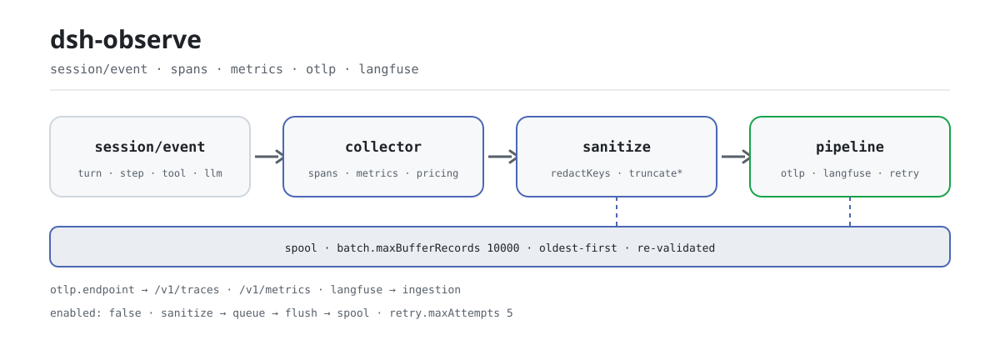

<div align="center">

<picture>
  <source media="(prefers-color-scheme: dark)" srcset="docs/assets/dsh-observe-flow-dark.svg">
  
</picture>

# dsh-observe

**Convierte cada sesión en trazas OTLP estándar y observaciones de Langfuse—saneado antes de salir, sin exportar nada por defecto.**

Exportador de observabilidad para DeepSeek Harness: spans de turn/step/llamada de herramienta/generación LLM, métricas de tokens y coste en USD, lotes asíncronos, búfer offline acotado y reintentos con backoff exponencial; usa OTLP, Langfuse o ambos.

[Instalar](#instalación-en-tres-pasos) · [Configuración](#configuración) · [FAQ](#faq) · [简体中文](README.md) · [English](README.en.md) · [Español](README.es.md) · [Português](README.pt.md) · [हिन्दी](README.hi.md)

[](LICENSE)
[](#compatibilidad)
[](https://www.npmjs.com/package/dsh-observe)
[](https://github.com/PerryLink/dsh-observe/actions/workflows/ci.yml)
[](#compatibilidad)

[](https://github.com/PerryLink/dsh-observe/stargazers)
[](https://www.npmjs.com/package/dsh-observe)
[](https://dshfind.com/plugins/PerryLink/dsh-observe?ref=badge)
[](https://securityscorecards.dev/viewer/?uri=github.com/PerryLink/dsh-observe)
[](https://dsh.market/)
[](https://gitee.com/perrylink/dsh-observe)

```sh
dsh plugin --profile <name> add dsh-observe
```

</div>

<sub>Plugin comunitario, no afiliado a DeepSeek. Repositorio único: <https://github.com/PerryLink/dsh-observe> (Gitee es un espejo).</sub>

## Qué es

`dsh-observe` traduce el flujo `session/event` del harness a protocolos de observabilidad estándar: una traza por turn, un span por step, por llamada de herramienta y por generación LLM, métricas acumuladas de tokens y coste, y cuerpos de prompt/completion que se sanean y truncan antes de entrar en la cola. Solo exporta: no registra herramientas de modelo ni comandos visibles para el usuario, y todo su comportamiento se gobierna por configuración. Configura OTLP o Langfuse, reinicia y los datos fluyen solos; sin configuración no se captura absolutamente nada.

## Instalación en tres pasos

1. **Instalar** (elige una):

   ```sh
   # canal git (main más reciente; el script prepare compila solo con dependencias de producción)
   dsh plugin --profile web add github:PerryLink/dsh-observe
   # canal npm (versión publicada)
   dsh plugin --profile web add dsh-observe
   # canal tarball: tras pnpm pack en este repositorio
   dsh plugin --profile web add ./dsh-observe-<version>.tgz
   ```

   > Si pnpm informa `ERR_PNPM_IGNORED_BUILDS` para este paquete (validación inofensiva del binario de plataforma de esbuild), añade `allowBuilds: { esbuild: true }` a tu `pnpm-workspace.yaml`; la CLI `dsh` imprime el fragmento exacto.

2. **Configuración mínima** (activa `enabled` en el patch del perfil y configura al menos un backend; la fila viene desactivada en `cordis.patch.yml`):

   ```yaml
   - insert:
       - id: dsh-observe
         name: dsh-observe
         config:
           enabled: true
           otlp:
             endpoint: http://localhost:4318
   ```

   Langfuse funciona igual: `langfuse.baseUrl` + `langfuse.publicKey` + `langfuse.secretKey`. Los dos backends pueden estar activos a la vez.

3. **Verificar que está activo**:

   ```sh
   dsh --profile web --dump-config | grep -A2 'id: dsh-observe'
   ```

   No se registra ningún comando visible para el usuario, así que no hay disparador manual del tipo `/observe`. Con `remote.enabled: true`, una página de ajustes puede leer los backends configurados, la profundidad de las colas y la ocupación del búfer mediante `observe/status`.

**Desinstalar**: `dsh plugin --profile web remove dsh-observe` (o borra la fila del patch del perfil).

<details>
<summary>Instalar desde el mercado de DSH Desktop</summary>

Todos los plugins de PerryLink se pueden explorar en el mercado integrado de DSH Desktop: **Mercado → Fuentes → añadir fuente → pegar** `https://perrylink-dsh-catalog.perrylink.workers.dev/catalog-source.json` **→ seleccionar**. La instalación sigue pasando por la verificación de identidad npm del mercado y tu confirmación.

</details>

## Capacidades clave

`dsh-observe` convierte el flujo de eventos de sesión en protocolos de observabilidad estándar:

- **Spans** — turn, step, llamada de herramienta (duración, estado, derivación de reintentos) y generación LLM, enlazados en trazas por turn con ids deterministas.
- **Métricas** — contadores de tokens por provider/model, contadores de coste en USD (tabla de precios configurable) y el gauge opcional de presión de contexto de `ctx.tokenMeter`.
- **Captura saneada** — los cuerpos de prompt y completion pasan por redacción estructural de nombres de clave, patrones de secreto integrados, tus patrones y presupuestos de caracteres antes de entrar en la cola o enviarse.
- **Fiabilidad** — lotes asíncronos (por tamaño y por temporizador), búfer offline durable acotado (storage-domain, expulsión del más antiguo primero) y reintentos deterministas con backoff exponencial; los lotes no entregados sobreviven al reinicio.
- **Interruptor en caliente** — el remote Typert opcional (`observe/status`, `observe/setEnabled`) permite a una página de ajustes detener y reanudar la exportación sin desmontar el plugin.
- **Desactivado por defecto** — `enabled: true` más al menos un backend es la activación explícita; sin eso no se captura ni se exporta nada.

```text
flujo session/event
   │ collector (spans turn/step/tool/llm, métricas)
   │ sanitize (claves, secretos, presupuestos)
   ├──▶ pipeline "otlp"  ── cola ── flush ──▶ OTLP /v1/traces + /v1/metrics
   │         └─ reintento/backoff ─┐
   ├──▶ pipeline "langfuse" ── cola ── flush ──▶ ingesta de Langfuse
   │         └─ reintento/backoff ─┤
   └────────── spool durable (búfer offline, acotado) ◀┘
```

### Superficies

Este plugin **no registra herramientas de modelo** ni comandos visibles para el usuario: es un exportador en segundo plano. Toda su superficie son tres cosas:

- **Consume** `session/event` (recogida de spans y métricas), `session/flush` (un empujón de exportación de mejor esfuerzo — el punto de durabilidad nunca espera a un backend remoto) y `session/disposed`.
- **Servicio remoto opcional** `observe` (`remote.enabled`, desactivado por defecto) — `observe/status` devuelve el estado del interruptor, los backends configurados, la profundidad de las colas y la ocupación del búfer; `observe/setEnabled` detiene y reanuda la exportación en caliente.
- **La única clave de servicio inyectada** `storageDomain`, usada para la tabla durable del búfer offline.

### Ejemplos

No hay disparador manual: tras instalar, activa `enabled` con la configuración mínima de arriba y reinicia; las trazas y métricas aparecen en el backend OTLP y las observaciones en Langfuse. Para confirmar que está recogiendo, mira la primera traza que recibe el backend; para confirmar que está enviando, observa cómo la profundidad de cola de `observe/status` baja a medida que avanza la sesión.

## Configuración

Todas las opciones son campos `Config` de Schemastery (modificables desde cordis.yml o el patch del perfil). Una sobrescritura por id reemplaza la fila entera: vuelve a declarar todas las claves que necesites. [`cordis.patch.yml`](cordis.patch.yml) documenta cada clave en línea.

Claves más usadas:

| Clave | Por defecto | Significado |
|---|---|---|
| `enabled` | `false` | Interruptor maestro; `true` más al menos un backend es la activación explícita |
| `otlp.endpoint` | *(obligatorio)* | URL base OTLP; el plugin añade `/v1/traces` y `/v1/metrics` |
| `otlp.serviceName` | `deepseek-harness` | Atributo de recurso `service.name` |
| `langfuse.baseUrl` | `https://cloud.langfuse.com` | URL base de Langfuse |
| `langfuse.traceName` | `session {session} turn {turn}` | Plantilla del nombre de traza; `{session}`/`{turn}` se interpolan por traza |
| `capture.llm` | `true` | Spans de generación LLM |
| `llm.prompt` | `true` | Captura el prompt de petición saneado (`false` = solo tamaños) |
| `batch.maxBufferRecords` | `10000` | Límite del búfer offline durable; los registros más antiguos caen primero |
| `remote.enabled` | `false` | Monta el remote Typert `observe` (interruptor en caliente) |

<details>
<summary>Tabla de configuración completa (47 claves)</summary>

| Clave | Por defecto | Significado |
|---|---|---|
| `enabled` | `false` | Interruptor maestro; `true` más al menos un backend es la activación explícita |
| `otlp` | `null` | Configuración del backend OTLP; `null` lo desactiva |
| `otlp.endpoint` | *(obligatorio)* | URL base OTLP; el plugin añade `/v1/traces` y `/v1/metrics` |
| `otlp.serviceName` | `deepseek-harness` | Atributo de recurso `service.name` |
| `otlp.serviceVersion` | *(ninguno)* | Atributo de recurso `service.version` |
| `otlp.headers` | `{}` | Cabeceras extra que se fusionan en cada petición de exportación |
| `otlp.timeoutMs` | `10000` | Tiempo de espera por petición |
| `langfuse` | `null` | Configuración del backend Langfuse; `null` lo desactiva |
| `langfuse.baseUrl` | `https://cloud.langfuse.com` | URL base de Langfuse |
| `langfuse.publicKey` | *(obligatorio)* | Clave pública del proyecto |
| `langfuse.secretKey` | *(obligatorio)* | Clave secreta del proyecto |
| `langfuse.release` | *(ninguno)* | Etiqueta de release estampada en las trazas |
| `langfuse.traceName` | `session {session} turn {turn}` | Plantilla del nombre de traza; `{session}`/`{turn}` se interpolan por traza |
| `langfuse.tags` | `[]` | Etiquetas estáticas estampadas en cada traza |
| `langfuse.timeoutMs` | `10000` | Tiempo de espera por petición |
| `capture.turns` | `true` | Spans de ciclo de vida del turn |
| `capture.steps` | `true` | Spans de ciclo de vida del step |
| `capture.tools` | `true` | Spans de llamada de herramienta con argumentos/resultados saneados |
| `capture.llm` | `true` | Spans de generación LLM |
| `llm.prompt` | `true` | Captura el prompt de petición saneado (`false` = solo tamaños) |
| `llm.completion` | `true` | Captura la completion saneada (`false` = solo tamaños) |
| `metadata.sessionId` | `true` | Atributo del id de sesión |
| `metadata.cwd` | `false` | Directorio de trabajo de la sesión (una ruta local; desactivado por defecto) |
| `metadata.agentPreset` | `true` | Atributo del id de preset de agente |
| `metadata.model` | `true` | Atributos de provider/model |
| `metrics.tokens` | `true` | Contadores de tokens por provider/model |
| `metrics.cost` | `true` | Contadores de coste en USD (requieren reglas `pricing` que coincidan) |
| `metrics.contextTokens` | `true` | Gauge de presión de contexto (requiere `ctx.tokenMeter`) |
| `pricing` | `[]` | Tabla de precios, gana la primera coincidencia: `{ provider?, model, inputPerToken, outputPerToken, cacheReadPerToken?, cacheWritePerToken? }` |
| `sanitize.enabled` | `true` | Interruptor maestro de redacción (`false` desactiva la redacción, nunca el truncado) |
| `sanitize.redactKeys` | `[]` | Subcadenas extra de nombres de clave (key/token/secret/password/authorization/credential/apiKey siempre están incluidos) |
| `sanitize.redactPatterns` | `[]` | Expresiones regulares extra para secretos |
| `sanitize.truncatePromptChars` | `4000` | Presupuesto de caracteres del prompt |
| `sanitize.truncateCompletionChars` | `4000` | Presupuesto de caracteres de la completion |
| `sanitize.truncateToolInputChars` | `2000` | Presupuesto de caracteres de los argumentos de herramienta |
| `sanitize.truncateToolOutputChars` | `2000` | Presupuesto de caracteres del resultado de herramienta |
| `sanitize.truncateAttributeChars` | `512` | Presupuesto de la cadena de atributo de span |
| `batch.maxRecords` | `256` | Vacía la cola cuando contiene este número de registros |
| `batch.flushIntervalMs` | `5000` | Intervalo del temporizador de vaciado |
| `batch.maxQueueRecords` | `2000` | Límite de la cola en memoria; el exceso pasa al búfer |
| `batch.maxBufferRecords` | `10000` | Límite del búfer offline durable; los registros más antiguos caen primero |
| `batch.bufferRetryIntervalMs` | `30000` | Intervalo de reintento del búfer offline |
| `retry.maxAttempts` | `5` | Intentos por lote, incluido el primero |
| `retry.baseDelayMs` | `1000` | Primer retardo de backoff |
| `retry.factor` | `2` | Multiplicador de backoff por fallo consecutivo |
| `retry.maxDelayMs` | `60000` | Techo del backoff |
| `remote.enabled` | `false` | Monta el remote Typert `observe` (interruptor en caliente) |

</details>

Ejemplo de sobrescritura por id (reemplaza la fila entera, así que vuelve a declarar las claves necesarias):

```yaml
- insert:
    - id: dsh-observe
      name: dsh-observe
      config:
        enabled: true
        otlp:
          endpoint: http://localhost:4318
        capture:
          tools: false
        sanitize:
          truncatePromptChars: 2000
        batch:
          maxBufferRecords: 20000
```

## FAQ

<details>
<summary>¿El prompt o los argumentos de herramienta en crudo llegan al backend?</summary>

No en crudo. Cada registro se sanea antes de entrar en la cola, en tres capas: nombres de clave estructurales (key/token/secret/password/authorization/credential/apiKey siempre están en la lista y `sanitize.redactKeys` añade subcadenas), patrones de secreto integrados (claves de API, tokens de GitHub, claves de AWS, credenciales bearer, claves privadas) más tus expresiones `sanitize.redactPatterns`, y truncado por presupuesto de caracteres (prompt/completion 4000 cada uno, argumentos y resultados de herramienta 2000 cada uno, atributos de span 512). Si solo quieres tamaños sin cuerpos, pon `llm.prompt` y `llm.completion` en `false` y los registros llevarán solo tamaños y recuentos.

</details>

<details>
<summary>¿Se pierden datos si el backend se cae o se corta la red?</summary>

Los spans y las métricas siguen la cadena reintento → derrame: un lote fallido se reintenta con backoff exponencial determinista (`retry.maxAttempts` 5 por defecto, `retry.baseDelayMs × retry.factor`), y cuando se agotan los reintentos o la cola en memoria supera `batch.maxQueueRecords` se derrama al spool durable acotado (`batch.maxBufferRecords` 10000 por defecto, primero los más antiguos), con drenaje periódico según `batch.bufferRetryIntervalMs`, de modo que los lotes no entregados sobreviven a un reinicio. Las métricas OTLP son la excepción: se agregan de forma acumulativa y un vaciado perdido se recupera en el siguiente.

</details>

<details>
<summary>¿Qué guarda el plugin y dónde viven las credenciales?</summary>

El búfer offline solo contiene registros saneados, y lo que se lee de vuelta del almacenamiento se valida otra vez antes de que lo vea un sink. El plugin no guarda credenciales: las claves pública/secreta de Langfuse solo aparecen en peticiones al endpoint de Langfuse que configures, y las cabeceras OTLP solo van a tu endpoint OTLP; mantenlas en referencias de credenciales o en valores inyectados por entorno, nunca en un patch de perfil versionado. Solo lee el flujo de eventos en vivo y jamás lee ni reescribe los ficheros de log de sesión.

</details>

<details>
<summary>¿Ralentiza la sesión?</summary>

La recogida y el saneado se ejecutan de forma síncrona en el manejador de eventos, pero el envío es totalmente asíncrono: la cola se vacía por tamaño o por temporizador, y `session/flush` es solo un empujón de mejor esfuerzo — el punto de durabilidad nunca espera a un backend remoto. Los fallos de exportación avisan, cuentan (`observe.export_failures`), reintentan y acaban en el spool; un fallo del manejador de `session/event` se captura y se registra, así que la observabilidad nunca puede romper la ruta caliente del harness.

</details>

<details>
<summary>¿Compite con otros plugins por servicios, eventos o slots?</summary>

Inyecta una clave de servicio (`storageDomain`), escucha tres eventos `session/*` y no registra herramientas de modelo, ni comandos, ni slots de cliente, ni listeners de waterfall, ni reescrituras globales. La única superficie de nombres a vigilar es el servicio remoto opcional `observe` (`remote.enabled` está desactivado por defecto): si otro plugin del mismo perfil ocupa ese nombre, activa solo uno de los dos.

</details>

## Límites de seguridad

- **Desactivado por defecto** — no se captura ni se exporta nada salvo que lo actives explícitamente (`enabled: true` más al menos un backend).
- **Saneado antes del envío** — la redacción estructural de claves, los patrones de secreto integrados (claves de API, tokens de GitHub, claves de AWS, credenciales bearer, claves privadas), tus patrones y los presupuestos de caracteres se aplican antes de que ningún registro abandone la memoria.
- **Revalidación en la frontera durable** — los registros leídos del almacenamiento se comprueban de nuevo antes de que un sink pueda verlos.
- **Fallo ruidoso, fallo contenido** — los fallos de exportación avisan, cuentan, reintentan y acaban en el spool; un fallo del manejador de sesión se captura y se registra para que la observabilidad nunca rompa la ruta caliente del harness.
- **Visible para el modelo ⟺ registrado** — las exportaciones de prompt/completion proyectan solo la superficie de sesión (cuyo nodo 0 es el system prompt) y la cabecera registrada (configuración de la llamada y herramientas); el exportador no inventa contenido.

## Permisos y datos

- **Permisos**: `network:outbound` hacia los endpoints que configures, `session:read` para el flujo de eventos y `storage:write` para el búfer offline; sin código nativo y sin acceso al sistema de ficheros.
- **Datos**: todo lo enviado deriva del log de sesión y se sanea (redacción + truncado) antes de encolarse, almacenarse o transmitirse. El búfer offline solo guarda registros saneados, revalidados al leerse.
- **Credenciales**: las claves pública/secreta de Langfuse solo viajan al endpoint de Langfuse configurado; las cabeceras OTLP solo al endpoint OTLP configurado. El plugin no almacena credenciales — usa referencias de credenciales o valores inyectados por entorno.

## Limitaciones conocidas

- **Base `0.2.2-rc.1`** — el plugin se desarrolla y prueba contra `@deepseek-ai/dsh@0.2.2-rc.1` (devDependencies y la regla principal de CI); `engines.dsh` (`>=0.2.1-0 <0.3.0 || >=0.2.2-0 <0.3.0`) y el rango compuesto de peers mantienen instalable cada línea publicada, y las bases más antiguas las cubren la segunda regla (`typecheck:ci`) y el workflow de compatibilidad.
- **Los eventos de auditoría no se persisten** — los registros `observe/*` del propio exportador son solo de auditoría: en la línea actual del host la compuerta de append de sesión solo admite eventos de superficie, así que ningún evento `observe/*` se escribe en el log de sesión, y el plugin no falsifica uno con un append sin marcar (eso haría ilegibles las sesiones). Usa la salida de `observe/status` (requiere `remote.enabled: true`) y los backends OTLP/Langfuse como superficie de auditoría.
- **Las métricas evitan la ruta de reintento/spool** — las métricas OTLP se agregan de forma acumulativa, así que un vaciado perdido se recupera en el siguiente (por diseño, no es un fallo).
- **Sin muestreo** — se exporta toda familia de spans habilitada; para sesiones de gran volumen ajusta los interruptores `capture.*` y `batch.maxBufferRecords`.

## Interoperabilidad con otros plugins DSH

La superficie de registro del plugin es deliberadamente estrecha, así que los conflictos son estructuralmente improbables:

- **Sin conflicto de nombres de herramienta** — no registra herramientas de modelo (ni el README ni `src/index.ts` tienen un registro de herramienta).
- **Sin conflicto de nombres de comando** — no registra comandos visibles para el usuario, así que nunca toca el espacio de nombres de comandos con barra.
- **Sin conflicto de slots de cliente** — el paquete no incluye mitad de navegador (no hay directorio `client/`), así que no registra slots de cliente.
- **Sin cortocircuito de waterfall** — solo lee `session/event`, `session/flush` y `session/disposed`; no escucha ningún waterfall de allow/passthrough, así que no puede bloquear la decisión de nadie.
- **Su única clave de servicio** — `storageDomain` (inyectada, no provista); más un servicio remoto **opcional**, `observe`, registrado solo con `remote.enabled: true`.
- **Tráfico saliente solo a tus endpoints** — OTLP y Langfuse son independientes; desactivar uno no afecta al otro.

Si hay otro plugin de observabilidad en el mismo perfil, atención a dos cosas: ambos consumen `session/event` (Cordis difunde, así que ninguno mata al otro) pero obtendrás dos juegos de trazas, y no registres dos veces el nombre de servicio remoto `observe`.

## Compatibilidad

| Dimensión | Estado |
|---|---|
| Harness | DeepSeek Harness `dsh-v0.2.1-alpha.1` (adaptado el 2026-10-04): el formato de sesión V4 representa el resultado de una herramienta como un mensaje de primera clase `role: 'tool'` con `toolCallId` + `content` + `isError` opcional en el nivel superior — el bloque de contenido `tool-result` de V3 ya no está en el `ContentBlockMap` del host, y este plugin solo lee la forma V4 (un log V3 anterior a la actualización todavía se proyecta por una ruta de compatibilidad de solo lectura). Los demás rasgos del formato V3 se mantienen: el flujo del asistente va embebido en `assistant/message` / `assistant/attempt`, y el system prompt es el nodo 0 de la superficie (`system/message`); el plugin consume solo el flujo de eventos en vivo y nunca lee ficheros de log de sesión. `engines.dsh` es `>=0.2.1-0 <0.3.0 \|\| >=0.2.2-0 <0.3.0`; el humo de instalación del perfil lo cubre el workflow de compatibilidad. |
| Node | `^22.19.0 \|\| >=24.9.0`, ESM puro (`"type": "module"`) |
| Backends | OpenTelemetry OTLP/HTTP (trazas + métricas, codificación JSON) y Langfuse (observabilidad LLM) — uno u otro, o ambos |
| Modelo | Independiente del modelo: exporta el flujo session/event; no realiza llamadas a modelos |

Dependencias peer: `@deepseek-ai/cordis ^4.0.5-alpha.1`, `@deepseek-ai/schemastery ^3.18.5`, y `@deepseek-ai/dsh-llm`, `@deepseek-ai/dsh-session`, `@deepseek-ai/dsh-storage`, `@deepseek-ai/dsh-storage-domain`, `@deepseek-ai/dsh-storage-json`, `@deepseek-ai/dsh-typert-protocol` (`>=0.1.2-rc.1 <0.2.0 || >=0.1.5-alpha.1 <0.2.0 || >=0.1.6-0 <0.2.0 || >=0.1.7-0 <0.2.0 || >=0.2.0-0 <0.3.0 || >=0.2.1-0 <0.3.0 || >=0.2.2-0 <0.3.0`; devDependencies fijadas a `0.2.2-rc.1`). `zod` es la única dependencia de ejecución, usada para la validación de la frontera durable del búfer offline.

## Ecosistema y calidad

- [Espejo en Gitee](https://gitee.com/perrylink/dsh-observe) (espejo sincronizado; GitHub es la fuente autorizada)
- [Página del plugin en dshfind](https://dshfind.com/plugins/PerryLink/dsh-observe) (instalaciones y ranking)
- [Informe OpenSSF Scorecard](https://securityscorecards.dev/viewer/?uri=github.com/PerryLink/dsh-observe) (impulsado por [.github/workflows/scorecard.yml](.github/workflows/scorecard.yml))
- [Informe de verificación de dsh-plugin-doctor](https://github.com/PerryLink/dsh-plugin-doctor#verified-徽章)
- [DSH Market](https://dsh.market/) (publicado)
- **Canal de la tienda 1024**: ejecuta `npm i -g dsh1024` una vez y luego `dsh1024 plugin --profile web add dsh-observe` (cuenta para el ranking de instalaciones de [deepseek1024.com](https://deepseek1024.com))
- [Base de conocimiento del ecosistema](https://perrylink.github.io/dsh-plugin-guide/): guía de desarrollo de plugins · datos de selección · criterios de mantenimiento

## Desarrollo

```sh
pnpm install               # node ^22.19 || >=24.9
pnpm run typecheck         # tsc: src + tests contra las devDeps 0.2.2-rc.1 (sin paths de tsconfig)
pnpm run typecheck:ci      # tsc contra la línea publicada (sin paths)
pnpm run check:ruler-live  # canario: debe fallar al compilar, lo que prueba que la regla sigue viva (requiere la cara checkout)
pnpm test                  # vitest: 126 tests, 18 suites (costura real de Context/Session/storage)
pnpm run test:coverage     # puerta de cobertura (90/80/90/90)
pnpm run build             # bundle tsdown + declaraciones tsc (lib/)
pnpm run verify:self-contained  # las dependencias se resuelven desde el registry
pnpm run verify:artifacts       # cara ESM compilada + patch del bundle presentes
node scripts/check-readme-sync.mjs  # puerta de sincronía de los README en cinco idiomas
pnpm pack                  # el tarball publicado
```

Las imágenes del README las genera [`scripts/gen-readme-assets.py`](scripts/gen-readme-assets.py) (Python + cadena de herramientas Pillow); escribe el par `docs/assets/dsh-observe-flow-{light,dark}.svg` y es idempotente. Los antiguos `docs/assets/dsh-observe-flow.svg` de un solo tema, `dsh-observe-hero.png` y `dsh-observe-demo.{png,gif}` se quedan donde están para que los enlaces externos no den 404; los README ya no los referencian.

Topics: `dsh`, `dsh-plugin`, `deepseek-harness`, `deepseek`, `cordis`, `observability`, `opentelemetry`, `otlp`, `langfuse`, `tracing`

## Familia y agradecimientos

Este proyecto forma parte de la familia de plugins de DeepSeek Harness mantenida por [PerryLink](https://github.com/PerryLink) (todos Apache-2.0). Si este plugin te resulta útil, **dale una estrella**: no desbloquea nada, pero ayuda a que la siguiente persona lo encuentre.

- [@PerryLink](https://github.com/PerryLink) — creador y mantenedor: collector, pipelines, spool, sinks OTLP/Langfuse, saneado y la documentación en cinco idiomas.

<details>
<summary>Expandir todos los plugins</summary>

| Plugin | Estado |
|---|---|
| **[dsh-aqua-input-check](https://github.com/PerryLink/dsh-aqua-input-check)** |  |
| **[dsh-archive-check](https://github.com/PerryLink/dsh-archive-check)** |  |
| **[dsh-auto-review](https://github.com/PerryLink/dsh-auto-review)** |  |
| **[dsh-autotier](https://github.com/PerryLink/dsh-autotier)** | 🧊 CONGELADO — ver el README del repo |
| **[dsh-bid-ca-precheck](https://github.com/PerryLink/dsh-bid-ca-precheck)** |  |
| **[dsh-bid-qual-check](https://github.com/PerryLink/dsh-bid-qual-check)** |  |
| **[dsh-cert-mcp](https://github.com/PerryLink/dsh-cert-mcp)** | 🧊 CONGELADO — ver el README del repo |
| **[dsh-checkpoint-rewind](https://github.com/PerryLink/dsh-checkpoint-rewind)** |  |
| **[dsh-click](https://github.com/PerryLink/dsh-click)** |  |
| **[dsh-composer-history](https://github.com/PerryLink/dsh-composer-history)** |  |
| **[dsh-contract-stance](https://github.com/PerryLink/dsh-contract-stance)** |  |
| **[dsh-customs-doc-check](https://github.com/PerryLink/dsh-customs-doc-check)** |  |
| **[dsh-data-quality](https://github.com/PerryLink/dsh-data-quality)** | 🧊 CONGELADO — ver el README del repo |
| **[dsh-demurrage-ledger](https://github.com/PerryLink/dsh-demurrage-ledger)** |  |
| **[dsh-doublecheck](https://github.com/PerryLink/dsh-doublecheck)** |  |
| **[dsh-drill-script-check](https://github.com/PerryLink/dsh-drill-script-check)** |  |
| **[dsh-eia-guide-check](https://github.com/PerryLink/dsh-eia-guide-check)** |  |
| **[dsh-emergency-plan](https://github.com/PerryLink/dsh-emergency-plan)** |  |
| **[dsh-essay-rubric-check](https://github.com/PerryLink/dsh-essay-rubric-check)** |  |
| **[dsh-evidence-check](https://github.com/PerryLink/dsh-evidence-check)** |  |
| **[dsh-export-ctl-check](https://github.com/PerryLink/dsh-export-ctl-check)** |  |
| **[dsh-fast](https://github.com/PerryLink/dsh-fast)** |  |
| **[dsh-fmea-table-check](https://github.com/PerryLink/dsh-fmea-table-check)** |  |
| **[dsh-forecast-penalty](https://github.com/PerryLink/dsh-forecast-penalty)** |  |
| **[dsh-fund-research](https://github.com/PerryLink/dsh-fund-research)** |  |
| **[dsh-github](https://github.com/PerryLink/dsh-github)** |  |
| **[dsh-gongwen-flow-check](https://github.com/PerryLink/dsh-gongwen-flow-check)** |  |
| **[dsh-gongwen-word-check](https://github.com/PerryLink/dsh-gongwen-word-check)** |  |
| **[dsh-guard-plan-qc](https://github.com/PerryLink/dsh-guard-plan-qc)** |  |
| **[dsh-hazchem-check](https://github.com/PerryLink/dsh-hazchem-check)** |  |
| **[dsh-hazplan-check](https://github.com/PerryLink/dsh-hazplan-check)** |  |
| **[dsh-hidden-risk-map](https://github.com/PerryLink/dsh-hidden-risk-map)** |  |
| **[dsh-hs-classify](https://github.com/PerryLink/dsh-hs-classify)** |  |
| **[dsh-icd-rule-check](https://github.com/PerryLink/dsh-icd-rule-check)** |  |
| **[dsh-industry-research](https://github.com/PerryLink/dsh-industry-research)** |  |
| **[dsh-lawcite-adapter](https://github.com/PerryLink/dsh-lawcite-adapter)** |  |
| **[dsh-laya](https://github.com/PerryLink/dsh-laya)** |  |
| **[dsh-lc-doc-check](https://github.com/PerryLink/dsh-lc-doc-check)** |  |
| **[dsh-learning-gap-check](https://github.com/PerryLink/dsh-learning-gap-check)** |  |
| **[dsh-library](https://github.com/PerryLink/dsh-library)** |  |
| **[dsh-local-ai](https://github.com/PerryLink/dsh-local-ai)** |  |
| **[dsh-lsp-actions](https://github.com/PerryLink/dsh-lsp-actions)** |  |
| **[dsh-mask](https://github.com/PerryLink/dsh-mask)** |  |
| **[dsh-mcp-panel](https://github.com/PerryLink/dsh-mcp-panel)** |  |
| **[dsh-medrec-qc](https://github.com/PerryLink/dsh-medrec-qc)** |  |
| **[dsh-memento](https://github.com/PerryLink/dsh-memento)** | 🧊 CONGELADO — ver el README del repo |
| **[dsh-nsfc-form-check](https://github.com/PerryLink/dsh-nsfc-form-check)** |  |
| **[dsh-nurse-record-check](https://github.com/PerryLink/dsh-nurse-record-check)** |  |
| **[dsh-observe](https://github.com/PerryLink/dsh-observe)** |  |
| **[dsh-origin-rvc-check](https://github.com/PerryLink/dsh-origin-rvc-check)** |  |
| **[dsh-ota-review-check](https://github.com/PerryLink/dsh-ota-review-check)** |  |
| **[dsh-output-styles](https://github.com/PerryLink/dsh-output-styles)** |  |
| **[dsh-paper-doc-adapter](https://github.com/PerryLink/dsh-paper-doc-adapter)** |  |
| **[dsh-permission-rules](https://github.com/PerryLink/dsh-permission-rules)** |  |
| **[dsh-permit-report-check](https://github.com/PerryLink/dsh-permit-report-check)** |  |
| **[dsh-pipeline-check](https://github.com/PerryLink/dsh-pipeline-check)** |  |
| **[dsh-pleading-draft](https://github.com/PerryLink/dsh-pleading-draft)** |  |
| **[dsh-plugin-doctor](https://github.com/PerryLink/dsh-plugin-doctor)** | 🚫 RETIRADO (repo archivado) |
| **[dsh-plugin-guide](https://github.com/PerryLink/dsh-plugin-guide)** |  |
| **[dsh-plugin-kit](https://github.com/PerryLink/dsh-plugin-kit)** | 🚫 RETIRADO (repo archivado) |
| **[dsh-plugin-upgrade](https://github.com/PerryLink/dsh-plugin-upgrade)** | 🚫 RETIRADO (repo archivado) |
| **[dsh-policy-brief-draft](https://github.com/PerryLink/dsh-policy-brief-draft)** |  |
| **[dsh-power-loss-split](https://github.com/PerryLink/dsh-power-loss-split)** |  |
| **[dsh-power-ticket-check](https://github.com/PerryLink/dsh-power-ticket-check)** |  |
| **[dsh-ppap-check](https://github.com/PerryLink/dsh-ppap-check)** |  |
| **[dsh-protest-deadline](https://github.com/PerryLink/dsh-protest-deadline)** |  |
| **[dsh-railway-window](https://github.com/PerryLink/dsh-railway-window)** |  |
| **[dsh-repair-order-qc](https://github.com/PerryLink/dsh-repair-order-qc)** |  |
| **[dsh-research-report](https://github.com/PerryLink/dsh-research-report)** |  |
| **[dsh-review-reply-check](https://github.com/PerryLink/dsh-review-reply-check)** |  |
| **[dsh-rulefile-check](https://github.com/PerryLink/dsh-rulefile-check)** |  |
| **[dsh-safety-brief-check](https://github.com/PerryLink/dsh-safety-brief-check)** |  |
| **[dsh-score](https://github.com/PerryLink/dsh-score)** | 🧊 CONGELADO — ver el README del repo |
| **[dsh-session-sync](https://github.com/PerryLink/dsh-session-sync)** |  |
| **[dsh-site-log-check](https://github.com/PerryLink/dsh-site-log-check)** |  |
| **[dsh-skill-pack-security](https://github.com/PerryLink/dsh-skill-pack-security)** |  |
| **[dsh-soe-decision-check](https://github.com/PerryLink/dsh-soe-decision-check)** |  |
| **[dsh-soilwater-check](https://github.com/PerryLink/dsh-soilwater-check)** |  |
| **[dsh-sop-sync-check](https://github.com/PerryLink/dsh-sop-sync-check)** |  |
| **[dsh-spc-gbt-adapter](https://github.com/PerryLink/dsh-spc-gbt-adapter)** |  |
| **[dsh-talk](https://github.com/PerryLink/dsh-talk)** |  |
| **[dsh-tender-extract](https://github.com/PerryLink/dsh-tender-extract)** |  |
| **[dsh-tender-matrix](https://github.com/PerryLink/dsh-tender-matrix)** |  |
| **[dsh-test-drive](https://github.com/PerryLink/dsh-test-drive)** |  |
| **[dsh-ticktick](https://github.com/PerryLink/dsh-ticktick)** | 🚫 RETIRADO (repo archivado) |
| **[dsh-translate](https://github.com/PerryLink/dsh-translate)** |  |
| **[dsh-warranty-calc](https://github.com/PerryLink/dsh-warranty-calc)** |  |
| **[dsh-budget](https://github.com/PerryLink/dsh-budget)** | 🧊 CONGELADO — ver el README del repo |
| **[dsh-claude-move](https://github.com/PerryLink/dsh-claude-move)** | 🧊 CONGELADO — ver el README del repo |
| **[dsh-defend](https://github.com/PerryLink/dsh-defend)** | 🧊 CONGELADO — ver el README del repo |
| **[dsh-draw](https://github.com/PerryLink/dsh-draw)** | 🧊 CONGELADO — ver el README del repo |
| **[dsh-reach](https://github.com/PerryLink/dsh-reach)** | 🧊 CONGELADO — ver el README del repo |
| **[dsh-background-agents](https://github.com/PerryLink/dsh-background-agents)** | 🚫 RETIRADO (repo archivado) |
| **[dsh-session-pin](https://github.com/PerryLink/dsh-session-pin)** | 🚫 RETIRADO (repo archivado) |
| **[dsh-team-rooms](https://github.com/PerryLink/dsh-team-rooms)** | 🚫 RETIRADO (repo archivado) |

</details>

## Licencia

[LICENSE](LICENSE) (Apache License 2.0) © 2026 dsh-observe contributors

<p align="center"><sub>Apache-2.0 · Plugin comunitario, no afiliado a DeepSeek.</sub></p>
