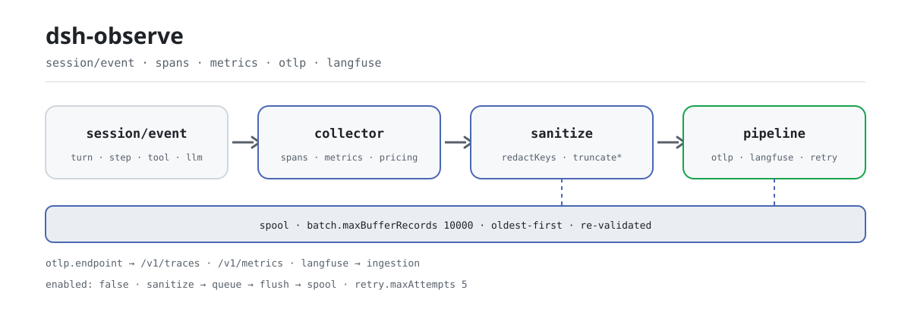

<div align="center">

<picture>
  <source media="(prefers-color-scheme: dark)" srcset="docs/assets/dsh-observe-flow-dark.svg">
  
</picture>

# dsh-observe

**हर सत्र को मानक OTLP ट्रेस और Langfuse अवलोकन में बदलें—बाहर जाने से पहले सैनिटाइज़, डिफ़ॉल्ट रूप से कुछ भी नहीं भेजा जाता।**

DeepSeek Harness के लिए अवलोकनीयता एक्सपोर्टर: turn/step/टूल-कॉल/LLM स्पैन, टोकन और USD लागत मेट्रिक्स, असिंक्रोनस बैचिंग, सीमित ऑफ़लाइन बफ़र और एक्सपोनेंशियल बैकऑफ़ पुनःप्रयास; OTLP, Langfuse या दोनों इस्तेमाल करें।

[इंस्टॉल](#तीन-चरणों-में-शुरुआत) · [कॉन्फ़िगरेशन](#कॉन्फ़िगरेशन) · [FAQ](#faq) · [简体中文](README.md) · [English](README.en.md) · [Español](README.es.md) · [Português](README.pt.md) · [हिन्दी](README.hi.md)

[](LICENSE)
[](#संगतता)
[](https://www.npmjs.com/package/dsh-observe)
[](https://github.com/PerryLink/dsh-observe/actions/workflows/ci.yml)
[](#संगतता)

[](https://github.com/PerryLink/dsh-observe/stargazers)
[](https://www.npmjs.com/package/dsh-observe)
[](https://dshfind.com/plugins/PerryLink/dsh-observe?ref=badge)
[](https://securityscorecards.dev/viewer/?uri=github.com/PerryLink/dsh-observe)
[](https://dsh.market/)
[](https://gitee.com/perrylink/dsh-observe)

```sh
dsh plugin --profile <name> add dsh-observe
```

</div>

<sub>सामुदायिक प्लगइन, DeepSeek से संबद्ध नहीं। एकमात्र रेपो: <https://github.com/PerryLink/dsh-observe> (Gitee एक मिरर है)।</sub>

## यह क्या है

`dsh-observe` हार्नेस की `session/event` धारा को मानक अवलोकनीयता प्रोटोकॉल में अनुवादित करता है: प्रति turn एक ट्रेस, step, टूल-कॉल और LLM जनरेशन के लिए अलग स्पैन, टोकन और लागत के संचयी मेट्रिक्स, और prompt/completion का मुख्य भाग जो कतार में आने से पहले सैनिटाइज़ और छोटा किया जाता है। यह केवल एक्सपोर्ट करता है: कोई मॉडल टूल या उपयोगकर्ता-दृश्य कमांड पंजीकृत नहीं करता, और सारा व्यवहार कॉन्फ़िगरेशन से तय होता है। OTLP या Langfuse कॉन्फ़िगर करें, पुनः आरंभ करें, और डेटा स्वयं बहने लगता है; बिना कॉन्फ़िगरेशन कुछ भी एकत्र नहीं होता।

## तीन चरणों में शुरुआत

1. **इंस्टॉल** (एक चुनें):

   ```sh
   # git चैनल (नवीनतम main; prepare स्क्रिप्ट केवल प्रोडक्शन निर्भरताओं से बिल्ड करती है)
   dsh plugin --profile web add github:PerryLink/dsh-observe
   # npm चैनल (प्रकाशित वर्शन)
   dsh plugin --profile web add dsh-observe
   # tarball चैनल: इस रेपो में pnpm pack के बाद
   dsh plugin --profile web add ./dsh-observe-<version>.tgz
   ```

   > यदि pnpm इस पैकेज के लिए `ERR_PNPM_IGNORED_BUILDS` दिखाए (esbuild के प्लेटफ़ॉर्म-बाइनरी का हानिरहित सत्यापन), तो अपने `pnpm-workspace.yaml` में `allowBuilds: { esbuild: true }` जोड़ें; `dsh` CLI ठीक वही स्निपेट छापती है।

2. **न्यूनतम कॉन्फ़िगरेशन** (profile patch में `enabled` चालू करें और कम से कम एक बैकएंड कॉन्फ़िगर करें; `cordis.patch.yml` में यह पंक्ति बंद हालत में आती है):

   ```yaml
   - insert:
       - id: dsh-observe
         name: dsh-observe
         config:
           enabled: true
           otlp:
             endpoint: http://localhost:4318
   ```

   Langfuse भी इसी तरह: `langfuse.baseUrl` + `langfuse.publicKey` + `langfuse.secretKey`। दोनों बैकएंड एक साथ चालू रह सकते हैं।

3. **जाँचें कि यह चालू है**:

   ```sh
   dsh --profile web --dump-config | grep -A2 'id: dsh-observe'
   ```

   कोई उपयोगकर्ता-दृश्य कमांड पंजीकृत नहीं है, इसलिए `/observe` जैसा कोई मैन्युअल ट्रिगर नहीं है। `remote.enabled: true` के साथ कोई सेटिंग्स पेज `observe/status` से कॉन्फ़िगर किए गए बैकएंड, कतार की गहराई और बफ़र का उपयोग पढ़ सकता है।

**अनइंस्टॉल**: `dsh plugin --profile web remove dsh-observe` (या profile patch से वह पंक्ति हटा दें)।

<details>
<summary>DSH Desktop मार्केट से इंस्टॉल करें</summary>

सभी PerryLink प्लगइन DSH Desktop के अंतर्निहित मार्केट में देखे जा सकते हैं: **मार्केट → स्रोत → स्रोत जोड़ें → चिपकाएँ** `https://perrylink-dsh-catalog.perrylink.workers.dev/catalog-source.json` **→ चुनें**। इंस्टॉल अब भी मार्केट के npm पहचान सत्यापन और आपकी पुष्टि से होता है।

</details>

## मुख्य क्षमताएँ

`dsh-observe` सत्र घटना-धारा को मानक अवलोकनीयता प्रोटोकॉल में बदलता है:

- **Spans** — turn, step, टूल-कॉल (अवधि, स्थिति, पुनःप्रयास व्युत्पत्ति) और LLM जनरेशन स्पैन, नियतात्मक ids के साथ प्रति-turn ट्रेस में जुड़े हुए।
- **Metrics** — प्रति provider/model टोकन काउंटर, USD लागत काउंटर (कॉन्फ़िगर करने योग्य मूल्य तालिका), और `ctx.tokenMeter` से वैकल्पिक संदर्भ-दबाव gauge।
- **सैनिटाइज़्ड कैप्चर** — prompt और completion का मुख्य भाग संरचनात्मक कुंजी-नाम रिडैक्शन, अंतर्निहित सीक्रेट पैटर्न, आपके पैटर्न और अक्षर बजट से गुज़रने के बाद ही कतार में आता है या भेजा जाता है।
- **विश्वसनीयता** — असिंक्रोनस बैचिंग (आकार और टाइमर दोनों से), सीमित टिकाऊ ऑफ़लाइन बफ़र (storage-domain, सबसे पुराना पहले निकलता है) और नियतात्मक एक्सपोनेंशियल बैकऑफ़ पुनःप्रयास; न पहुँचे बैच पुनः आरंभ के बाद भी बचे रहते हैं।
- **रनटाइम किल स्विच** — वैकल्पिक Typert remote (`observe/status`, `observe/setEnabled`) से सेटिंग्स पेज प्लगइन हटाए बिना एक्सपोर्ट रोक और फिर शुरू कर सकता है।
- **डिफ़ॉल्ट रूप से बंद** — `enabled: true` और कम से कम एक बैकएंड ही स्पष्ट ऑप्ट-इन है; अन्यथा कुछ भी एकत्र या एक्सपोर्ट नहीं होता।

```text
session/event धारा
   │ collector (turn/step/tool/llm स्पैन, मेट्रिक्स)
   │ sanitize (कुंजियाँ, सीक्रेट, बजट)
   ├──▶ pipeline "otlp"  ── कतार ── flush ──▶ OTLP /v1/traces + /v1/metrics
   │         └─ पुनःप्रयास/बैकऑफ़ ─┐
   ├──▶ pipeline "langfuse" ── कतार ── flush ──▶ Langfuse ingestion
   │         └─ पुनःप्रयास/बैकऑफ़ ─┤
   └────────── टिकाऊ spool (ऑफ़लाइन बफ़र, सीमित) ◀┘
```

### सतहें

यह प्लगइन **कोई मॉडल टूल पंजीकृत नहीं करता** और कोई उपयोगकर्ता-दृश्य कमांड भी नहीं — यह पृष्ठभूमि एक्सपोर्टर है। इसकी पूरी सतह तीन चीज़ें हैं:

- **उपभोग** `session/event` (स्पैन/मेट्रिक संग्रह), `session/flush` (सर्वोत्तम-प्रयास एक्सपोर्ट किक — टिकाऊता चेकपॉइंट रिमोट बैकएंड की प्रतीक्षा कभी नहीं करता) और `session/disposed`।
- **वैकल्पिक remote सेवा** `observe` (`remote.enabled`, डिफ़ॉल्ट रूप से बंद) — `observe/status` किल-स्विच स्थिति, कॉन्फ़िगर किए गए बैकएंड, कतार की गहराई और बफ़र उपयोग लौटाता है; `observe/setEnabled` रनटाइम पर एक्सपोर्ट रोकता और शुरू करता है।
- **एकमात्र इंजेक्ट की गई सेवा कुंजी** `storageDomain`, जो ऑफ़लाइन बफ़र की टिकाऊ तालिका के लिए है।

### उदाहरण

कोई मैन्युअल ट्रिगर नहीं है: इंस्टॉल के बाद ऊपर दिए न्यूनतम कॉन्फ़िगरेशन से `enabled` चालू करें और पुनः आरंभ करें; ट्रेस और मेट्रिक्स OTLP बैकएंड में दिखने लगते हैं और अवलोकन Langfuse में। यह पुष्टि करने के लिए कि संग्रह हो रहा है, बैकएंड को मिला पहला ट्रेस देखें; यह पुष्टि करने के लिए कि भेजा जा रहा है, देखें कि `observe/status` की कतार-गहराई सत्र बढ़ने के साथ घटती है।

## कॉन्फ़िगरेशन

सभी ट्यूनेबल Schemastery `Config` फ़ील्ड हैं (cordis.yml या profile patch से बदले जा सकते हैं)। id-लक्षित ओवरराइड पूरी पंक्ति बदल देता है — ज़रूरत की हर कुंजी दोबारा लिखें। [`cordis.patch.yml`](cordis.patch.yml) हर कुंजी को इनलाइन समझाता है।

सबसे अधिक इस्तेमाल होने वाली कुंजियाँ:

| कुंजी | डिफ़ॉल्ट | अर्थ |
|---|---|---|
| `enabled` | `false` | मुख्य स्विच; `true` और कम से कम एक बैकएंड ही स्पष्ट ऑप्ट-इन है |
| `otlp.endpoint` | *(आवश्यक)* | OTLP आधार URL; प्लगइन `/v1/traces` और `/v1/metrics` जोड़ता है |
| `otlp.serviceName` | `deepseek-harness` | `service.name` संसाधन विशेषता |
| `langfuse.baseUrl` | `https://cloud.langfuse.com` | Langfuse आधार URL |
| `langfuse.traceName` | `session {session} turn {turn}` | ट्रेस-नाम टेम्पलेट; `{session}`/`{turn}` प्रति ट्रेस प्रतिस्थापित होते हैं |
| `capture.llm` | `true` | LLM जनरेशन स्पैन |
| `llm.prompt` | `true` | सैनिटाइज़ किया गया अनुरोध prompt कैप्चर करें (`false` = केवल आकार) |
| `batch.maxBufferRecords` | `10000` | टिकाऊ ऑफ़लाइन बफ़र की सीमा; सबसे पुराने रिकॉर्ड पहले गिरते हैं |
| `remote.enabled` | `false` | `observe` Typert remote माउंट करें (रनटाइम किल स्विच) |

<details>
<summary>पूरी कॉन्फ़िगरेशन तालिका (47 कुंजियाँ)</summary>

| कुंजी | डिफ़ॉल्ट | अर्थ |
|---|---|---|
| `enabled` | `false` | मुख्य स्विच; `true` और कम से कम एक बैकएंड ही स्पष्ट ऑप्ट-इन है |
| `otlp` | `null` | OTLP बैकएंड कॉन्फ़िगरेशन; `null` इसे बंद करता है |
| `otlp.endpoint` | *(आवश्यक)* | OTLP आधार URL; प्लगइन `/v1/traces` और `/v1/metrics` जोड़ता है |
| `otlp.serviceName` | `deepseek-harness` | `service.name` संसाधन विशेषता |
| `otlp.serviceVersion` | *(कोई नहीं)* | `service.version` संसाधन विशेषता |
| `otlp.headers` | `{}` | हर एक्सपोर्ट अनुरोध में जुड़ने वाले अतिरिक्त हेडर |
| `otlp.timeoutMs` | `10000` | प्रति अनुरोध टाइमआउट |
| `langfuse` | `null` | Langfuse बैकएंड कॉन्फ़िगरेशन; `null` इसे बंद करता है |
| `langfuse.baseUrl` | `https://cloud.langfuse.com` | Langfuse आधार URL |
| `langfuse.publicKey` | *(आवश्यक)* | प्रोजेक्ट सार्वजनिक कुंजी |
| `langfuse.secretKey` | *(आवश्यक)* | प्रोजेक्ट गुप्त कुंजी |
| `langfuse.release` | *(कोई नहीं)* | ट्रेस पर लगने वाला रिलीज़ टैग |
| `langfuse.traceName` | `session {session} turn {turn}` | ट्रेस-नाम टेम्पलेट; `{session}`/`{turn}` प्रति ट्रेस प्रतिस्थापित होते हैं |
| `langfuse.tags` | `[]` | हर ट्रेस पर लगने वाले स्थिर टैग |
| `langfuse.timeoutMs` | `10000` | प्रति अनुरोध टाइमआउट |
| `capture.turns` | `true` | turn जीवनचक्र स्पैन |
| `capture.steps` | `true` | step जीवनचक्र स्पैन |
| `capture.tools` | `true` | सैनिटाइज़ किए गए आर्ग्युमेंट/परिणाम के साथ टूल-कॉल स्पैन |
| `capture.llm` | `true` | LLM जनरेशन स्पैन |
| `llm.prompt` | `true` | सैनिटाइज़ किया गया अनुरोध prompt कैप्चर करें (`false` = केवल आकार) |
| `llm.completion` | `true` | सैनिटाइज़ की गई completion कैप्चर करें (`false` = केवल आकार) |
| `metadata.sessionId` | `true` | सत्र id विशेषता |
| `metadata.cwd` | `false` | सत्र कार्य निर्देशिका (एक स्थानीय पथ — डिफ़ॉल्ट रूप से बंद) |
| `metadata.agentPreset` | `true` | agent preset id विशेषता |
| `metadata.model` | `true` | provider/model विशेषताएँ |
| `metrics.tokens` | `true` | प्रति provider/model टोकन काउंटर |
| `metrics.cost` | `true` | USD लागत काउंटर (मेल खाते `pricing` नियम चाहिए) |
| `metrics.contextTokens` | `true` | संदर्भ-दबाव gauge (`ctx.tokenMeter` चाहिए) |
| `pricing` | `[]` | मूल्य तालिका, पहला मेल जीतता है: `{ provider?, model, inputPerToken, outputPerToken, cacheReadPerToken?, cacheWritePerToken? }` |
| `sanitize.enabled` | `true` | रिडैक्शन मुख्य स्विच (`false` रिडैक्शन बंद करता है, ट्रंकेशन कभी नहीं) |
| `sanitize.redactKeys` | `[]` | अतिरिक्त कुंजी-नाम उपस्ट्रिंग (key/token/secret/password/authorization/credential/apiKey सदैव शामिल) |
| `sanitize.redactPatterns` | `[]` | अतिरिक्त सीक्रेट रेगुलर एक्सप्रेशन |
| `sanitize.truncatePromptChars` | `4000` | prompt अक्षर बजट |
| `sanitize.truncateCompletionChars` | `4000` | completion अक्षर बजट |
| `sanitize.truncateToolInputChars` | `2000` | टूल आर्ग्युमेंट अक्षर बजट |
| `sanitize.truncateToolOutputChars` | `2000` | टूल परिणाम अक्षर बजट |
| `sanitize.truncateAttributeChars` | `512` | स्पैन विशेषता स्ट्रिंग बजट |
| `batch.maxRecords` | `256` | कतार में इतने रिकॉर्ड होते ही flush |
| `batch.flushIntervalMs` | `5000` | टाइमर flush अंतराल |
| `batch.maxQueueRecords` | `2000` | मेमोरी कतार की सीमा; अधिक बफ़र में बह जाता है |
| `batch.maxBufferRecords` | `10000` | टिकाऊ ऑफ़लाइन बफ़र की सीमा; सबसे पुराने रिकॉर्ड पहले गिरते हैं |
| `batch.bufferRetryIntervalMs` | `30000` | ऑफ़लाइन बफ़र पुनःप्रयास अंतराल |
| `retry.maxAttempts` | `5` | प्रति बैच प्रयास, पहला भी शामिल |
| `retry.baseDelayMs` | `1000` | पहला बैकऑफ़ विलंब |
| `retry.factor` | `2` | प्रति लगातार विफलता बैकऑफ़ गुणक |
| `retry.maxDelayMs` | `60000` | बैकऑफ़ की ऊपरी सीमा |
| `remote.enabled` | `false` | `observe` Typert remote माउंट करें (रनटाइम किल स्विच) |

</details>

id-लक्षित ओवरराइड का उदाहरण (पूरी पंक्ति बदलती है, इसलिए ज़रूरत की कुंजियाँ दोबारा लिखें):

```yaml
- insert:
    - id: dsh-observe
      name: dsh-observe
      config:
        enabled: true
        otlp:
          endpoint: http://localhost:4318
        capture:
          tools: false
        sanitize:
          truncatePromptChars: 2000
        batch:
          maxBufferRecords: 20000
```

## FAQ

<details>
<summary>क्या prompt या टूल आर्ग्युमेंट कच्चे रूप में बैकएंड तक पहुँचते हैं?</summary>

कच्चे रूप में नहीं। हर रिकॉर्ड कतार में आने से पहले तीन परतों में सैनिटाइज़ होता है: संरचनात्मक कुंजी-नाम (key/token/secret/password/authorization/credential/apiKey सदैव सूची में हैं और `sanitize.redactKeys` उपस्ट्रिंग जोड़ता है), अंतर्निहित सीक्रेट पैटर्न (API कुंजियाँ, GitHub टोकन, AWS कुंजियाँ, bearer क्रेडेंशियल, निजी कुंजियाँ) और आपके `sanitize.redactPatterns`, तथा अक्षर-बजट ट्रंकेशन (prompt/completion प्रत्येक 4000, टूल आर्ग्युमेंट और परिणाम प्रत्येक 2000, स्पैन विशेषता 512)। यदि केवल आकार चाहिए, मुख्य भाग नहीं, तो `llm.prompt` और `llm.completion` को `false` कर दें — रिकॉर्ड में केवल आकार और गणना रहेगी।

</details>

<details>
<summary>बैकएंड बंद हो या नेटवर्क टूटे तो डेटा खोएगा?</summary>

स्पैन और मेट्रिक्स "पुनःप्रयास → बहाव" श्रृंखला से चलते हैं: विफल बैच को नियतात्मक एक्सपोनेंशियल बैकऑफ़ से दोहराया जाता है (`retry.maxAttempts` डिफ़ॉल्ट 5, `retry.baseDelayMs × retry.factor`), और प्रयास समाप्त होने या मेमोरी कतार `batch.maxQueueRecords` पार करने पर वह सीमित टिकाऊ spool में बह जाता है (`batch.maxBufferRecords` डिफ़ॉल्ट 10000, सबसे पुराना पहले), जो `batch.bufferRetryIntervalMs` पर समय-समय पर खाली होता है — इसलिए न पहुँचे बैच पुनः आरंभ के बाद भी रहते हैं। OTLP मेट्रिक्स अपवाद हैं: वे संचयी रूप से एकत्र होते हैं और खोया हुआ एक flush अगले में स्वयं भर जाता है।

</details>

<details>
<summary>प्लगइन स्वयं क्या रखता है और क्रेडेंशियल कहाँ रहते हैं?</summary>

ऑफ़लाइन बफ़र में केवल सैनिटाइज़ किए गए रिकॉर्ड रहते हैं, और स्टोरेज से पढ़े गए रिकॉर्ड sink तक पहुँचने से पहले फिर से सत्यापित होते हैं। प्लगइन स्वयं कोई क्रेडेंशियल नहीं रखता: Langfuse की सार्वजनिक/गुप्त कुंजियाँ केवल आपके कॉन्फ़िगर किए Langfuse एंडपॉइंट के अनुरोधों में जाती हैं, और OTLP हेडर केवल आपके OTLP एंडपॉइंट पर — इन्हें क्रेडेंशियल संदर्भ या एनवायरनमेंट-इंजेक्टेड मानों में रखें, कभी कमिट किए गए profile patch में नहीं। यह केवल लाइव घटना-धारा पढ़ता है और सत्र लॉग फ़ाइलें कभी नहीं पढ़ता या बदलता।

</details>

<details>
<summary>क्या यह सत्र धीमा करता है?</summary>

संग्रह और सैनिटाइज़ेशन घटना हैंडलर में सिंक्रोनस रूप से चलते हैं, पर भेजना पूरी तरह असिंक्रोनस है: कतार आकार या टाइमर पर खाली होती है, और `session/flush` केवल एक सर्वोत्तम-प्रयास किक है — टिकाऊता चेकपॉइंट रिमोट बैकएंड की प्रतीक्षा कभी नहीं करता। एक्सपोर्ट विफलताएँ चेतावनी देती हैं, गिनी जाती हैं (`observe.export_failures`), दोहराई जाती हैं और अंत में spool में जाती हैं; `session/event` हैंडलर की विफलता पकड़ी और लॉग की जाती है, इसलिए अवलोकनीयता हार्नेस के हॉट पाथ को कभी नहीं तोड़ सकती।

</details>

<details>
<summary>क्या यह दूसरे प्लगइनों से सेवा, घटना या slot के लिए टकराता है?</summary>

यह एक सेवा कुंजी (`storageDomain`) इंजेक्ट करता है, तीन `session/*` घटनाएँ सुनता है, और कोई मॉडल टूल, कमांड, client slot, waterfall listener या वैश्विक रीराइट पंजीकृत नहीं करता। नाम की एकमात्र सतह वैकल्पिक remote सेवा `observe` है (`remote.enabled` डिफ़ॉल्ट रूप से बंद): यदि उसी profile में कोई दूसरा प्लगइन यह नाम ले ले, तो दोनों में से केवल एक चालू रखें।

</details>

## सुरक्षा सीमाएँ

- **डिफ़ॉल्ट रूप से बंद** — जब तक आप स्पष्ट रूप से चालू न करें (`enabled: true` और कम से कम एक बैकएंड), कुछ भी एकत्र या एक्सपोर्ट नहीं होता।
- **भेजने से पहले सैनिटाइज़** — संरचनात्मक कुंजी रिडैक्शन, अंतर्निहित सीक्रेट पैटर्न (API कुंजियाँ, GitHub टोकन, AWS कुंजियाँ, bearer क्रेडेंशियल, निजी कुंजियाँ), आपके पैटर्न और अक्षर बजट — सब कुछ किसी भी रिकॉर्ड के मेमोरी छोड़ने से पहले लागू होता है।
- **टिकाऊ सीमा पर पुनःसत्यापन** — स्टोरेज से पढ़े गए रिकॉर्ड sink तक पहुँचने से पहले फिर जाँचे जाते हैं।
- **विफलता मुखर, विफलता सीमित** — एक्सपोर्ट विफलताएँ चेतावनी देती हैं, गिनी जाती हैं, दोहराई जाती हैं और अंत में spool में जाती हैं; सत्र हैंडलर की विफलता पकड़ी और लॉग की जाती है ताकि अवलोकनीयता हार्नेस का हॉट पाथ कभी न तोड़े।
- **मॉडल को दृश्य ⟺ लॉग में दर्ज** — prompt/completion एक्सपोर्ट केवल सत्र सतह (जिसका नोड 0 system prompt है) और लॉग किया गया header (कॉल कॉन्फ़िगरेशन और टूल) प्रक्षेपित करते हैं; एक्सपोर्टर कोई सामग्री नहीं गढ़ता।

## अनुमतियाँ और डेटा

- **अनुमतियाँ**: आपके कॉन्फ़िगर किए एंडपॉइंट तक `network:outbound`, घटना-धारा के लिए `session:read`, ऑफ़लाइन बफ़र के लिए `storage:write`; कोई नेटिव कोड नहीं, कोई फ़ाइलसिस्टम पहुँच नहीं।
- **डेटा**: भेजी जाने वाली हर चीज़ सत्र लॉग से व्युत्पन्न है और कतार, बफ़र या प्रसारण से पहले सैनिटाइज़ (रिडैक्शन + ट्रंकेशन) होती है। ऑफ़लाइन बफ़र केवल सैनिटाइज़ किए गए रिकॉर्ड रखता है, जो पढ़ते समय फिर सत्यापित होते हैं।
- **क्रेडेंशियल**: Langfuse की सार्वजनिक/गुप्त कुंजियाँ केवल कॉन्फ़िगर किए Langfuse एंडपॉइंट तक जाती हैं; OTLP हेडर केवल कॉन्फ़िगर किए OTLP एंडपॉइंट तक। प्लगइन स्वयं कोई क्रेडेंशियल संग्रहीत नहीं करता — क्रेडेंशियल संदर्भ या एनवायरनमेंट-इंजेक्टेड मान इस्तेमाल करें।

## ज्ञात सीमाएँ

- **आधार `0.2.2-rc.1`** — प्लगइन `@deepseek-ai/dsh@0.2.2-rc.1` के विरुद्ध विकसित और परीक्षित है (devDependencies और CI की मुख्य पैमाना); `engines.dsh` (`>=0.2.1-0 <0.3.0 || >=0.2.2-0 <0.3.0`) और समग्र peer श्रेणी हर प्रकाशित लाइन को इंस्टॉल-योग्य रखती है, और पुराने आधार दूसरे पैमाने (`typecheck:ci`) तथा compat वर्कफ़्लो से कवर होते हैं।
- **ऑडिट घटनाएँ स्थायी नहीं होतीं** — एक्सपोर्टर के अपने `observe/*` रिकॉर्ड केवल ऑडिट हैं: मौजूदा होस्ट लाइन पर सत्र append गेट केवल सरफ़ेस घटनाएँ स्वीकार करता है, इसलिए कोई `observe/*` घटना सत्र लॉग में नहीं लिखी जाती, और प्लगइन बिना-चिह्न append से नकली घटना नहीं बनाता (इससे सत्र अपठनीय हो जाते)। ऑडिट सतह के लिए `observe/status` आउटपुट (जिसके लिए `remote.enabled: true` चाहिए) और OTLP/Langfuse बैकएंड देखें।
- **मेट्रिक्स पुनःप्रयास/spool पथ से बाहर हैं** — OTLP मेट्रिक्स संचयी रूप से एकत्र होते हैं, इसलिए खोया हुआ flush अगले में स्वयं भर जाता है (यह डिज़ाइन है, बग नहीं)।
- **कोई सैंपलिंग नहीं** — हर सक्षम स्पैन परिवार एक्सपोर्ट होता है; अधिक भार वाले सत्रों के लिए `capture.*` स्विच और `batch.maxBufferRecords` समायोजित करें।

## अन्य DSH प्लगइनों के साथ इंटरऑपरेबिलिटी

प्लगइन की पंजीकरण सतह जानबूझकर संकीर्ण है, इसलिए टकराव संरचनात्मक रूप से असंभाव्य हैं:

- **कोई टूल-नाम टकराव नहीं** — कोई मॉडल टूल पंजीकृत नहीं करता (न README में न `src/index.ts` में टूल पंजीकरण है)।
- **कोई कमांड-नाम टकराव नहीं** — कोई उपयोगकर्ता-दृश्य कमांड पंजीकृत नहीं करता, इसलिए स्लैश-कमांड नेमस्पेस को कभी नहीं छूता।
- **कोई client slot टकराव नहीं** — पैकेज में ब्राउज़र-आधा नहीं है (कोई `client/` निर्देशिका नहीं), इसलिए कोई client slot पंजीकृत नहीं होता।
- **कोई waterfall शॉर्ट-सर्किट नहीं** — केवल `session/event`, `session/flush` और `session/disposed` पढ़ता है; किसी allow/passthrough waterfall को नहीं सुनता, इसलिए किसी का निर्णय नहीं रोक सकता।
- **इसकी एकमात्र सेवा कुंजी** — `storageDomain` (इंजेक्ट, प्रदान नहीं); साथ में एक **वैकल्पिक** remote सेवा `observe`, जो केवल `remote.enabled: true` पर पंजीकृत होती है।
- **बाहरी ट्रैफ़िक केवल आपके एंडपॉइंट तक** — OTLP और Langfuse स्वतंत्र हैं; एक बंद करने से दूसरा प्रभावित नहीं होता।

यदि उसी profile में कोई दूसरा अवलोकनीयता प्लगइन है, तो दो बातें ध्यान में रखें: दोनों `session/event` उपभोग करते हैं (Cordis प्रसारण करता है, इसलिए कोई किसी को भूखा नहीं मारता) पर आपको दो ट्रेस सेट मिलेंगे, और `observe` remote सेवा नाम दो बार पंजीकृत न करें।

## संगतता

| आयाम | स्थिति |
|---|---|
| Harness | DeepSeek Harness `dsh-v0.2.1-alpha.1` (2026-10-04 को अनुकूलित): सत्र प्रारूप V4 टूल परिणाम को प्रथम-श्रेणी `role: 'tool'` संदेश के रूप में दर्शाता है जिसमें शीर्ष स्तर पर `toolCallId` + `content` + वैकल्पिक `isError` होता है — V3 का `tool-result` कंटेंट ब्लॉक होस्ट के `ContentBlockMap` से हट चुका है, और यह प्लगइन केवल V4 आकार पढ़ता है (अपग्रेड-पूर्व V3 लॉग अब भी केवल-पढ़ने योग्य संगतता पथ से प्रक्षेपित होता है)। V3 प्रारूप के बाकी लक्षण जारी हैं: असिस्टेंट स्ट्रीम `assistant/message` / `assistant/attempt` में अंतर्निहित है, और system prompt सतह का नोड 0 (`system/message`) है; प्लगइन केवल लाइव घटना-धारा उपभोग करता है और सत्र लॉग फ़ाइलें कभी नहीं पढ़ता। `engines.dsh` है `>=0.2.1-0 <0.3.0 \|\| >=0.2.2-0 <0.3.0`; profile इंस्टॉल स्मोक compat वर्कफ़्लो से कवर है। |
| Node | `^22.19.0 \|\| >=24.9.0`, शुद्ध ESM (`"type": "module"`) |
| बैकएंड | OpenTelemetry OTLP/HTTP (ट्रेस + मेट्रिक्स, JSON एन्कोडिंग) और Langfuse (LLM अवलोकनीयता) — एक या दोनों |
| मॉडल | मॉडल-निरपेक्ष: यह session/event धारा एक्सपोर्ट करता है; कोई मॉडल कॉल नहीं करता |

peer निर्भरताएँ: `@deepseek-ai/cordis ^4.0.5-alpha.1`, `@deepseek-ai/schemastery ^3.18.5`, और `@deepseek-ai/dsh-llm`, `@deepseek-ai/dsh-session`, `@deepseek-ai/dsh-storage`, `@deepseek-ai/dsh-storage-domain`, `@deepseek-ai/dsh-storage-json`, `@deepseek-ai/dsh-typert-protocol` (`>=0.1.2-rc.1 <0.2.0 || >=0.1.5-alpha.1 <0.2.0 || >=0.1.6-0 <0.2.0 || >=0.1.7-0 <0.2.0 || >=0.2.0-0 <0.3.0 || >=0.2.1-0 <0.3.0 || >=0.2.2-0 <0.3.0`; devDependencies `0.2.2-rc.1` पर पिन)। `zod` एकमात्र रनटाइम निर्भरता है, जो ऑफ़लाइन बफ़र की टिकाऊ-सीमा सत्यापन के लिए है।

## इकोसिस्टम और गुणवत्ता

- [Gitee मिरर](https://gitee.com/perrylink/dsh-observe) (समन्वित मिरर; GitHub आधिकारिक स्रोत है)
- [dshfind प्लगइन पेज](https://dshfind.com/plugins/PerryLink/dsh-observe) (इंस्टॉल और रैंकिंग)
- [OpenSSF Scorecard रिपोर्ट](https://securityscorecards.dev/viewer/?uri=github.com/PerryLink/dsh-observe) ([.github/workflows/scorecard.yml](.github/workflows/scorecard.yml) द्वारा संचालित)
- [dsh-plugin-doctor सत्यापन रिपोर्ट](https://github.com/PerryLink/dsh-plugin-doctor#verified-徽章)
- [DSH Market](https://dsh.market/) (सूचीबद्ध)
- **1024 स्टोर चैनल**: एक बार `npm i -g dsh1024`, फिर `dsh1024 plugin --profile web add dsh-observe` ([deepseek1024.com](https://deepseek1024.com) इंस्टॉल रैंकिंग में गिना जाता है)
- [इकोसिस्टम नॉलेज बेस](https://perrylink.github.io/dsh-plugin-guide/): प्लगइन डेवलपमेंट गाइड · चयन डेटा · रखरखाव मानदंड

## डेवलपमेंट

```sh
pnpm install               # node ^22.19 || >=24.9
pnpm run typecheck         # tsc: src + tests, 0.2.2-rc.1 devDeps के विरुद्ध (कोई tsconfig paths नहीं)
pnpm run typecheck:ci      # tsc: प्रकाशित लाइन के विरुद्ध (कोई paths नहीं)
pnpm run check:ruler-live  # canary: कंपाइल विफल होना चाहिए, जो साबित करता है कि पैमाना जीवित है (checkout फ़ेस चाहिए)
pnpm test                  # vitest: 126 टेस्ट, 18 सुइट (असली Context/Session/storage सीम)
pnpm run test:coverage     # कवरेज गेट (90/80/90/90)
pnpm run build             # tsdown बंडल + tsc डिक्लेरेशन (lib/)
pnpm run verify:self-contained  # निर्भरता स्पेक registry से हल होते हैं
pnpm run verify:artifacts       # बिल्ट ESM फ़ेस + बंडल पैच मौजूद
node scripts/check-readme-sync.mjs  # पाँच-भाषा README सिंक गेट
pnpm pack                  # प्रकाशित tarball
```

README की छवियाँ [`scripts/gen-readme-assets.py`](scripts/gen-readme-assets.py) से बनती हैं (Python + Pillow टूलचेन); यह `docs/assets/dsh-observe-flow-{light,dark}.svg` जोड़ी लिखती है और idempotent है। पुराने एक-थीम `docs/assets/dsh-observe-flow.svg`, `dsh-observe-hero.png` और `dsh-observe-demo.{png,gif}` बाहरी लिंक के 404 से बचने के लिए वहीं रखे गए हैं; README अब उन्हें संदर्भित नहीं करते।

Topics: `dsh`, `dsh-plugin`, `deepseek-harness`, `deepseek`, `cordis`, `observability`, `opentelemetry`, `otlp`, `langfuse`, `tracing`

## परिवार और आभार

यह प्रोजेक्ट [PerryLink](https://github.com/PerryLink) द्वारा अनुरक्षित DeepSeek Harness प्लगइन परिवार का हिस्सा है (सभी Apache-2.0)। अगर यह प्लगइन उपयोगी लगे, तो **एक स्टार दें** — इससे कोई सुविधा अनलॉक नहीं होती, पर अगला व्यक्ति इसे जल्दी पा लेता है।

- [@PerryLink](https://github.com/PerryLink) — निर्माता और अनुरक्षक: collector, pipelines, spool, OTLP/Langfuse sinks, सैनिटाइज़ेशन तथा पाँच-भाषा दस्तावेज़।

<details>
<summary>सभी प्लगइन खोलें</summary>

| प्लगइन | स्थिति |
|---|---|
| **[dsh-aqua-input-check](https://github.com/PerryLink/dsh-aqua-input-check)** |  |
| **[dsh-archive-check](https://github.com/PerryLink/dsh-archive-check)** |  |
| **[dsh-auto-review](https://github.com/PerryLink/dsh-auto-review)** |  |
| **[dsh-autotier](https://github.com/PerryLink/dsh-autotier)** | 🧊 फ़्रोज़न — रेपो README देखें |
| **[dsh-bid-ca-precheck](https://github.com/PerryLink/dsh-bid-ca-precheck)** |  |
| **[dsh-bid-qual-check](https://github.com/PerryLink/dsh-bid-qual-check)** |  |
| **[dsh-cert-mcp](https://github.com/PerryLink/dsh-cert-mcp)** | 🧊 फ़्रोज़न — रेपो README देखें |
| **[dsh-checkpoint-rewind](https://github.com/PerryLink/dsh-checkpoint-rewind)** |  |
| **[dsh-click](https://github.com/PerryLink/dsh-click)** |  |
| **[dsh-composer-history](https://github.com/PerryLink/dsh-composer-history)** |  |
| **[dsh-contract-stance](https://github.com/PerryLink/dsh-contract-stance)** |  |
| **[dsh-customs-doc-check](https://github.com/PerryLink/dsh-customs-doc-check)** |  |
| **[dsh-data-quality](https://github.com/PerryLink/dsh-data-quality)** | 🧊 फ़्रोज़न — रेपो README देखें |
| **[dsh-demurrage-ledger](https://github.com/PerryLink/dsh-demurrage-ledger)** |  |
| **[dsh-doublecheck](https://github.com/PerryLink/dsh-doublecheck)** |  |
| **[dsh-drill-script-check](https://github.com/PerryLink/dsh-drill-script-check)** |  |
| **[dsh-eia-guide-check](https://github.com/PerryLink/dsh-eia-guide-check)** |  |
| **[dsh-emergency-plan](https://github.com/PerryLink/dsh-emergency-plan)** |  |
| **[dsh-essay-rubric-check](https://github.com/PerryLink/dsh-essay-rubric-check)** |  |
| **[dsh-evidence-check](https://github.com/PerryLink/dsh-evidence-check)** |  |
| **[dsh-export-ctl-check](https://github.com/PerryLink/dsh-export-ctl-check)** |  |
| **[dsh-fast](https://github.com/PerryLink/dsh-fast)** |  |
| **[dsh-fmea-table-check](https://github.com/PerryLink/dsh-fmea-table-check)** |  |
| **[dsh-forecast-penalty](https://github.com/PerryLink/dsh-forecast-penalty)** |  |
| **[dsh-fund-research](https://github.com/PerryLink/dsh-fund-research)** |  |
| **[dsh-github](https://github.com/PerryLink/dsh-github)** |  |
| **[dsh-gongwen-flow-check](https://github.com/PerryLink/dsh-gongwen-flow-check)** |  |
| **[dsh-gongwen-word-check](https://github.com/PerryLink/dsh-gongwen-word-check)** |  |
| **[dsh-guard-plan-qc](https://github.com/PerryLink/dsh-guard-plan-qc)** |  |
| **[dsh-hazchem-check](https://github.com/PerryLink/dsh-hazchem-check)** |  |
| **[dsh-hazplan-check](https://github.com/PerryLink/dsh-hazplan-check)** |  |
| **[dsh-hidden-risk-map](https://github.com/PerryLink/dsh-hidden-risk-map)** |  |
| **[dsh-hs-classify](https://github.com/PerryLink/dsh-hs-classify)** |  |
| **[dsh-icd-rule-check](https://github.com/PerryLink/dsh-icd-rule-check)** |  |
| **[dsh-industry-research](https://github.com/PerryLink/dsh-industry-research)** |  |
| **[dsh-lawcite-adapter](https://github.com/PerryLink/dsh-lawcite-adapter)** |  |
| **[dsh-laya](https://github.com/PerryLink/dsh-laya)** |  |
| **[dsh-lc-doc-check](https://github.com/PerryLink/dsh-lc-doc-check)** |  |
| **[dsh-learning-gap-check](https://github.com/PerryLink/dsh-learning-gap-check)** |  |
| **[dsh-library](https://github.com/PerryLink/dsh-library)** |  |
| **[dsh-local-ai](https://github.com/PerryLink/dsh-local-ai)** |  |
| **[dsh-lsp-actions](https://github.com/PerryLink/dsh-lsp-actions)** |  |
| **[dsh-mask](https://github.com/PerryLink/dsh-mask)** |  |
| **[dsh-mcp-panel](https://github.com/PerryLink/dsh-mcp-panel)** |  |
| **[dsh-medrec-qc](https://github.com/PerryLink/dsh-medrec-qc)** |  |
| **[dsh-memento](https://github.com/PerryLink/dsh-memento)** | 🧊 फ़्रोज़न — रेपो README देखें |
| **[dsh-nsfc-form-check](https://github.com/PerryLink/dsh-nsfc-form-check)** |  |
| **[dsh-nurse-record-check](https://github.com/PerryLink/dsh-nurse-record-check)** |  |
| **[dsh-observe](https://github.com/PerryLink/dsh-observe)** |  |
| **[dsh-origin-rvc-check](https://github.com/PerryLink/dsh-origin-rvc-check)** |  |
| **[dsh-ota-review-check](https://github.com/PerryLink/dsh-ota-review-check)** |  |
| **[dsh-output-styles](https://github.com/PerryLink/dsh-output-styles)** |  |
| **[dsh-paper-doc-adapter](https://github.com/PerryLink/dsh-paper-doc-adapter)** |  |
| **[dsh-permission-rules](https://github.com/PerryLink/dsh-permission-rules)** |  |
| **[dsh-permit-report-check](https://github.com/PerryLink/dsh-permit-report-check)** |  |
| **[dsh-pipeline-check](https://github.com/PerryLink/dsh-pipeline-check)** |  |
| **[dsh-pleading-draft](https://github.com/PerryLink/dsh-pleading-draft)** |  |
| **[dsh-plugin-doctor](https://github.com/PerryLink/dsh-plugin-doctor)** | 🚫 रिटायर्ड (रेपो संग्रहीत) |
| **[dsh-plugin-guide](https://github.com/PerryLink/dsh-plugin-guide)** |  |
| **[dsh-plugin-kit](https://github.com/PerryLink/dsh-plugin-kit)** | 🚫 रिटायर्ड (रेपो संग्रहीत) |
| **[dsh-plugin-upgrade](https://github.com/PerryLink/dsh-plugin-upgrade)** | 🚫 रिटायर्ड (रेपो संग्रहीत) |
| **[dsh-policy-brief-draft](https://github.com/PerryLink/dsh-policy-brief-draft)** |  |
| **[dsh-power-loss-split](https://github.com/PerryLink/dsh-power-loss-split)** |  |
| **[dsh-power-ticket-check](https://github.com/PerryLink/dsh-power-ticket-check)** |  |
| **[dsh-ppap-check](https://github.com/PerryLink/dsh-ppap-check)** |  |
| **[dsh-protest-deadline](https://github.com/PerryLink/dsh-protest-deadline)** |  |
| **[dsh-railway-window](https://github.com/PerryLink/dsh-railway-window)** |  |
| **[dsh-repair-order-qc](https://github.com/PerryLink/dsh-repair-order-qc)** |  |
| **[dsh-research-report](https://github.com/PerryLink/dsh-research-report)** |  |
| **[dsh-review-reply-check](https://github.com/PerryLink/dsh-review-reply-check)** |  |
| **[dsh-rulefile-check](https://github.com/PerryLink/dsh-rulefile-check)** |  |
| **[dsh-safety-brief-check](https://github.com/PerryLink/dsh-safety-brief-check)** |  |
| **[dsh-score](https://github.com/PerryLink/dsh-score)** | 🧊 फ़्रोज़न — रेपो README देखें |
| **[dsh-session-sync](https://github.com/PerryLink/dsh-session-sync)** |  |
| **[dsh-site-log-check](https://github.com/PerryLink/dsh-site-log-check)** |  |
| **[dsh-skill-pack-security](https://github.com/PerryLink/dsh-skill-pack-security)** |  |
| **[dsh-soe-decision-check](https://github.com/PerryLink/dsh-soe-decision-check)** |  |
| **[dsh-soilwater-check](https://github.com/PerryLink/dsh-soilwater-check)** |  |
| **[dsh-sop-sync-check](https://github.com/PerryLink/dsh-sop-sync-check)** |  |
| **[dsh-spc-gbt-adapter](https://github.com/PerryLink/dsh-spc-gbt-adapter)** |  |
| **[dsh-talk](https://github.com/PerryLink/dsh-talk)** |  |
| **[dsh-tender-extract](https://github.com/PerryLink/dsh-tender-extract)** |  |
| **[dsh-tender-matrix](https://github.com/PerryLink/dsh-tender-matrix)** |  |
| **[dsh-test-drive](https://github.com/PerryLink/dsh-test-drive)** |  |
| **[dsh-ticktick](https://github.com/PerryLink/dsh-ticktick)** | 🚫 रिटायर्ड (रेपो संग्रहीत) |
| **[dsh-translate](https://github.com/PerryLink/dsh-translate)** |  |
| **[dsh-warranty-calc](https://github.com/PerryLink/dsh-warranty-calc)** |  |
| **[dsh-budget](https://github.com/PerryLink/dsh-budget)** | 🧊 फ़्रोज़न — रेपो README देखें |
| **[dsh-claude-move](https://github.com/PerryLink/dsh-claude-move)** | 🧊 फ़्रोज़न — रेपो README देखें |
| **[dsh-defend](https://github.com/PerryLink/dsh-defend)** | 🧊 फ़्रोज़न — रेपो README देखें |
| **[dsh-draw](https://github.com/PerryLink/dsh-draw)** | 🧊 फ़्रोज़न — रेपो README देखें |
| **[dsh-reach](https://github.com/PerryLink/dsh-reach)** | 🧊 फ़्रोज़न — रेपो README देखें |
| **[dsh-background-agents](https://github.com/PerryLink/dsh-background-agents)** | 🚫 रिटायर्ड (रेपो संग्रहीत) |
| **[dsh-session-pin](https://github.com/PerryLink/dsh-session-pin)** | 🚫 रिटायर्ड (रेपो संग्रहीत) |
| **[dsh-team-rooms](https://github.com/PerryLink/dsh-team-rooms)** | 🚫 रिटायर्ड (रेपो संग्रहीत) |

</details>

## लाइसेंस

[LICENSE](LICENSE) (Apache License 2.0) © 2026 dsh-observe contributors

<p align="center"><sub>Apache-2.0 · सामुदायिक प्लगइन, DeepSeek से संबद्ध नहीं।</sub></p>
