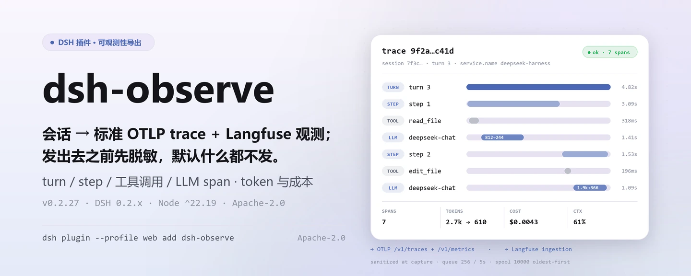

<div align="center">

<picture>
  <source media="(prefers-color-scheme: dark)" srcset="docs/assets/dsh-observe-hero-zh-dark.webp">
  
</picture>

# dsh-observe

**把每次会话变成标准 OTLP trace 与 Langfuse 观测——发出去之前先脱敏，默认什么都不发。**

面向 DeepSeek Harness 的可观测性导出器：turn/step/工具调用/LLM 生成 span，token 与 USD 成本指标，异步批量、有界离线缓冲、指数退避重试；OTLP 与 Langfuse 接其一或两个都接。

[安装](#三步上手) · [配置](#配置) · [FAQ](#faq) · [简体中文](README.md) · [English](README.en.md) · [Español](README.es.md) · [Português](README.pt.md) · [हिन्दी](README.hi.md)

[](LICENSE)
[](#兼容性)
[](https://www.npmjs.com/package/dsh-observe)
[](https://github.com/PerryLink/dsh-observe/actions/workflows/ci.yml)
[](#兼容性)

[](https://github.com/PerryLink/dsh-observe/stargazers)
[](https://www.npmjs.com/package/dsh-observe)
[](https://dshfind.com/plugins/PerryLink/dsh-observe?ref=badge)
[](https://securityscorecards.dev/viewer/?uri=github.com/PerryLink/dsh-observe)
[](https://dsh.market/)
[](https://gitee.com/perrylink/dsh-observe)

```sh
dsh plugin --profile <name> add dsh-observe
```

</div>

<sub>社区插件，与 DeepSeek 官方无关。唯一仓库：<https://github.com/PerryLink/dsh-observe>（Gitee 为镜像）。</sub>

## 它是什么

`dsh-observe` 把 harness 的 `session/event` 流翻译成标准可观测协议：一个 turn 一条 trace，step、工具调用与 LLM 生成各是一个 span，token 与成本是累计指标，prompt/completion 正文先脱敏截断再入队。它只做导出——不注册任何模型工具、不注册用户可见命令，全部行为由配置决定；配置了 OTLP 或 Langfuse 之后重启，数据自己流走，没配置就什么都不采集。

<picture>
  <source media="(prefers-color-scheme: dark)" srcset="docs/assets/dsh-observe-flow-v5-dark.svg">
  
</picture>

## 三步上手

1. **安装**（三选一）：

   ```sh
   # git 通道（最新 main；prepare 脚本只用生产依赖构建）
   dsh plugin --profile web add github:PerryLink/dsh-observe
   # npm 通道（已发布版本）
   dsh plugin --profile web add dsh-observe
   # tarball 通道：本仓库 pnpm pack 后
   dsh plugin --profile web add ./dsh-observe-<version>.tgz
   ```

   > 如果 pnpm 对本包报 `ERR_PNPM_IGNORED_BUILDS`（esbuild 的平台二进制无害校验），在你的 `pnpm-workspace.yaml` 中加入 `allowBuilds: { esbuild: true }` —— `dsh` CLI 会打印确切片段。

2. **最小配置**（在 profile patch 里打开 `enabled` 并至少配一个后端；`cordis.patch.yml` 里该行默认关闭）：

   ```yaml
   - insert:
       - id: dsh-observe
         name: dsh-observe
         config:
           enabled: true
           otlp:
             endpoint: http://localhost:4318
   ```

   Langfuse 侧同理：`langfuse.baseUrl` + `langfuse.publicKey` + `langfuse.secretKey`，两者可以同时开。

3. **验证已生效**：

   ```sh
   dsh --profile web --dump-config | grep -A2 'id: dsh-observe'
   ```

   本插件不注册用户可见命令，所以没有 `/observe` 之类的手动触发面；把 `remote.enabled` 设为 `true` 后，设置页可经 `observe/status` 读到已配置后端、队列深度与离线缓冲占用。

**卸载**：`dsh plugin --profile web remove dsh-observe`（或从 profile patch 删掉该行）。

<details>
<summary>从 DSH Desktop 市场安装</summary>

所有 PerryLink 插件均可在 DSH Desktop 内置市场中浏览：**市场 → 来源 → 添加来源 → 粘贴** `https://perrylink-dsh-catalog.perrylink.workers.dev/catalog-source.json` **→ 选中**。安装仍需通过市场的 npm 身份校验与你的确认。

</details>

## 核心能力

`dsh-observe` 把会话事件流变成标准可观测协议：

- **Spans** —— turn、step、工具调用（耗时、状态、重试推导）与 LLM 生成 span，按 turn 连成 trace，id 确定性可复现。
- **Metrics** —— 按 provider/model 的 token 计数、USD 成本计数（可配价格表）、以及可选的 `ctx.tokenMeter` 上下文压力 gauge。
- **脱敏采集** —— prompt 与 completion 正文先经结构性键名脱敏 + 内置密钥模式 + 自定义模式 + 字符预算截断，之后才进入队列或发送。
- **可靠性** —— 异步批量（数量与定时双触发）、有界持久离线缓冲（storage-domain，最旧优先淘汰）、确定性指数退避重试；未送达批次重启后仍在。
- **运行时总开关** —— 可选 Typert remote（`observe/status`、`observe/setEnabled`）让设置页在不卸载的情况下停止/恢复导出。
- **默认关闭** —— `enabled: true` 且至少配置一个后端才是显式开启；否则不采集、不导出。

```text
session/event 流
   │ collector（turn/step/tool/llm span、metrics）
   │ sanitize（键名、密钥、预算）
   ├──▶ pipeline "otlp"  ── 队列 ── flush ──▶ OTLP /v1/traces + /v1/metrics
   │         └─ 重试/退避 ──┐
   ├──▶ pipeline "langfuse" ── 队列 ── flush ──▶ Langfuse ingestion
   │         └─ 重试/退避 ──┤
   └────────── 持久 spool（离线缓冲，有界）◀┘
```

### 表面

本插件**不注册任何模型工具**，也不注册用户可见命令——它是后台导出器。它只有三类表面：

- **消费** `session/event`（span/metric 采集）、`session/flush`（尽力导出 kick —— 持久化检查点绝不等待远端后端）、`session/disposed`。
- **可选 remote 服务** `observe`（`remote.enabled`，默认关闭）—— `observe/status` 返回总开关状态、已配置后端、队列深度与缓冲占用；`observe/setEnabled` 在运行时停止/恢复导出。
- **唯一注入的服务键** `storageDomain`，用于离线缓冲的持久表。

### 示例

没有手动触发面：安装后按上面的最小配置打开 `enabled`，重启后即可在 OTLP 后端看到 trace 与指标、在 Langfuse 看到 observations。要确认「确实在采集」，看后端收到的第一条 trace 即可；要确认「确实在发」，看 `observe/status` 的队列深度是否随会话推进而回落。

## 配置

所有可调项都是 Schemastery `Config` 字段（可在 cordis.yml / profile patch 中修改）。按 id 定向覆盖会替换整行 —— 需要重新声明每个键。[`cordis.patch.yml`](cordis.patch.yml) 逐键内联注释。

最常用键：

| 键 | 默认值 | 含义 |
|---|---|---|
| `enabled` | `false` | 总开关；`true` 且至少一个后端才是显式开启 |
| `otlp.endpoint` | *(必填)* | OTLP 基础 URL；`/v1/traces` 与 `/v1/metrics` 由插件追加 |
| `otlp.serviceName` | `deepseek-harness` | `service.name` 资源属性 |
| `langfuse.baseUrl` | `https://cloud.langfuse.com` | Langfuse 基础 URL |
| `langfuse.traceName` | `session {session} turn {turn}` | trace 名称模板；`{session}`/`{turn}` 按 trace 插值 |
| `capture.llm` | `true` | LLM 生成 span 开关 |
| `llm.prompt` | `true` | 采集脱敏后的请求 prompt（`false` 只记大小） |
| `batch.maxBufferRecords` | `10000` | 持久离线缓冲上限；最旧记录先丢 |
| `remote.enabled` | `false` | 挂载 `observe` Typert remote（运行时总开关） |

<details>
<summary>完整配置表（47 个键）</summary>

| 键 | 默认值 | 含义 |
|---|---|---|
| `enabled` | `false` | 总开关；`true` 且至少一个后端才是显式开启 |
| `otlp` | `null` | OTLP 后端配置，`null` 表示禁用 |
| `otlp.endpoint` | *(必填)* | OTLP 基础 URL；`/v1/traces` 与 `/v1/metrics` 由插件追加 |
| `otlp.serviceName` | `deepseek-harness` | `service.name` 资源属性 |
| `otlp.serviceVersion` | *(无)* | `service.version` 资源属性 |
| `otlp.headers` | `{}` | 合并进每个导出请求的额外请求头 |
| `otlp.timeoutMs` | `10000` | 单请求超时 |
| `langfuse` | `null` | Langfuse 后端配置，`null` 表示禁用 |
| `langfuse.baseUrl` | `https://cloud.langfuse.com` | Langfuse 基础 URL |
| `langfuse.publicKey` | *(必填)* | 项目公钥 |
| `langfuse.secretKey` | *(必填)* | 项目密钥 |
| `langfuse.release` | *(无)* | 打在各 trace 上的 release 标签 |
| `langfuse.traceName` | `session {session} turn {turn}` | trace 名称模板；`{session}`/`{turn}` 按 trace 插值 |
| `langfuse.tags` | `[]` | 打在每个 trace 上的静态标签 |
| `langfuse.timeoutMs` | `10000` | 单请求超时 |
| `capture.turns` | `true` | turn 生命周期 span |
| `capture.steps` | `true` | step 生命周期 span |
| `capture.tools` | `true` | 工具调用 span（参数/结果脱敏） |
| `capture.llm` | `true` | LLM 生成 span |
| `llm.prompt` | `true` | 采集脱敏后的请求 prompt（`false` 只记大小） |
| `llm.completion` | `true` | 采集脱敏后的 completion（`false` 只记大小） |
| `metadata.sessionId` | `true` | 会话 id 属性 |
| `metadata.cwd` | `false` | 会话工作目录（本地路径——默认关闭） |
| `metadata.agentPreset` | `true` | agent preset id 属性 |
| `metadata.model` | `true` | provider/model 属性 |
| `metrics.tokens` | `true` | 按 provider/model 的 token 计数 |
| `metrics.cost` | `true` | USD 成本计数（需 `pricing` 规则匹配） |
| `metrics.contextTokens` | `true` | 上下文压力 gauge（需 `ctx.tokenMeter`） |
| `pricing` | `[]` | 价格表，首个匹配生效：`{ provider?, model, inputPerToken, outputPerToken, cacheReadPerToken?, cacheWritePerToken? }` |
| `sanitize.enabled` | `true` | 脱敏总开关（`false` 只关脱敏，不关截断） |
| `sanitize.redactKeys` | `[]` | 额外键名子串（key/token/secret/password/authorization/credential/apiKey 恒生效） |
| `sanitize.redactPatterns` | `[]` | 额外密钥正则 |
| `sanitize.truncatePromptChars` | `4000` | prompt 字符预算 |
| `sanitize.truncateCompletionChars` | `4000` | completion 字符预算 |
| `sanitize.truncateToolInputChars` | `2000` | 工具参数字符预算 |
| `sanitize.truncateToolOutputChars` | `2000` | 工具结果字符预算 |
| `sanitize.truncateAttributeChars` | `512` | span 属性字符串预算 |
| `batch.maxRecords` | `256` | 队列达到该数量即 flush |
| `batch.flushIntervalMs` | `5000` | 定时 flush 间隔 |
| `batch.maxQueueRecords` | `2000` | 内存队列上限；超出溢入缓冲 |
| `batch.maxBufferRecords` | `10000` | 持久离线缓冲上限；最旧记录先丢 |
| `batch.bufferRetryIntervalMs` | `30000` | 离线缓冲重试间隔 |
| `retry.maxAttempts` | `5` | 每批尝试次数（含首次） |
| `retry.baseDelayMs` | `1000` | 首次退避延迟 |
| `retry.factor` | `2` | 每连续失败一次的退避倍数 |
| `retry.maxDelayMs` | `60000` | 退避上限 |
| `remote.enabled` | `false` | 挂载 `observe` Typert remote（运行时总开关） |

</details>

按 id 覆盖的示例（会替换整行，所以重述需要的键）：

```yaml
- insert:
    - id: dsh-observe
      name: dsh-observe
      config:
        enabled: true
        otlp:
          endpoint: http://localhost:4318
        capture:
          tools: false
        sanitize:
          truncatePromptChars: 2000
        batch:
          maxBufferRecords: 20000
```

## FAQ

<details>
<summary>会不会把 prompt、工具参数原文发到后端？</summary>

不会按原文发出。每条记录在入队之前就完成三层脱敏：结构性键名（key/token/secret/password/authorization/credential/apiKey 恒在名单内，可用 `sanitize.redactKeys` 追加子串）、内置密钥模式（API key、GitHub token、AWS key、bearer 凭据、私钥）加 `sanitize.redactPatterns` 自定义正则、以及字符预算截断（prompt/completion 各 4000、工具参数与结果各 2000、span 属性 512）。只想要体积不想要正文时，把 `llm.prompt` 与 `llm.completion` 设为 `false`，记录里只剩大小与计数。

</details>

<details>
<summary>后端挂了、网络断了会丢数据吗？</summary>

普通 span 与指标走「重试 → 溢出到离线缓冲」这条链：批次失败按 `retry.maxAttempts`（默认 5 次）与 `retry.baseDelayMs × retry.factor` 的确定性指数退避重试，重试耗尽或内存队列超过 `batch.maxQueueRecords` 时溢出到有界持久 spool（`batch.maxBufferRecords` 默认 10000，最旧优先淘汰），并有 `batch.bufferRetryIntervalMs` 的周期性回灌，重启后未送达批次仍在。OTLP metrics 是例外：它按累计聚合，丢一次 flush 会在下一次自愈。

</details>

<details>
<summary>插件自己存了什么？凭据放在哪？</summary>

离线缓冲里只有已脱敏的记录，且从存储读回时会再校验一次才交给 sink。插件本身不存任何凭据：Langfuse 公钥/密钥只出现在发往你配置的 Langfuse 端点的请求里，OTLP 请求头同理只发往你配置的 OTLP 端点——请用凭据引用或环境注入，不要写进 profile patch 提交。它只读会话事件流，从不读取或改写会话日志文件。

</details>

<details>
<summary>会不会拖慢会话？</summary>

采集与脱敏都在事件处理里同步完成，但发送全部是异步的：队列按数量或定时 flush，`session/flush` 只是一次尽力而为的 kick——持久化检查点绝不等待远端后端。导出失败会告警、计数（`observe.export_failures`）、重试，最后进缓冲；会话事件处理器本身抛错会被捕获并记录，可观测性不会拖垮 harness 热路径。

</details>

<details>
<summary>会和别的插件抢服务、事件或 slot 吗？</summary>

只注入一个服务键 `storageDomain`，只监听三个 `session/*` 事件，不注册模型工具、不注册命令、不注册 client slot、不监听任何 waterfall，也不改全局对象。唯一需要留意的命名面是可选 remote 服务 `observe`（`remote.enabled` 默认关闭）——同一 profile 里若已有别的插件占用同名服务，只开其中一个。

</details>

## 安全边界

- **默认关闭** —— 不显式开启（`enabled: true` 且至少一个后端）则不采集、不导出。
- **发送前脱敏** —— 结构性键名脱敏、内置密钥模式（API key、GitHub token、AWS key、bearer 凭据、私钥）、自定义模式与字符预算，全部在任何记录离开内存前生效。
- **持久边界再校验** —— 从存储读回的记录在到达 sink 前再次检查。
- **失败大声、失败隔离** —— 导出失败会告警、计数、重试并最终入缓冲；会话事件处理失败被捕获并记录，可观测性永远不会拖垮 harness 热路径。
- **模型可见 ⟺ 已记录** —— prompt/completion 导出只投影会话 surface（其节点 0 即系统提示词）与已记录的 header（调用配置与工具）；导出器不发明任何内容。

## 权限与数据

- **权限**：对你配置的端点出网（`network:outbound`）、读取事件流（`session:read`）、写离线缓冲（`storage:write`）；无原生代码、无文件系统访问。
- **数据**：所有外发内容都来自会话日志，并在入队、缓冲、发送前完成脱敏（脱敏 + 截断）。离线缓冲只存脱敏记录，读回时再次校验。
- **凭据**：Langfuse 公钥/密钥只发往你配置的 Langfuse 端点；OTLP 请求头只发往你配置的 OTLP 端点。插件自身不存任何凭据 —— 请使用凭据引用或环境注入。

## 已知限制

- **基线 `0.2.2-rc.1`** —— 插件针对 `@deepseek-ai/dsh@0.2.2-rc.1` 开发与测试（devDependencies 与 CI 的主尺子）；`engines.dsh` 的 `>=0.2.1-0 <0.3.0 || >=0.2.2-0 <0.3.0` 与 peer 复合范围让每条已发布线都可安装，更旧的基线由第二把尺子（`typecheck:ci`）与 compat 工作流覆盖。
- **审计事件不落盘** —— 本插件自身的 `observe/*` 记录仅作审计：当前宿主线的会话 append 闸门只接纳 surface 事件，因此不会有 `observe/*` 事件写入会话日志；插件也不会用未标记 append 伪造一条（那会让会话不可读）。审计面请以 `observe/status` 输出（需 `remote.enabled: true`）与 OTLP/Langfuse 后端为准。
- **Metrics 不走重试/缓冲路径** —— OTLP metrics 按累计聚合，丢失一次 flush 会在下一次自愈（设计如此，非缺陷）。
- **无采样** —— 每个启用的 span 族都会导出；大流量会话请调整 `capture.*` 开关与 `batch.maxBufferRecords`。

## 与其他 DSH 插件的互操作性

本插件的注册面很窄，因此天然不易与别的插件冲突：

- **无工具名冲突** —— 不注册任何模型工具（README 与 `src/index.ts` 均无工具注册）。
- **无命令名冲突** —— 不注册用户可见命令，斜杠命令命名空间完全不碰。
- **无 client slot 冲突** —— 本包不含浏览器半（无 `client/` 目录），不注册任何 client slot。
- **无 waterfall 短路** —— 只读监听 `session/event`、`session/flush`、`session/disposed`，不监听任何 allow/passthrough 型 waterfall，因此不存在压住别人决策的问题。
- **唯一的服务键** —— `storageDomain`（注入，不提供）；另有一个**可选**的 remote 服务 `observe`，仅在 `remote.enabled: true` 时注册。
- **出网只去你配置的端点** —— OTLP 与 Langfuse 各自独立，关掉一个不影响另一个。

如果你在同一个 profile 里同时装了别的可观测性插件，注意两点：两者都会消费 `session/event`（Cordis 的广播语义，互相不会饿死），但会产生两份 trace；以及不要同时注册 `observe` 这个 remote 服务名。

## 兼容性

| 维度 | 状态 |
|---|---|
| Harness | DeepSeek Harness `dsh-v0.2.1-alpha.1`（2026-10-04 已适配）：会话格式 V4 把工具结果改为 `role: 'tool'` 的一等消息，顶层携带 `toolCallId` + `content` + 可选 `isError` —— V3 的 `tool-result` 内容块已从宿主 `ContentBlockMap` 移除，本插件只读 V4 形状（升级前的 V3 日志仍可经只读兼容路径投影）。会话格式 V3 的其余特征沿用：助手流内嵌到 `assistant/message` / `assistant/attempt`，系统提示词为 surface 节点 0（`system/message`）；本插件只消费实时事件流，从不读取会话日志文件。`engines.dsh` 为 `>=0.2.1-0 <0.3.0 \|\| >=0.2.2-0 <0.3.0`，profile 安装冒烟由 compat 工作流覆盖。 |
| Node | `^22.19.0 \|\| >=24.9.0`，纯 ESM（`"type": "module"`） |
| 后端 | OpenTelemetry OTLP/HTTP（traces + metrics，JSON 编码）与 Langfuse（LLM 可观测）——二选一或同时 |
| 模型 | 与模型无关：它导出 session/event 流，自身不调用任何模型 |

peer 依赖：`@deepseek-ai/cordis ^4.0.5-alpha.1`、`@deepseek-ai/schemastery ^3.18.5`，以及 `@deepseek-ai/dsh-llm`、`@deepseek-ai/dsh-session`、`@deepseek-ai/dsh-storage`、`@deepseek-ai/dsh-storage-domain`、`@deepseek-ai/dsh-storage-json`、`@deepseek-ai/dsh-typert-protocol`（`>=0.1.2-rc.1 <0.2.0 || >=0.1.5-alpha.1 <0.2.0 || >=0.1.6-0 <0.2.0 || >=0.1.7-0 <0.2.0 || >=0.2.0-0 <0.3.0 || >=0.2.1-0 <0.3.0 || >=0.2.2-0 <0.3.0`；devDependencies 钉 `0.2.2-rc.1`）。`zod` 是唯一的运行时依赖，用于离线缓冲的持久边界校验。

## 生态与质量

- [Gitee 镜像](https://gitee.com/perrylink/dsh-observe)（同步镜像，以 GitHub 为准）
- [dshfind 插件页](https://dshfind.com/plugins/PerryLink/dsh-observe)（安装量与排名）
- [OpenSSF Scorecard 报告](https://securityscorecards.dev/viewer/?uri=github.com/PerryLink/dsh-observe)（由 [.github/workflows/scorecard.yml](.github/workflows/scorecard.yml) 驱动）
- [dsh-plugin-doctor 验证报告](https://github.com/PerryLink/dsh-plugin-doctor#verified-徽章)
- [DSH Market](https://dsh.market/)（已上架）
- **1024 商店渠道**：先 `npm i -g dsh1024`，再 `dsh1024 plugin --profile web add dsh-observe`（计入 [deepseek1024.com](https://deepseek1024.com) 安装排行）
- [生态实测知识库](https://perrylink.github.io/dsh-plugin-guide/)：插件开发指南 · 选型实测数据 · 维护取舍判据

## 开发

```sh
pnpm install               # node ^22.19 || >=24.9
pnpm run typecheck         # tsc：src + tests，对照 0.2.2-rc.1 devDeps（无 tsconfig paths）
pnpm run typecheck:ci      # tsc：对照已发布线（无 paths）
pnpm run check:ruler-live  # canary：必须编译失败，以证明尺子仍是活的（需 checkout 面）
pnpm test                  # vitest：126 个测试、18 个套件（真实 Context/Session/storage 接缝）
pnpm run test:coverage     # 覆盖率门禁（90/80/90/90）
pnpm run build             # tsdown bundle + tsc 声明（lib/）
pnpm run verify:self-contained  # 依赖声明全部来自 registry
pnpm run verify:artifacts       # 构建产物 ESM 面 + bundle patch 齐全
node scripts/check-readme-sync.mjs  # 五语 README 同步门
pnpm pack                  # 发布用 tarball
```

配图由 [`scripts/gen-readme-assets.py`](scripts/gen-readme-assets.py) 程序化生成（Pillow 绘制 1440×576 hero，结构图为手写 1100×660 SVG），输出 `docs/assets/dsh-observe-hero-{zh,en}-{light,dark}.webp` 四张与 `docs/assets/dsh-observe-flow-v5-{light,dark}.svg` 一对，可重复执行。旧的 `docs/assets/dsh-observe-flow-{light,dark}.svg`、`dsh-observe-flow.svg`、`dsh-observe-hero.png` 与 `dsh-observe-demo.{png,gif}` 保留在原处以防外链失效，README 不再引用。

Topics：`dsh`, `dsh-plugin`, `deepseek-harness`, `deepseek`, `cordis`, `observability`, `opentelemetry`, `otlp`, `langfuse`, `tracing`

## 家族与致谢

本项目是 [PerryLink](https://github.com/PerryLink) 维护的 DeepSeek Harness 插件家族成员（全部 Apache-2.0）。如果这个插件帮到了你，**给个 star**——它不解锁任何功能，但会让下一个人更容易找到它。

- [@PerryLink](https://github.com/PerryLink) —— 创建者与维护者：collector、pipeline、spool、OTLP/Langfuse sink、脱敏层与五语文档。

<details>
<summary>展开全部插件</summary>

| 插件 | 状态 |
|---|---|
| **[dsh-aqua-input-check](https://github.com/PerryLink/dsh-aqua-input-check)** |  |
| **[dsh-archive-check](https://github.com/PerryLink/dsh-archive-check)** |  |
| **[dsh-auto-review](https://github.com/PerryLink/dsh-auto-review)** |  |
| **[dsh-autotier](https://github.com/PerryLink/dsh-autotier)** | 🧊 已冻结 — 见仓库 README |
| **[dsh-bid-ca-precheck](https://github.com/PerryLink/dsh-bid-ca-precheck)** |  |
| **[dsh-bid-qual-check](https://github.com/PerryLink/dsh-bid-qual-check)** |  |
| **[dsh-cert-mcp](https://github.com/PerryLink/dsh-cert-mcp)** | 🧊 已冻结 — 见仓库 README |
| **[dsh-checkpoint-rewind](https://github.com/PerryLink/dsh-checkpoint-rewind)** |  |
| **[dsh-click](https://github.com/PerryLink/dsh-click)** |  |
| **[dsh-composer-history](https://github.com/PerryLink/dsh-composer-history)** |  |
| **[dsh-contract-stance](https://github.com/PerryLink/dsh-contract-stance)** |  |
| **[dsh-customs-doc-check](https://github.com/PerryLink/dsh-customs-doc-check)** |  |
| **[dsh-data-quality](https://github.com/PerryLink/dsh-data-quality)** | 🧊 已冻结 — 见仓库 README |
| **[dsh-demurrage-ledger](https://github.com/PerryLink/dsh-demurrage-ledger)** |  |
| **[dsh-doublecheck](https://github.com/PerryLink/dsh-doublecheck)** |  |
| **[dsh-drill-script-check](https://github.com/PerryLink/dsh-drill-script-check)** |  |
| **[dsh-eia-guide-check](https://github.com/PerryLink/dsh-eia-guide-check)** |  |
| **[dsh-emergency-plan](https://github.com/PerryLink/dsh-emergency-plan)** |  |
| **[dsh-essay-rubric-check](https://github.com/PerryLink/dsh-essay-rubric-check)** |  |
| **[dsh-evidence-check](https://github.com/PerryLink/dsh-evidence-check)** |  |
| **[dsh-export-ctl-check](https://github.com/PerryLink/dsh-export-ctl-check)** |  |
| **[dsh-fast](https://github.com/PerryLink/dsh-fast)** |  |
| **[dsh-fmea-table-check](https://github.com/PerryLink/dsh-fmea-table-check)** |  |
| **[dsh-forecast-penalty](https://github.com/PerryLink/dsh-forecast-penalty)** |  |
| **[dsh-fund-research](https://github.com/PerryLink/dsh-fund-research)** |  |
| **[dsh-github](https://github.com/PerryLink/dsh-github)** |  |
| **[dsh-gongwen-flow-check](https://github.com/PerryLink/dsh-gongwen-flow-check)** |  |
| **[dsh-gongwen-word-check](https://github.com/PerryLink/dsh-gongwen-word-check)** |  |
| **[dsh-guard-plan-qc](https://github.com/PerryLink/dsh-guard-plan-qc)** |  |
| **[dsh-hazchem-check](https://github.com/PerryLink/dsh-hazchem-check)** |  |
| **[dsh-hazplan-check](https://github.com/PerryLink/dsh-hazplan-check)** |  |
| **[dsh-hidden-risk-map](https://github.com/PerryLink/dsh-hidden-risk-map)** |  |
| **[dsh-hs-classify](https://github.com/PerryLink/dsh-hs-classify)** |  |
| **[dsh-icd-rule-check](https://github.com/PerryLink/dsh-icd-rule-check)** |  |
| **[dsh-industry-research](https://github.com/PerryLink/dsh-industry-research)** |  |
| **[dsh-lawcite-adapter](https://github.com/PerryLink/dsh-lawcite-adapter)** |  |
| **[dsh-laya](https://github.com/PerryLink/dsh-laya)** |  |
| **[dsh-lc-doc-check](https://github.com/PerryLink/dsh-lc-doc-check)** |  |
| **[dsh-learning-gap-check](https://github.com/PerryLink/dsh-learning-gap-check)** |  |
| **[dsh-library](https://github.com/PerryLink/dsh-library)** |  |
| **[dsh-local-ai](https://github.com/PerryLink/dsh-local-ai)** |  |
| **[dsh-lsp-actions](https://github.com/PerryLink/dsh-lsp-actions)** |  |
| **[dsh-mask](https://github.com/PerryLink/dsh-mask)** |  |
| **[dsh-mcp-panel](https://github.com/PerryLink/dsh-mcp-panel)** |  |
| **[dsh-medrec-qc](https://github.com/PerryLink/dsh-medrec-qc)** |  |
| **[dsh-memento](https://github.com/PerryLink/dsh-memento)** | 🧊 已冻结 — 见仓库 README |
| **[dsh-nsfc-form-check](https://github.com/PerryLink/dsh-nsfc-form-check)** |  |
| **[dsh-nurse-record-check](https://github.com/PerryLink/dsh-nurse-record-check)** |  |
| **[dsh-observe](https://github.com/PerryLink/dsh-observe)** |  |
| **[dsh-origin-rvc-check](https://github.com/PerryLink/dsh-origin-rvc-check)** |  |
| **[dsh-ota-review-check](https://github.com/PerryLink/dsh-ota-review-check)** |  |
| **[dsh-output-styles](https://github.com/PerryLink/dsh-output-styles)** |  |
| **[dsh-paper-doc-adapter](https://github.com/PerryLink/dsh-paper-doc-adapter)** |  |
| **[dsh-permission-rules](https://github.com/PerryLink/dsh-permission-rules)** |  |
| **[dsh-permit-report-check](https://github.com/PerryLink/dsh-permit-report-check)** |  |
| **[dsh-pipeline-check](https://github.com/PerryLink/dsh-pipeline-check)** |  |
| **[dsh-pleading-draft](https://github.com/PerryLink/dsh-pleading-draft)** |  |
| **[dsh-plugin-doctor](https://github.com/PerryLink/dsh-plugin-doctor)** | 🚫 已退役（仓库已归档） |
| **[dsh-plugin-guide](https://github.com/PerryLink/dsh-plugin-guide)** |  |
| **[dsh-plugin-kit](https://github.com/PerryLink/dsh-plugin-kit)** | 🚫 已退役（仓库已归档） |
| **[dsh-plugin-upgrade](https://github.com/PerryLink/dsh-plugin-upgrade)** | 🚫 已退役（仓库已归档） |
| **[dsh-policy-brief-draft](https://github.com/PerryLink/dsh-policy-brief-draft)** |  |
| **[dsh-power-loss-split](https://github.com/PerryLink/dsh-power-loss-split)** |  |
| **[dsh-power-ticket-check](https://github.com/PerryLink/dsh-power-ticket-check)** |  |
| **[dsh-ppap-check](https://github.com/PerryLink/dsh-ppap-check)** |  |
| **[dsh-protest-deadline](https://github.com/PerryLink/dsh-protest-deadline)** |  |
| **[dsh-railway-window](https://github.com/PerryLink/dsh-railway-window)** |  |
| **[dsh-repair-order-qc](https://github.com/PerryLink/dsh-repair-order-qc)** |  |
| **[dsh-research-report](https://github.com/PerryLink/dsh-research-report)** |  |
| **[dsh-review-reply-check](https://github.com/PerryLink/dsh-review-reply-check)** |  |
| **[dsh-rulefile-check](https://github.com/PerryLink/dsh-rulefile-check)** |  |
| **[dsh-safety-brief-check](https://github.com/PerryLink/dsh-safety-brief-check)** |  |
| **[dsh-score](https://github.com/PerryLink/dsh-score)** | 🧊 已冻结 — 见仓库 README |
| **[dsh-session-sync](https://github.com/PerryLink/dsh-session-sync)** |  |
| **[dsh-site-log-check](https://github.com/PerryLink/dsh-site-log-check)** |  |
| **[dsh-skill-pack-security](https://github.com/PerryLink/dsh-skill-pack-security)** |  |
| **[dsh-soe-decision-check](https://github.com/PerryLink/dsh-soe-decision-check)** |  |
| **[dsh-soilwater-check](https://github.com/PerryLink/dsh-soilwater-check)** |  |
| **[dsh-sop-sync-check](https://github.com/PerryLink/dsh-sop-sync-check)** |  |
| **[dsh-spc-gbt-adapter](https://github.com/PerryLink/dsh-spc-gbt-adapter)** |  |
| **[dsh-talk](https://github.com/PerryLink/dsh-talk)** |  |
| **[dsh-tender-extract](https://github.com/PerryLink/dsh-tender-extract)** |  |
| **[dsh-tender-matrix](https://github.com/PerryLink/dsh-tender-matrix)** |  |
| **[dsh-test-drive](https://github.com/PerryLink/dsh-test-drive)** |  |
| **[dsh-ticktick](https://github.com/PerryLink/dsh-ticktick)** | 🚫 已退役（仓库已归档） |
| **[dsh-translate](https://github.com/PerryLink/dsh-translate)** |  |
| **[dsh-warranty-calc](https://github.com/PerryLink/dsh-warranty-calc)** |  |
| **[dsh-budget](https://github.com/PerryLink/dsh-budget)** | 🧊 已冻结 — 见仓库 README |
| **[dsh-claude-move](https://github.com/PerryLink/dsh-claude-move)** | 🧊 已冻结 — 见仓库 README |
| **[dsh-defend](https://github.com/PerryLink/dsh-defend)** | 🧊 已冻结 — 见仓库 README |
| **[dsh-draw](https://github.com/PerryLink/dsh-draw)** | 🧊 已冻结 — 见仓库 README |
| **[dsh-reach](https://github.com/PerryLink/dsh-reach)** | 🧊 已冻结 — 见仓库 README |
| **[dsh-background-agents](https://github.com/PerryLink/dsh-background-agents)** | 🚫 已退役（仓库已归档） |
| **[dsh-session-pin](https://github.com/PerryLink/dsh-session-pin)** | 🚫 已退役（仓库已归档） |
| **[dsh-team-rooms](https://github.com/PerryLink/dsh-team-rooms)** | 🚫 已退役（仓库已归档） |

</details>

## License

[LICENSE](LICENSE)（Apache License 2.0）© 2026 dsh-observe contributors

<p align="center"><sub>Apache-2.0 · 社区插件，与 DeepSeek 无关。</sub></p>
