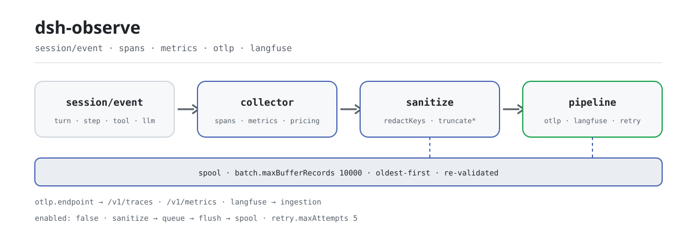

<div align="center">

<picture>
  <source media="(prefers-color-scheme: dark)" srcset="docs/assets/dsh-observe-flow-dark.svg">
  
</picture>

# dsh-observe

**Transforme cada sessão em traces OTLP padrão e observações do Langfuse—saneado antes de sair, sem exportar nada por padrão.**

Exportador de observabilidade para o DeepSeek Harness: spans de turn/step/chamada de ferramenta/geração LLM, métricas de tokens e custo em USD, lotes assíncronos, buffer offline limitado e novas tentativas com backoff exponencial; use OTLP, Langfuse ou ambos.

[Instalar](#instalação-em-três-passos) · [Configuração](#configuração) · [FAQ](#faq) · [简体中文](README.md) · [English](README.en.md) · [Español](README.es.md) · [Português](README.pt.md) · [हिन्दी](README.hi.md)

[](LICENSE)
[](#compatibilidade)
[](https://www.npmjs.com/package/dsh-observe)
[](https://github.com/PerryLink/dsh-observe/actions/workflows/ci.yml)
[](#compatibilidade)

[](https://github.com/PerryLink/dsh-observe/stargazers)
[](https://www.npmjs.com/package/dsh-observe)
[](https://dshfind.com/plugins/PerryLink/dsh-observe?ref=badge)
[](https://securityscorecards.dev/viewer/?uri=github.com/PerryLink/dsh-observe)
[](https://dsh.market/)
[](https://gitee.com/perrylink/dsh-observe)

```sh
dsh plugin --profile <name> add dsh-observe
```

</div>

<sub>Plugin da comunidade, não afiliado ao DeepSeek. Repositório único: <https://github.com/PerryLink/dsh-observe> (o Gitee é um espelho).</sub>

## O que é

O `dsh-observe` traduz o fluxo `session/event` do harness em protocolos de observabilidade padrão: um trace por turn, um span para cada step, chamada de ferramenta e geração LLM, métricas acumuladas de tokens e custo, e corpos de prompt/completion que são saneados e truncados antes de entrar na fila. Ele só exporta: não registra ferramentas de modelo nem comandos visíveis ao usuário, e todo o comportamento vem da configuração. Configure OTLP ou Langfuse, reinicie, e os dados fluem sozinhos; sem configuração nada é coletado.

## Instalação em três passos

1. **Instalar** (escolha uma):

   ```sh
   # canal git (main mais recente; o script prepare compila só com dependências de produção)
   dsh plugin --profile web add github:PerryLink/dsh-observe
   # canal npm (versão publicada)
   dsh plugin --profile web add dsh-observe
   # canal tarball: após pnpm pack neste repositório
   dsh plugin --profile web add ./dsh-observe-<version>.tgz
   ```

   > Se o pnpm reportar `ERR_PNPM_IGNORED_BUILDS` para este pacote (validação inofensiva do binário de plataforma do esbuild), adicione `allowBuilds: { esbuild: true }` ao seu `pnpm-workspace.yaml`; a CLI `dsh` imprime o trecho exato.

2. **Configuração mínima** (ative `enabled` no patch do perfil e configure ao menos um backend; a linha vem desativada no `cordis.patch.yml`):

   ```yaml
   - insert:
       - id: dsh-observe
         name: dsh-observe
         config:
           enabled: true
           otlp:
             endpoint: http://localhost:4318
   ```

   O Langfuse funciona igual: `langfuse.baseUrl` + `langfuse.publicKey` + `langfuse.secretKey`. Os dois backends podem ficar ativos ao mesmo tempo.

3. **Verificar que está ativo**:

   ```sh
   dsh --profile web --dump-config | grep -A2 'id: dsh-observe'
   ```

   Nenhum comando visível ao usuário é registrado, então não existe gatilho manual do tipo `/observe`. Com `remote.enabled: true`, uma página de ajustes pode ler os backends configurados, a profundidade das filas e a ocupação do buffer via `observe/status`.

**Desinstalar**: `dsh plugin --profile web remove dsh-observe` (ou remova a linha do patch do perfil).

<details>
<summary>Instalar pelo mercado do DSH Desktop</summary>

Todos os plugins da PerryLink podem ser navegados no mercado embutido do DSH Desktop: **Mercado → Fontes → adicionar fonte → colar** `https://perrylink-dsh-catalog.perrylink.workers.dev/catalog-source.json` **→ selecionar**. A instalação continua passando pela verificação de identidade npm do mercado e pela sua confirmação.

</details>

## Capacidades principais

O `dsh-observe` converte o fluxo de eventos de sessão em protocolos de observabilidade padrão:

- **Spans** — turn, step, chamada de ferramenta (duração, status, derivação de tentativas) e geração LLM, encadeados em traces por turn com ids determinísticos.
- **Métricas** — contadores de tokens por provider/model, contadores de custo em USD (tabela de preços configurável) e o gauge opcional de pressão de contexto do `ctx.tokenMeter`.
- **Captura saneada** — os corpos de prompt e completion passam por redação estrutural de nomes de chave, padrões de segredo embutidos, seus padrões e orçamentos de caracteres antes de entrar na fila ou serem enviados.
- **Confiabilidade** — lotes assíncronos (por tamanho e por temporizador), buffer offline durável e limitado (storage-domain, expulsão do mais antigo primeiro) e novas tentativas determinísticas com backoff exponencial; lotes não entregues sobrevivem ao reinício.
- **Interruptor em tempo real** — o remote Typert opcional (`observe/status`, `observe/setEnabled`) deixa uma página de ajustes parar e retomar a exportação sem desmontar o plugin.
- **Desativado por padrão** — `enabled: true` mais ao menos um backend é a ativação explícita; sem isso nada é coletado nem exportado.

```text
fluxo session/event
   │ collector (spans turn/step/tool/llm, métricas)
   │ sanitize (chaves, segredos, orçamentos)
   ├──▶ pipeline "otlp"  ── fila ── flush ──▶ OTLP /v1/traces + /v1/metrics
   │         └─ retry/backoff ─┐
   ├──▶ pipeline "langfuse" ── fila ── flush ──▶ ingestão do Langfuse
   │         └─ retry/backoff ─┤
   └────────── spool durável (buffer offline, limitado) ◀┘
```

### Superfícies

Este plugin **não registra ferramentas de modelo** nem comandos visíveis ao usuário: é um exportador em segundo plano. Toda a superfície são três coisas:

- **Consome** `session/event` (coleta de spans e métricas), `session/flush` (um empurrão de exportação de melhor esforço — o ponto de durabilidade nunca espera por um backend remoto) e `session/disposed`.
- **Serviço remoto opcional** `observe` (`remote.enabled`, desativado por padrão) — `observe/status` devolve o estado do interruptor, os backends configurados, a profundidade das filas e a ocupação do buffer; `observe/setEnabled` para e retoma a exportação em tempo de execução.
- **A única chave de serviço injetada** `storageDomain`, usada pela tabela durável do buffer offline.

### Exemplos

Não há gatilho manual: depois de instalar, ative `enabled` com a configuração mínima acima e reinicie; os traces e as métricas aparecem no backend OTLP e as observações no Langfuse. Para confirmar que está coletando, veja o primeiro trace que o backend recebe; para confirmar que está enviando, acompanhe a profundidade de fila do `observe/status` caindo conforme a sessão avança.

## Configuração

Todas as opções são campos `Config` do Schemastery (alteráveis no cordis.yml ou no patch do perfil). Uma sobrescrita por id substitui a linha inteira: redeclare todas as chaves necessárias. O [`cordis.patch.yml`](cordis.patch.yml) documenta cada chave em linha.

Chaves mais usadas:

| Chave | Padrão | Significado |
|---|---|---|
| `enabled` | `false` | Interruptor mestre; `true` mais ao menos um backend é a ativação explícita |
| `otlp.endpoint` | *(obrigatório)* | URL base do OTLP; o plugin acrescenta `/v1/traces` e `/v1/metrics` |
| `otlp.serviceName` | `deepseek-harness` | Atributo de recurso `service.name` |
| `langfuse.baseUrl` | `https://cloud.langfuse.com` | URL base do Langfuse |
| `langfuse.traceName` | `session {session} turn {turn}` | Template do nome do trace; `{session}`/`{turn}` são interpolados por trace |
| `capture.llm` | `true` | Spans de geração LLM |
| `llm.prompt` | `true` | Captura o prompt da requisição já saneado (`false` = só tamanhos) |
| `batch.maxBufferRecords` | `10000` | Limite do buffer offline durável; os registros mais antigos caem primeiro |
| `remote.enabled` | `false` | Monta o remote Typert `observe` (interruptor em tempo real) |

<details>
<summary>Tabela completa de configuração (47 chaves)</summary>

| Chave | Padrão | Significado |
|---|---|---|
| `enabled` | `false` | Interruptor mestre; `true` mais ao menos um backend é a ativação explícita |
| `otlp` | `null` | Configuração do backend OTLP; `null` o desativa |
| `otlp.endpoint` | *(obrigatório)* | URL base do OTLP; o plugin acrescenta `/v1/traces` e `/v1/metrics` |
| `otlp.serviceName` | `deepseek-harness` | Atributo de recurso `service.name` |
| `otlp.serviceVersion` | *(nenhum)* | Atributo de recurso `service.version` |
| `otlp.headers` | `{}` | Cabeçalhos extras mesclados em cada requisição de exportação |
| `otlp.timeoutMs` | `10000` | Tempo limite por requisição |
| `langfuse` | `null` | Configuração do backend Langfuse; `null` o desativa |
| `langfuse.baseUrl` | `https://cloud.langfuse.com` | URL base do Langfuse |
| `langfuse.publicKey` | *(obrigatório)* | Chave pública do projeto |
| `langfuse.secretKey` | *(obrigatório)* | Chave secreta do projeto |
| `langfuse.release` | *(nenhum)* | Etiqueta de release carimbada nos traces |
| `langfuse.traceName` | `session {session} turn {turn}` | Template do nome do trace; `{session}`/`{turn}` são interpolados por trace |
| `langfuse.tags` | `[]` | Etiquetas estáticas carimbadas em cada trace |
| `langfuse.timeoutMs` | `10000` | Tempo limite por requisição |
| `capture.turns` | `true` | Spans de ciclo de vida do turn |
| `capture.steps` | `true` | Spans de ciclo de vida do step |
| `capture.tools` | `true` | Spans de chamada de ferramenta com argumentos/resultados saneados |
| `capture.llm` | `true` | Spans de geração LLM |
| `llm.prompt` | `true` | Captura o prompt da requisição já saneado (`false` = só tamanhos) |
| `llm.completion` | `true` | Captura a completion já saneada (`false` = só tamanhos) |
| `metadata.sessionId` | `true` | Atributo do id da sessão |
| `metadata.cwd` | `false` | Diretório de trabalho da sessão (um caminho local; desativado por padrão) |
| `metadata.agentPreset` | `true` | Atributo do id do preset de agente |
| `metadata.model` | `true` | Atributos de provider/model |
| `metrics.tokens` | `true` | Contadores de tokens por provider/model |
| `metrics.cost` | `true` | Contadores de custo em USD (precisam de regras `pricing` que casem) |
| `metrics.contextTokens` | `true` | Gauge de pressão de contexto (precisa de `ctx.tokenMeter`) |
| `pricing` | `[]` | Tabela de preços, vence a primeira correspondência: `{ provider?, model, inputPerToken, outputPerToken, cacheReadPerToken?, cacheWritePerToken? }` |
| `sanitize.enabled` | `true` | Interruptor mestre da redação (`false` desativa a redação, nunca o truncamento) |
| `sanitize.redactKeys` | `[]` | Substrings extras de nomes de chave (key/token/secret/password/authorization/credential/apiKey sempre entram) |
| `sanitize.redactPatterns` | `[]` | Expressões regulares extras de segredo |
| `sanitize.truncatePromptChars` | `4000` | Orçamento de caracteres do prompt |
| `sanitize.truncateCompletionChars` | `4000` | Orçamento de caracteres da completion |
| `sanitize.truncateToolInputChars` | `2000` | Orçamento de caracteres dos argumentos de ferramenta |
| `sanitize.truncateToolOutputChars` | `2000` | Orçamento de caracteres do resultado de ferramenta |
| `sanitize.truncateAttributeChars` | `512` | Orçamento da string de atributo de span |
| `batch.maxRecords` | `256` | Esvazia a fila quando ela tem este número de registros |
| `batch.flushIntervalMs` | `5000` | Intervalo do temporizador de flush |
| `batch.maxQueueRecords` | `2000` | Limite da fila em memória; o excesso transborda para o buffer |
| `batch.maxBufferRecords` | `10000` | Limite do buffer offline durável; os registros mais antigos caem primeiro |
| `batch.bufferRetryIntervalMs` | `30000` | Intervalo de nova tentativa do buffer offline |
| `retry.maxAttempts` | `5` | Tentativas por lote, incluindo a primeira |
| `retry.baseDelayMs` | `1000` | Primeiro atraso de backoff |
| `retry.factor` | `2` | Multiplicador de backoff por falha consecutiva |
| `retry.maxDelayMs` | `60000` | Teto do backoff |
| `remote.enabled` | `false` | Monta o remote Typert `observe` (interruptor em tempo real) |

</details>

Exemplo de sobrescrita por id (substitui a linha inteira, então redeclare as chaves necessárias):

```yaml
- insert:
    - id: dsh-observe
      name: dsh-observe
      config:
        enabled: true
        otlp:
          endpoint: http://localhost:4318
        capture:
          tools: false
        sanitize:
          truncatePromptChars: 2000
        batch:
          maxBufferRecords: 20000
```

## FAQ

<details>
<summary>O prompt ou os argumentos de ferramenta em texto puro chegam ao backend?</summary>

Não em texto puro. Cada registro é saneado antes de entrar na fila, em três camadas: nomes de chave estruturais (key/token/secret/password/authorization/credential/apiKey sempre na lista, e `sanitize.redactKeys` acrescenta substrings), padrões de segredo embutidos (chaves de API, tokens do GitHub, chaves da AWS, credenciais bearer, chaves privadas) mais suas expressões `sanitize.redactPatterns`, e truncamento por orçamento de caracteres (prompt/completion 4000 cada, argumentos e resultados de ferramenta 2000 cada, atributos de span 512). Se você quer só tamanhos sem corpos, defina `llm.prompt` e `llm.completion` como `false` e os registros passam a levar apenas tamanhos e contagens.

</details>

<details>
<summary>Perco dados se o backend cair ou a rede oscilar?</summary>

Spans e métricas seguem a cadeia de nova tentativa → transbordo: um lote com falha é repetido com backoff exponencial determinístico (`retry.maxAttempts` 5 por padrão, `retry.baseDelayMs × retry.factor`), e quando as tentativas se esgotam ou a fila em memória passa de `batch.maxQueueRecords` ele transborda para o spool durável limitado (`batch.maxBufferRecords` 10000 por padrão, mais antigos primeiro), com drenagem periódica em `batch.bufferRetryIntervalMs`, então lotes não entregues sobrevivem a um reinício. As métricas OTLP são a exceção: são agregadas de forma cumulativa e um flush perdido se recupera no seguinte.

</details>

<details>
<summary>O que o plugin guarda e onde ficam as credenciais?</summary>

O buffer offline guarda apenas registros saneados, e o que é lido de volta do armazenamento é validado outra vez antes de chegar a um sink. O plugin não guarda credenciais: as chaves pública/secreta do Langfuse aparecem só em requisições ao endpoint do Langfuse que você configurar, e os cabeçalhos OTLP vão só para o seu endpoint OTLP; mantenha-as em referências de credenciais ou valores injetados por ambiente, nunca em um patch de perfil versionado. Ele só lê o fluxo de eventos ao vivo e jamais lê ou reescreve os arquivos de log da sessão.

</details>

<details>
<summary>Isso deixa a sessão mais lenta?</summary>

A coleta e o saneamento rodam de forma síncrona no manipulador de eventos, mas o envio é totalmente assíncrono: a fila é esvaziada por tamanho ou por temporizador, e `session/flush` é apenas um empurrão de melhor esforço — o ponto de durabilidade nunca espera por um backend remoto. Falhas de exportação avisam, contam (`observe.export_failures`), repetem e por fim caem no spool; uma falha do manipulador de `session/event` é capturada e registrada, então a observabilidade nunca quebra o caminho quente do harness.

</details>

<details>
<summary>Ele disputa serviços, eventos ou slots com outros plugins?</summary>

Ele injeta uma chave de serviço (`storageDomain`), escuta três eventos `session/*` e não registra ferramentas de modelo, nem comandos, nem slots de cliente, nem listeners de waterfall, nem reescritas globais. A única superfície de nomes a observar é o serviço remoto opcional `observe` (`remote.enabled` vem desativado): se outro plugin do mesmo perfil ocupar esse nome, ative apenas um deles.

</details>

## Limites de segurança

- **Desativado por padrão** — nada é coletado nem exportado a menos que você ative explicitamente (`enabled: true` mais ao menos um backend).
- **Saneamento antes do envio** — redação estrutural de chaves, padrões de segredo embutidos (chaves de API, tokens do GitHub, chaves da AWS, credenciais bearer, chaves privadas), seus padrões e orçamentos de caracteres se aplicam antes de qualquer registro sair da memória.
- **Revalidação na fronteira durável** — registros lidos do armazenamento são checados de novo antes de um sink vê-los.
- **Falha ruidosa, falha contida** — falhas de exportação avisam, contam, repetem e por fim caem no spool; uma falha do manipulador de sessão é capturada e registrada para que a observabilidade nunca quebre o caminho quente do harness.
- **Visível ao modelo ⟺ registrado** — as exportações de prompt/completion projetam apenas a superfície da sessão (cujo nó 0 é o system prompt) e o cabeçalho registrado (configuração da chamada e ferramentas); o exportador não inventa conteúdo.

## Permissões e dados

- **Permissões**: `network:outbound` para os endpoints que você configurar, `session:read` para o fluxo de eventos e `storage:write` para o buffer offline; sem código nativo e sem acesso ao sistema de arquivos.
- **Dados**: tudo o que é enviado deriva do log da sessão e é saneado (redação + truncamento) antes de entrar na fila, no buffer ou na transmissão. O buffer offline guarda só registros saneados, revalidados quando lidos de volta.
- **Credenciais**: as chaves pública/secreta do Langfuse viajam só para o endpoint do Langfuse configurado; os cabeçalhos OTLP só para o endpoint OTLP configurado. O plugin não armazena credenciais — use referências de credenciais ou valores injetados por ambiente.

## Limitações conhecidas

- **Base `0.2.2-rc.1`** — o plugin é desenvolvido e testado contra `@deepseek-ai/dsh@0.2.2-rc.1` (devDependencies e a régua principal da CI); `engines.dsh` (`>=0.2.1-0 <0.3.0 || >=0.2.2-0 <0.3.0`) e o intervalo composto de peers mantêm cada linha publicada instalável, e as bases mais antigas são cobertas pela segunda régua (`typecheck:ci`) e pelo workflow de compatibilidade.
- **Eventos de auditoria não são persistidos** — os registros `observe/*` do próprio exportador são apenas de auditoria: na linha atual do host o portão de append da sessão só aceita eventos de superfície, então nenhum evento `observe/*` é escrito no log da sessão, e o plugin não falsifica um com append sem marcação (isso tornaria as sessões ilegíveis). Use a saída de `observe/status` (requer `remote.enabled: true`) e os backends OTLP/Langfuse como superfície de auditoria.
- **Métricas evitam o caminho de nova tentativa/spool** — as métricas OTLP são agregadas de forma cumulativa, então um flush perdido se recupera no seguinte (por projeto, não é um bug).
- **Sem amostragem** — toda família de spans habilitada é exportada; para sessões de grande volume ajuste os interruptores `capture.*` e `batch.maxBufferRecords`.

## Interoperabilidade com outros plugins DSH

A superfície de registro do plugin é deliberadamente estreita, então conflitos são estruturalmente improváveis:

- **Sem conflito de nome de ferramenta** — não registra ferramentas de modelo (nem o README nem o `src/index.ts` têm registro de ferramenta).
- **Sem conflito de nome de comando** — não registra comandos visíveis ao usuário, então nunca toca o namespace de comandos com barra.
- **Sem conflito de slot de cliente** — o pacote não traz metade de navegador (sem diretório `client/`), então não registra slots de cliente.
- **Sem curto-circuito de waterfall** — só lê `session/event`, `session/flush` e `session/disposed`; não escuta nenhum waterfall de allow/passthrough, então não pode segurar a decisão de ninguém.
- **Sua única chave de serviço** — `storageDomain` (injetada, não fornecida); mais um serviço remoto **opcional**, `observe`, registrado só com `remote.enabled: true`.
- **Tráfego de saída só para os seus endpoints** — OTLP e Langfuse são independentes; desligar um não afeta o outro.

Se houver outro plugin de observabilidade no mesmo perfil, atenção a duas coisas: ambos consomem `session/event` (o Cordis difunde, então nenhum mata o outro), mas você terá dois conjuntos de traces, e não registre o nome de serviço remoto `observe` duas vezes.

## Compatibilidade

| Dimensão | Estado |
|---|---|
| Harness | DeepSeek Harness `dsh-v0.2.1-alpha.1` (adaptado em 2026-10-04): o formato de sessão V4 representa o resultado de uma ferramenta como uma mensagem de primeira classe `role: 'tool'` com `toolCallId` + `content` + `isError` opcional no nível superior — o bloco de conteúdo `tool-result` do V3 saiu do `ContentBlockMap` do host, e este plugin lê só a forma V4 (um log V3 anterior à atualização ainda é projetado por um caminho de compatibilidade somente leitura). Os demais traços do formato V3 continuam: o fluxo do assistente vem embutido em `assistant/message` / `assistant/attempt`, e o system prompt é o nó 0 da superfície (`system/message`); o plugin consome apenas o fluxo de eventos ao vivo e nunca lê arquivos de log de sessão. `engines.dsh` é `>=0.2.1-0 <0.3.0 \|\| >=0.2.2-0 <0.3.0`; o teste de fumaça de instalação do perfil é coberto pelo workflow de compatibilidade. |
| Node | `^22.19.0 \|\| >=24.9.0`, ESM puro (`"type": "module"`) |
| Backends | OpenTelemetry OTLP/HTTP (traces + métricas, codificação JSON) e Langfuse (observabilidade LLM) — um ou outro, ou ambos |
| Modelo | Independente de modelo: exporta o fluxo session/event; não faz chamadas a modelos |

Dependências peer: `@deepseek-ai/cordis ^4.0.5-alpha.1`, `@deepseek-ai/schemastery ^3.18.5`, e `@deepseek-ai/dsh-llm`, `@deepseek-ai/dsh-session`, `@deepseek-ai/dsh-storage`, `@deepseek-ai/dsh-storage-domain`, `@deepseek-ai/dsh-storage-json`, `@deepseek-ai/dsh-typert-protocol` (`>=0.1.2-rc.1 <0.2.0 || >=0.1.5-alpha.1 <0.2.0 || >=0.1.6-0 <0.2.0 || >=0.1.7-0 <0.2.0 || >=0.2.0-0 <0.3.0 || >=0.2.1-0 <0.3.0 || >=0.2.2-0 <0.3.0`; devDependencies fixadas em `0.2.2-rc.1`). O `zod` é a única dependência de execução, usada na validação da fronteira durável do buffer offline.

## Ecossistema e qualidade

- [Espelho no Gitee](https://gitee.com/perrylink/dsh-observe) (espelho sincronizado; o GitHub é a fonte autoritativa)
- [Página do plugin no dshfind](https://dshfind.com/plugins/PerryLink/dsh-observe) (instalações e ranking)
- [Relatório do OpenSSF Scorecard](https://securityscorecards.dev/viewer/?uri=github.com/PerryLink/dsh-observe) (gerado pelo [.github/workflows/scorecard.yml](.github/workflows/scorecard.yml))
- [Relatório de verificação do dsh-plugin-doctor](https://github.com/PerryLink/dsh-plugin-doctor#verified-徽章)
- [DSH Market](https://dsh.market/) (listado)
- **Canal da loja 1024**: rode `npm i -g dsh1024` uma vez e depois `dsh1024 plugin --profile web add dsh-observe` (conta para o ranking de instalações do [deepseek1024.com](https://deepseek1024.com))
- [Base de conhecimento do ecossistema](https://perrylink.github.io/dsh-plugin-guide/): guia de desenvolvimento de plugins · dados de seleção · critérios de manutenção

## Desenvolvimento

```sh
pnpm install               # node ^22.19 || >=24.9
pnpm run typecheck         # tsc: src + tests contra as devDeps 0.2.2-rc.1 (sem paths de tsconfig)
pnpm run typecheck:ci      # tsc contra a linha publicada (sem paths)
pnpm run check:ruler-live  # canário: precisa falhar ao compilar, provando que a régua segue viva (requer a face checkout)
pnpm test                  # vitest: 126 testes, 18 suítes (costura real de Context/Session/storage)
pnpm run test:coverage     # portão de cobertura (90/80/90/90)
pnpm run build             # bundle tsdown + declarações tsc (lib/)
pnpm run verify:self-contained  # as dependências resolvem a partir do registry
pnpm run verify:artifacts       # face ESM compilada + patch do bundle presentes
node scripts/check-readme-sync.mjs  # portão de sincronia dos README em cinco idiomas
pnpm pack                  # o tarball publicado
```

As imagens do README são geradas por [`scripts/gen-readme-assets.py`](scripts/gen-readme-assets.py) (Python + cadeia de ferramentas Pillow); ele escreve o par `docs/assets/dsh-observe-flow-{light,dark}.svg` e é idempotente. Os antigos `docs/assets/dsh-observe-flow.svg` de tema único, `dsh-observe-hero.png` e `dsh-observe-demo.{png,gif}` ficam onde estão para que links externos não deem 404; os README não os referenciam mais.

Topics: `dsh`, `dsh-plugin`, `deepseek-harness`, `deepseek`, `cordis`, `observability`, `opentelemetry`, `otlp`, `langfuse`, `tracing`

## Família e agradecimentos

Este projeto faz parte da família de plugins do DeepSeek Harness mantida pela [PerryLink](https://github.com/PerryLink) (todos Apache-2.0). Se este plugin for útil, **deixe uma estrela**: não desbloqueia nada, mas ajuda a próxima pessoa a encontrá-lo.

- [@PerryLink](https://github.com/PerryLink) — criador e mantenedor: collector, pipelines, spool, sinks OTLP/Langfuse, saneamento e a documentação em cinco idiomas.

<details>
<summary>Expandir todos os plugins</summary>

| Plugin | Status |
|---|---|
| **[dsh-aqua-input-check](https://github.com/PerryLink/dsh-aqua-input-check)** |  |
| **[dsh-archive-check](https://github.com/PerryLink/dsh-archive-check)** |  |
| **[dsh-auto-review](https://github.com/PerryLink/dsh-auto-review)** |  |
| **[dsh-autotier](https://github.com/PerryLink/dsh-autotier)** | 🧊 CONGELADO — ver o README do repo |
| **[dsh-bid-ca-precheck](https://github.com/PerryLink/dsh-bid-ca-precheck)** |  |
| **[dsh-bid-qual-check](https://github.com/PerryLink/dsh-bid-qual-check)** |  |
| **[dsh-cert-mcp](https://github.com/PerryLink/dsh-cert-mcp)** | 🧊 CONGELADO — ver o README do repo |
| **[dsh-checkpoint-rewind](https://github.com/PerryLink/dsh-checkpoint-rewind)** |  |
| **[dsh-click](https://github.com/PerryLink/dsh-click)** |  |
| **[dsh-composer-history](https://github.com/PerryLink/dsh-composer-history)** |  |
| **[dsh-contract-stance](https://github.com/PerryLink/dsh-contract-stance)** |  |
| **[dsh-customs-doc-check](https://github.com/PerryLink/dsh-customs-doc-check)** |  |
| **[dsh-data-quality](https://github.com/PerryLink/dsh-data-quality)** | 🧊 CONGELADO — ver o README do repo |
| **[dsh-demurrage-ledger](https://github.com/PerryLink/dsh-demurrage-ledger)** |  |
| **[dsh-doublecheck](https://github.com/PerryLink/dsh-doublecheck)** |  |
| **[dsh-drill-script-check](https://github.com/PerryLink/dsh-drill-script-check)** |  |
| **[dsh-eia-guide-check](https://github.com/PerryLink/dsh-eia-guide-check)** |  |
| **[dsh-emergency-plan](https://github.com/PerryLink/dsh-emergency-plan)** |  |
| **[dsh-essay-rubric-check](https://github.com/PerryLink/dsh-essay-rubric-check)** |  |
| **[dsh-evidence-check](https://github.com/PerryLink/dsh-evidence-check)** |  |
| **[dsh-export-ctl-check](https://github.com/PerryLink/dsh-export-ctl-check)** |  |
| **[dsh-fast](https://github.com/PerryLink/dsh-fast)** |  |
| **[dsh-fmea-table-check](https://github.com/PerryLink/dsh-fmea-table-check)** |  |
| **[dsh-forecast-penalty](https://github.com/PerryLink/dsh-forecast-penalty)** |  |
| **[dsh-fund-research](https://github.com/PerryLink/dsh-fund-research)** |  |
| **[dsh-github](https://github.com/PerryLink/dsh-github)** |  |
| **[dsh-gongwen-flow-check](https://github.com/PerryLink/dsh-gongwen-flow-check)** |  |
| **[dsh-gongwen-word-check](https://github.com/PerryLink/dsh-gongwen-word-check)** |  |
| **[dsh-guard-plan-qc](https://github.com/PerryLink/dsh-guard-plan-qc)** |  |
| **[dsh-hazchem-check](https://github.com/PerryLink/dsh-hazchem-check)** |  |
| **[dsh-hazplan-check](https://github.com/PerryLink/dsh-hazplan-check)** |  |
| **[dsh-hidden-risk-map](https://github.com/PerryLink/dsh-hidden-risk-map)** |  |
| **[dsh-hs-classify](https://github.com/PerryLink/dsh-hs-classify)** |  |
| **[dsh-icd-rule-check](https://github.com/PerryLink/dsh-icd-rule-check)** |  |
| **[dsh-industry-research](https://github.com/PerryLink/dsh-industry-research)** |  |
| **[dsh-lawcite-adapter](https://github.com/PerryLink/dsh-lawcite-adapter)** |  |
| **[dsh-laya](https://github.com/PerryLink/dsh-laya)** |  |
| **[dsh-lc-doc-check](https://github.com/PerryLink/dsh-lc-doc-check)** |  |
| **[dsh-learning-gap-check](https://github.com/PerryLink/dsh-learning-gap-check)** |  |
| **[dsh-library](https://github.com/PerryLink/dsh-library)** |  |
| **[dsh-local-ai](https://github.com/PerryLink/dsh-local-ai)** |  |
| **[dsh-lsp-actions](https://github.com/PerryLink/dsh-lsp-actions)** |  |
| **[dsh-mask](https://github.com/PerryLink/dsh-mask)** |  |
| **[dsh-mcp-panel](https://github.com/PerryLink/dsh-mcp-panel)** |  |
| **[dsh-medrec-qc](https://github.com/PerryLink/dsh-medrec-qc)** |  |
| **[dsh-memento](https://github.com/PerryLink/dsh-memento)** | 🧊 CONGELADO — ver o README do repo |
| **[dsh-nsfc-form-check](https://github.com/PerryLink/dsh-nsfc-form-check)** |  |
| **[dsh-nurse-record-check](https://github.com/PerryLink/dsh-nurse-record-check)** |  |
| **[dsh-observe](https://github.com/PerryLink/dsh-observe)** |  |
| **[dsh-origin-rvc-check](https://github.com/PerryLink/dsh-origin-rvc-check)** |  |
| **[dsh-ota-review-check](https://github.com/PerryLink/dsh-ota-review-check)** |  |
| **[dsh-output-styles](https://github.com/PerryLink/dsh-output-styles)** |  |
| **[dsh-paper-doc-adapter](https://github.com/PerryLink/dsh-paper-doc-adapter)** |  |
| **[dsh-permission-rules](https://github.com/PerryLink/dsh-permission-rules)** |  |
| **[dsh-permit-report-check](https://github.com/PerryLink/dsh-permit-report-check)** |  |
| **[dsh-pipeline-check](https://github.com/PerryLink/dsh-pipeline-check)** |  |
| **[dsh-pleading-draft](https://github.com/PerryLink/dsh-pleading-draft)** |  |
| **[dsh-plugin-doctor](https://github.com/PerryLink/dsh-plugin-doctor)** | 🚫 APOSENTADO (repo arquivado) |
| **[dsh-plugin-guide](https://github.com/PerryLink/dsh-plugin-guide)** |  |
| **[dsh-plugin-kit](https://github.com/PerryLink/dsh-plugin-kit)** | 🚫 APOSENTADO (repo arquivado) |
| **[dsh-plugin-upgrade](https://github.com/PerryLink/dsh-plugin-upgrade)** | 🚫 APOSENTADO (repo arquivado) |
| **[dsh-policy-brief-draft](https://github.com/PerryLink/dsh-policy-brief-draft)** |  |
| **[dsh-power-loss-split](https://github.com/PerryLink/dsh-power-loss-split)** |  |
| **[dsh-power-ticket-check](https://github.com/PerryLink/dsh-power-ticket-check)** |  |
| **[dsh-ppap-check](https://github.com/PerryLink/dsh-ppap-check)** |  |
| **[dsh-protest-deadline](https://github.com/PerryLink/dsh-protest-deadline)** |  |
| **[dsh-railway-window](https://github.com/PerryLink/dsh-railway-window)** |  |
| **[dsh-repair-order-qc](https://github.com/PerryLink/dsh-repair-order-qc)** |  |
| **[dsh-research-report](https://github.com/PerryLink/dsh-research-report)** |  |
| **[dsh-review-reply-check](https://github.com/PerryLink/dsh-review-reply-check)** |  |
| **[dsh-rulefile-check](https://github.com/PerryLink/dsh-rulefile-check)** |  |
| **[dsh-safety-brief-check](https://github.com/PerryLink/dsh-safety-brief-check)** |  |
| **[dsh-score](https://github.com/PerryLink/dsh-score)** | 🧊 CONGELADO — ver o README do repo |
| **[dsh-session-sync](https://github.com/PerryLink/dsh-session-sync)** |  |
| **[dsh-site-log-check](https://github.com/PerryLink/dsh-site-log-check)** |  |
| **[dsh-skill-pack-security](https://github.com/PerryLink/dsh-skill-pack-security)** |  |
| **[dsh-soe-decision-check](https://github.com/PerryLink/dsh-soe-decision-check)** |  |
| **[dsh-soilwater-check](https://github.com/PerryLink/dsh-soilwater-check)** |  |
| **[dsh-sop-sync-check](https://github.com/PerryLink/dsh-sop-sync-check)** |  |
| **[dsh-spc-gbt-adapter](https://github.com/PerryLink/dsh-spc-gbt-adapter)** |  |
| **[dsh-talk](https://github.com/PerryLink/dsh-talk)** |  |
| **[dsh-tender-extract](https://github.com/PerryLink/dsh-tender-extract)** |  |
| **[dsh-tender-matrix](https://github.com/PerryLink/dsh-tender-matrix)** |  |
| **[dsh-test-drive](https://github.com/PerryLink/dsh-test-drive)** |  |
| **[dsh-ticktick](https://github.com/PerryLink/dsh-ticktick)** | 🚫 APOSENTADO (repo arquivado) |
| **[dsh-translate](https://github.com/PerryLink/dsh-translate)** |  |
| **[dsh-warranty-calc](https://github.com/PerryLink/dsh-warranty-calc)** |  |
| **[dsh-budget](https://github.com/PerryLink/dsh-budget)** | 🧊 CONGELADO — ver o README do repo |
| **[dsh-claude-move](https://github.com/PerryLink/dsh-claude-move)** | 🧊 CONGELADO — ver o README do repo |
| **[dsh-defend](https://github.com/PerryLink/dsh-defend)** | 🧊 CONGELADO — ver o README do repo |
| **[dsh-draw](https://github.com/PerryLink/dsh-draw)** | 🧊 CONGELADO — ver o README do repo |
| **[dsh-reach](https://github.com/PerryLink/dsh-reach)** | 🧊 CONGELADO — ver o README do repo |
| **[dsh-background-agents](https://github.com/PerryLink/dsh-background-agents)** | 🚫 APOSENTADO (repo arquivado) |
| **[dsh-session-pin](https://github.com/PerryLink/dsh-session-pin)** | 🚫 APOSENTADO (repo arquivado) |
| **[dsh-team-rooms](https://github.com/PerryLink/dsh-team-rooms)** | 🚫 APOSENTADO (repo arquivado) |

</details>

## Licença

[LICENSE](LICENSE) (Apache License 2.0) © 2026 dsh-observe contributors

<p align="center"><sub>Apache-2.0 · Plugin da comunidade, não afiliado ao DeepSeek.</sub></p>
